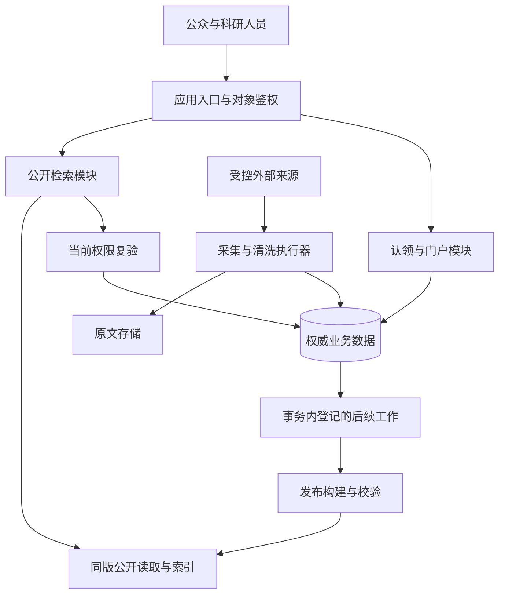

# 学术成果分享平台需求实践与分析成果研讨

第9组 1011101011 A组　2026年11月4日

本次研讨以本组需求调研、SRS、核心业务类图和关键时序图为基础，结合《第5讲 架构设计》检查这些成果能否支持下一步设计。重点讨论三个问题：需求是否有明确依据，模型能否解释异常与并发，以及还缺少哪些可验证的架构输入。

现有材料已经形成28个业务类、45条关系和采集、认领、检索三条关键交互，能够解释主要对象及规则。最需要继续补充的是运行证据：故障恢复、并发授权、同版检索、性能和数据质量目标，目前主要有设计约定，还没有相应的平台运行结果。

本稿给出研讨分析和建议处理意见，供课堂发言、组内讨论及后续架构设计使用。它不记录未发生的会议，也不代表小组已经表决通过了候选架构。

阅读顺序：先看第1节的成果依据，再看第2至4节的业务走查；第5至7节说明质量场景、问题和架构候选；第8节给出验证安排和讨论问题。三张完整时序子图放在附录，发言稿另附。

课件引用按PDF实际页序定位。第4、10页用于区分需求输入和设计输出，第28至30页用于检查视图及架构攸关需求，第60至64页用于组织场景与评估，第95页用于讨论权衡。课件第99页另列作业4，本稿承接到其输入准备，未将全部架构作业写成已完成。

<!-- page -->

## 1 现有成果是否有足够依据

调研采用公开资料研究、角色任务分析和场景推演。它能支持业务问题识别，但没有真实访谈和问卷数据。因此，报告可以说“场景推演发现同名和误归属问题”，不能说“多数受访者要求某项功能”。已有采集实验描述缺少部分原始响应和样本，本次也没有重新执行实验。

| 成果 | 可以支持的结论 | 仍不能证明的内容 |
| --- | --- | --- |
| 调研报告与执行记录 | 人物同名、来源重复、四类成果字段差异等问题有材料定位 | 真实用户偏好比例、实验可复现性 |
| SRS及SPEC | 功能范围、状态、权限及验收目标有文字约定 | 目标已经达成、参数已经调优 |
| 28类45关系及属性操作字典 | 对象边界、成果继承和历史关系有明确表达 | 数据库表结构和服务部署已经确定 |
| 三条主时序及异常子交互 | 正常、失败、补充和并发请求有设计路径 | 事务隔离、重试和权限撤销在运行中正确 |
| 32项设计场景 | 固定输入可以对应到预期和消息位置 | 已执行32项测试并全部通过 |

从调研到对象的推导比较清楚。认领场景要求分开Account、Scholar、ClaimApplication与PortalAuthorization；错误关联撤销要求Work与Contribution分离；历史机构统计要求区分Affiliation与ContributionAffiliation；失败重跑要求保存SourceRecord、CollectionObservation、CollectionTask与UpdateRecord。

本次讨论涉及的对象范围可以归成三组：

| 对象组 | 核心对象 | 识别依据与需求对应 |
| --- | --- | --- |
| 学术主体与成果 | Scholar、Work及论文/专利/项目/获奖类型、Contribution、Institution、AcademicField | 搜索和个人主页要描述“谁以何种身份参与什么成果、关联什么机构和领域”；对应成果查询、作者检索和历史署名场景（UC2） |
| 认领与授权 | Account、ClaimApplication、PortalAuthorization、ReviewDecision | 申请、审核、撤回和撤权是不同业务事实；对应门户认领及权限边界（UC3、SEC-01） |
| 来源与数据治理 | Source、SourceRecord、CollectionTask、CollectionObservation、UpdateRecord、Release | 需要追踪原始来源、每次观察、失败重跑和公开版本；对应采集入库、更新和公开检索一致性（UC5、REL-01、REL-02） |

这份清单是讨论中实际用到的核心对象，不是全量数据库字段清单。领域类图保留更完整的属性、操作和关系，附录D提供原图。

研讨意见：后续保留这些可追溯的对象边界。修订需求时，应同时记录影响到的类、消息及场景，不能只改报告一句话。业务类数量不直接决定数据库表数，更不意味着要拆成28个服务。

依据：调研执行记录§1.3、§2.1至2.6；SRS §4.1、§4.3；业务对象字典；32项设计场景。

<!-- page -->

## 2 采集入库是否真正能够恢复

讨论场景：一次任务固定采集10月1日至7日更新的数据，该范围分三页获取。第一页已提交，第二页处理失败，第三页尚未获取。这里固定的是采集时间范围，页面只是该范围内的数据分页。

现有模型把分页断点和成功水位分开，这一点应保留。分页断点表示已经可靠登记到哪里；成功水位表示哪个范围已经完整处理。第二页失败时，第一页数据保留，整窗成功水位仍保持原值。

还要区分两个故障位置。若第二页的原文引用、观测及待处理工作尚未提交，就重取第二页。若这些记录已经提交，只是清洗没完成，获取进度可以在后面，但恢复时必须继续第二页积压工作。只按“下一页”继续，会漏掉已取回但未处理的数据。

| 故障位置 | 正确恢复结果 | 需要验证的证据 |
| --- | --- | --- |
| 页事务提交前退出 | 断点不前进，重入后不产生重复成果 | 事务前后断点、原文引用及成果数量 |
| 原文登记后清洗退出 | 根据待处理记录重做清洗 | 待处理记录可重查，完成后结果唯一 |
| 规范入库成功但索引构建失败 | 保留规范数据和恢复工作，继续提供旧公开版本 | UpdateRecord及公开版本切换记录 |
| 新执行器接管后旧回调到达 | 拒绝旧attempt写入和推进水位 | 有效执行尝试、拒绝原因、最终状态 |

架构含义：来源访问和清洗处理适合按阶段组织，后台执行可与公开请求分开运行。异步执行以前，必须先可靠保存处理任务；不能先推进断点，再把尚未持久化的工作交给内存队列。跨数据库与消息系统的提交需要额外机制，不能仅凭“加一个消息队列”保证可靠性。

建议优先验证页提交、恢复扫描和幂等写入，而不是先增加并发采集数量。附录图A给出X06失败及X07至X08重试的原始交互。

依据：SRS UC5.1、§4.1.3、REL-01；SPEC §2；M11至M15、N07及X子交互。处理过程是设计约定，尚无故障注入运行报告。

<!-- page -->

## 3 门户认领是否具有正确的授权边界

讨论场景：管理员和申请人都读取申请版本7。管理员准备批准，申请人同时点击撤回。设计上必须保证只有一个合法结果提交，后提交的旧请求不能覆盖已生效决定。

若撤回先提交，申请进入WITHDRAWN、版本递增，基于版本7的批准应返回冲突。若批准先提交，申请进入APPROVED，并同时创建授权、保存审核决定和审计；旧撤回失败，后续解除权限走授权撤销流程。

这里有两种不同约束。申请版本检查解决同一申请上的并发决定。账号侧和门户侧的有效唯一性，解决不同申请同时争夺同一账号或门户的问题。只检查版本，仍可能让两份不同申请分别建立冲突授权。

建议将申请决定、有效授权和必要审计保留在同一事务边界内。通知在提交后发送，失败可补发。当前没有跨服务独立提交的必要证据，过早拆开这些对象会引入部分批准、补偿和对账问题。

还需检查材料版本。管理员核验的是旧材料时，不能把审核结果写成“已审核新材料”；提交决定时应重新核对材料、申请和目标版本。验证服务超时保留可恢复状态，不能据此判定申请应被驳回。

研讨建议：保留六个认领业务状态，把验证进度和审核占用作为内部信息。占用可以减少重复劳动，最终正确性仍依赖事务、版本和唯一约束。门户管理权只作用于允许维护的个人资料，不自动确认所有候选成果，也不允许直接覆盖公共题录。

验证时至少覆盖同申请双批准、撤回与批准竞争、两账号申请同门户、同账号申请两门户，以及审批时材料更新。每种情况检查有效授权条数、终态、材料版本和审计，而不只看页面提示。

依据：SRS UC3.1、UC3.5、UC5.2及§4.1.2；SPEC §7；CX01至CX10。附录图B为原子授权与撤回交互。

<!-- page -->

## 4 检索是否表达了同一件业务事实

第一项检查是人物与机构条件。R06中A01署名I03，A03署名I01；查询“A01在I01署名的成果”时，R06不命中。因为两项条件来自不同贡献。当前任职也不能覆盖历史署名。

实现上应沿同一Contribution关联其ContributionAffiliation。无论选什么搜索产品，都需要保留这个关联语义。若把全部作者和机构分别摊平成两个数组，直接求交就可能产生误命中。固定样例中正确命中R01、R04、R07，可用于后续查询原型的精确断言。

第二项检查是同版读取。列表固定公开版本R1以后，续页、详情和相关统计继续读R1；R2发布不会悄悄改变原查询。R1已经失效时提示刷新，而不是从最新业务库补齐缺项。

第三项检查是权限。10条候选中3条不可见，应先得到7条允许记录，再用这一集合计算total、分面和分页。返回之前发现权限修订变化，作废本次结果和旧计数，保留条件并要求显式重试。

这形成两个不同的版本维度：公开数据版本控制内容一致性，权限修订反映当前访问资格。缓存键只含查询文本和公开版本并不足够。若使用结果缓存，还须绑定查询上下文和授权范围，返回前复验当前权限，不能用延长缓存有效期掩盖撤权。

性能与一致性在这里有直接冲突。更多缓存可能降低时延，却增加失效管理成本；更长的历史版本保留方便翻页，却增加存储和清理成本。这两项成本尚无实测，应在原型中测量后决定保留策略。

验证案例包括R06交叉误命中、R1列表后发布R2、返回前撤权、total为3且每页2条时请求第3页，以及查询超时与合法零结果。附录图C保留共同允许集合及权限变化分支。

依据：SRS UC2.1至UC2.3、REL-02；SPEC §5至6；QX03至QX06、Q15a。相关流程已落入模型，但未证明实际索引支持这些契约。

<!-- page -->

## 5 把质量要求写成能够检查的场景

课件第61页要求场景包含刺激源、刺激、制品、环境、响应和度量。下面将已有SRS要求写成完整场景，数值目标保持原口径，缺少依据的项目明确列为待确认。

### QA01 公开检索性能

刺激源是20个并发访问者，刺激是固定查询及详情请求，制品是检索与公开详情链路。环境为至少10000条成果，记录机器、数据分布、缓存与查询参数，完成预热并固定运行至少5分钟。响应是返回符合条件、权限和版本规则的结果。度量为检索P95不超过2秒，详情P95不超过1秒，并记录失败率。SRS未给出失败率阈值，应先补充验收约定，不能自行写成0.1%。依据为PER-01。

### QA02 故障后的采集恢复

刺激源是执行进程或来源连接故障，刺激是页提交前后中断，制品是任务、观测及待处理记录，环境是部分页面已经成功保存。响应为保留已提交数据，从可靠断点及积压工作恢复。度量建议为重复有效成果为0、未登记漏条为0、失败或停止导致的错误水位推进为0。恢复时长目前没有SRS数值，先测量再确定目标。这些零错误项是本次对REL-01的验收细化建议。

### QA03 并发认领

刺激源是申请人与审核人，刺激是同时撤回和批准，制品为同一申请、有效授权和审核记录，环境为两方均读到版本7。响应为仅一个合法决定提交，另一方得到当前状态或冲突。度量建议为最多一份有效授权、没有部分生效、成功决定有对应审计。依据为认领业务规则及SEC-01。

### QA04 检索期间撤销权限

刺激源是授权管理操作，刺激是在结果生成后、返回前撤权，制品为结果、total、分面与续页上下文，环境为数据版本仍是R1。响应为拒绝返回旧权限结果并提示重试。度量建议为受限记录及其旧计数泄露为0，旧权限令牌不被继续接受。依据为REL-02及QX06。

以上“建议”需要纳入评审，不能冒充既有SRS的逐字指标。课件第4页的1000万条、1秒，以及第96页的99.99%可用性均为教学示例，未替换本组指标。

### QA05 数据质量与来源追踪

刺激源是成果导入及人工复核，刺激是固定样本中的缺失、冲突和无法确认字段，制品是规范成果、来源记录及清洗结果，环境为按成果类型分层的500条人工标注样本。响应是按适用字段统计完整性、保留公开成果的来源链，并标记无法自动判定的记录。度量按SRS分别检查：适用核心字段完整率至少95%，公开规范成果来源追踪100%；清洗样本目标至少99%，启用自动去重时准确率至少98%，作者自动关联至少97%。不同指标须按各自样本和算法口径计算，不能合并成一个“数据准确率”。依据为DQ-01、DQ-02；标注规范、类别分布和样本不足时的适用范围仍要随测试记录提交。

<!-- page -->

## 6 研讨中需要明确处理的问题

| 编号与优先级 | 当前问题 | 建议处理与完成证据 |
| --- | --- | --- |
| R01 高 | 缺少运行证据，设计场景容易被理解为测试结果 | 原型逐项执行并保留输入、日志、实际输出和版本。测试结果与设计预期分开 |
| R02 高 | 业务数据提交与异步任务交接机制未具体确定 | 验证事务内可靠登记，提交后拉取执行；注入崩溃检查工作不丢失 |
| R03 高 | 有效授权唯一性尚未在数据库中验证 | 建立两侧唯一保护和条件更新，执行不同申请并发场景 |
| R04 高 | 索引是否支持同贡献、同版与当前权限组合尚未验证 | 用固定样例构建最小索引原型，检查误命中、计数、详情与撤权 |
| R05 中 | SRS有性能目标，但机器配置及查询分布尚不完整 | 固定数据集、机器、冷热条件、查询集合与失败率验收口径 |
| R06 中 | 采集恢复时长、公开更新时延、RTO/RPO缺少数值 | 先测原型并提出目标，由小组确认后补入质量约束 |
| R07 中 | 老图局部UC编号容易与SRS新编号混用 | 继续按业务名称维护映射；图源修改后同步对象和消息表 |
| R08 中 | 历史AI记录没有新增成员交叉复审确认 | 对三个关键案例实际复述和交叉核对，记录真实意见及修订 |

优先级是本稿的建议排序。高优先级问题会直接改变事务边界或数据组织，应在正式架构选型以前验证。R05至R06需要先取得实测和部署约束，再补充指标。

数据质量也需要单独保留验证安排。SRS的95%适用字段完整率、100%公开成果来源追踪，以及500条标注样本目标都是待验证要求。没有来源的字段、未知日期及不适用字段应分开统计，不能通过删除困难样本提高完整率。

当前材料未确认部署预算、机器资源、运维条件及成员可投入时间。因而，本稿不会假定具备多机房、多副本和专职运维，也不把“一个节点故障后仍可用”写成已有保证。

<!-- page -->

## 7 从研讨意见形成架构候选

按课件第60至64页的方法，先以恢复、一致性和对象权限约束划分职责，再比较结构。当前建议将公开查询、认领审核、采集治理和公开发布作为明确模块；业务写入使用关系数据作为权威来源，索引与统计作为可重建的读取结果。

| 候选 | 对本项目的作用 | 主要代价与适用前提 |
| --- | --- | --- |
| 分层模块化单体加独立后台执行器 | 认领事务留在一处，采集不占用公开请求执行资源；模块边界可逐步验证 | 同一节点或数据库仍可能成为故障点，必须实测资源争用 |
| 按业务全面拆分微服务 | 模块可独立发布和伸缩 | 授权与版本提交增加分布式协调，需额外运维和契约能力，当前必要性不足 |
| 以事件驱动所有业务 | 适合采集后的索引、统计和通知 | 即时授权仍需确定事务结果，重放、重复消费及消息交接成本不能省略 |

候选建议采用第一种作为原型起点，在索引构建、统计和通知环节异步执行。这里的独立执行器表示不同执行进程，可先部署在同一台机器，不能据此宣称实现了容灾。

候选职责示意如下，最终边界仍需原型确认。

接口先明确任务标识、预期版本、幂等键、输入输出和错误结果。新增数据源通过适配接口接入；发布构建失败保留旧版；通知重试不重做审批。具体框架、数据库产品和消息产品留待架构作业对照原型结果确定。

<!-- page -->

## 8 关键决策与视图准备

决策草案ADR01：认领审批中的状态、授权、决定和必要审计共同提交。理由是它们组成同一个业务事实，分开提交会出现部分授权。代价是审批写入边界暂时集中；只有出现独立部署需求及可验证补偿方案，再讨论拆分。验证为版本冲突、两侧唯一性和写入失败回滚。

决策草案ADR02：采集与公开发布分阶段执行。理由是来源访问、清洗及索引构建失败方式不同，公开查询需要继续提供旧版。代价是引入待处理工作、失败重试和公开更新延迟。完成可靠任务交接和重放实验后，才能接受该方案。

决策草案ADR03：数据内容按release固定，访问资格按当前权限判断。理由是列表与详情要保持内容一致，撤权又不能等待旧版本失效。代价是查询上下文和缓存键更复杂，返回前多一次校验。固定版本缺项、权限变化及旧令牌测试是接受条件。

这些是建议决策，不是已签署ADR。研讨时应确认理由、可接受代价和否决条件，记录实际参与人的意见。

按照课件第28页的4+1视图，下一步需要以下材料。

| 视图 | 已有输入 | 需要补足 |
| --- | --- | --- |
| 逻辑 | 领域类图和对象职责 | 模块、接口及依赖边界；避免把领域类图直接当完整架构 |
| 开发 | 岗位分工与模型源文件 | 代码包、公共契约和依赖方向 |
| 运行 | 三条时序及状态约束 | 真实进程、队列、事务、并发点与故障处理 |
| 部署 | SRS性能及扩展目标 | 实际节点规格、资源配额、网络与备份恢复方案 |
| 场景 | SRS用例条目、`images/`目录中的用例/活动/状态图、三条时序图及32项设计走查 | 将SRS引用的原图与整合版类图、时序逐条核对；再用原型串起请求、状态、任务和公开结果 |

分析模型之间的对应关系要按同一业务场景核对。用例、活动和状态图保存在工作区`images/`，并由SRS相应章节引用；它们不在A组整合报告的`图件/`子目录里。本稿按SRS的实际引用定位这些图，没有把Group2存档图当成本组成果。下面将需求图、时序和类放在同一行核对，并指出需要进一步确认的边界。

| 业务场景 | 需求模型基线与待补图 | 时序与业务类 | SRS约束及检查点 |
| --- | --- | --- | --- |
| 数据采集入库 | SRS UC5.1基本/备选事件流；`数据采集任务状态机.drawio.png`限定六状态。当前没有单独的采集活动图 | 采集时序规定分页、提交、恢复顺序；SourceRecord、Observation、Task、UpdateRecord承载记录 | REL-01；核对事件流分支、状态迁移、断点、水位、attempt和幂等恢复 |
| 门户认领审核 | SRS UC3.1事件流、`03_门户认领活动图.drawio.png`及`04_认领申请状态图.drawio.png` | 认领时序对应ClaimApplication、ReviewDecision、PortalAuthorization | SEC-01及认领权限要求；核对补充/撤回分支、六状态、并发及原子授权 |
| 检索请求处理 | SRS UC2.1/UC2.2、`普通用户活动图.drawio.png`和`作者检索详细活动图.drawio.png` | 检索时序关联Contribution、Institution、Release和当前权限 | PER-01、REL-02；核对条件校验、同贡献匹配、同版读取、权限过滤和P95 |

核对链条是“用例目标→活动分支→状态迁移与消息→类及关系”，再按SRS规则验收。采集用例目前有事件流、状态图和时序图，未单列活动图；若课程要求三项交互都配活动图，应补画。SRS引用图及Draw.io源文件随包保存于`图件/需求建模模型/`。

课件中智能体架构用于说明另一类系统。当前平台核心查询、授权和数据治理以确定性规则处理。若以后增加AI辅助候选匹配，应单独定义输入数据边界、输出校验、人工复核及评测集合，不能让模型直接决定门户授权或强制归并人物。

<!-- page -->

## 9 研讨后的验证安排与讨论问题

第一轮原型只验证三个高风险点。采集原型在页提交、清洗和后续工作登记前后注入故障，核对断点、积压和最终数据；认领原型模拟并发批准与撤回，核对事务与唯一授权；检索原型使用R06及R1/R2样例，核对关系匹配、同版读取、计数与撤权。每轮记录环境、输入、预期、实际结果和失败日志。

第二轮再按PER-01执行固定负载，记录P95、失败率和资源占用；冷启动单列。若不达标，先定位数据库、索引、鉴权或资源争用，再评估缓存和进程拆分，避免仅靠增加组件改变结构。

建议课堂讨论围绕以下问题展开。

1. 一页原文已经保存、清洗未完成时，断点可以前进吗？前提是待处理工作可靠登记并能恢复，成功水位仍不能前进。
2. 两个申请各自版本都正确，是否就能避免重复授权？还需要账号侧和门户侧的有效唯一性保护。
3. 新版发布后，旧列表的详情为什么继续读旧版？因为必须保持同一次查询的业务事实；旧版不可用时提示刷新。
4. 28个业务类是否意味着28个服务？不意味着。类围绕领域身份与规则划分，服务边界还取决于事务、负载和部署约束。
5. 当前最应该先验证什么？优先处理可靠任务交接、并发授权、关系匹配与撤权，再讨论扩大规模。

本次AI使用：Codex读取用户提供的课件和已有项目材料，辅助整理场景、问题清单、候选方案及文档。关键提示包括“参考课件完成需求实践与分析成果研讨”“结合已有模型说明故障位置、约束和验证证据”“区分既有SRS目标与建议指标”。后两项为本轮工作中归纳的任务约束，不冒充用户逐字原话。

| 环节 | AI辅助内容 | 人工核验与责任 |
| --- | --- | --- |
| 资料整理 | 提取课件架构方法，按SRS和现有图件组织讨论结构 | 已对照SRS条目、课件页码和图件来源；提交成员仍需复核自己的原始调研与图模型 |
| 分析推演 | 草拟故障恢复、认领竞争、检索版本与权限场景，提出架构候选 | 场景推演不是实测；成员应能解释每项规则、边界条件和代价，不能把建议说成已实现 |
| 文档编写 | 辅助生成报告、发言提纲和决策表的初稿及版式 | 小组对最终提交内容负责；请按课程AI政策如实保留使用声明，发现不符原始材料的内容应修改 |

验证范围：核对课件页序和SRS原文、场景编号及附件来源，检查文档引用与版式。没有运行平台、完成真实课堂会议或取得新增成员签字。本稿保留这些边界，正式研讨意见应由实际参与者记录。

资料依据：用户提供的《ssad05.架构设计》课件；本组《系统需求规格说明书_SRS》及SPEC；需求调研与执行记录；核心业务对象字典、类图、用例/活动/状态模型；采集、认领和检索时序图及32项设计场景。具体条目在各节注明。课件中的架构方法用于组织研讨，不替代本组项目证据。

<!-- page -->

## 附录A 采集失败与恢复原图

图A　X06保留断点且不推进成功水位，X07至X08安排重试并取得新的有效执行尝试。完整图保留停止、安全退出与失效执行器分支。

<!-- page -->

## 附录B 认领批准与撤回原图

图B　批准与撤回是竞争同一版本的独立请求。批准分支的状态、授权、审核决定和审计共同提交，终态冲突返回真实当前结果。

<!-- page -->

## 附录C 检索权限与分页原图

图C　共同允许集合支撑列表、总数和分面，返回前权限变化时作废结果并要求重试。高清原图随文保留。

<!-- page -->

## 附录D 核心业务类图

图D　全量领域类图。它描述业务身份、属性操作和关系，用于对照本报告讨论的核心对象；类图不是数据库表结构图，也不直接规定服务拆分方式。
