# 系统需求规格说明书

## 1. 引言

### 1.1 项目背景

学术成果检索与分享平台以公开学术资料为基础，组织论文、授权专利、科研项目和学术获奖，提供成果与学者检索、公开门户、身份与认领审核、公共数据治理和基础统计。平台账号、来源学者、门户管理授权和具体成果贡献是不同对象。认领表示平台确认的管理权或贡献关联，不直接判定法律权属。

### 1.2 文档目的

本说明书作为需求建模阶段的沟通与验收依据，通过参与者和用例规约说明系统应完成的用户任务、失败处理及权限边界，补充公共数据规则、非功能目标和设计约束。功能是否实现、参数是否合适、性能是否达到目标，以后续真实实现、测试和团队评审结果为准。

### 1.3 文档结构

第 2 章定义系统参与者，第 3 章按五个用例包组织用户与认证、学术信息、门户管理、科研态势分析以及平台运营，第 4 章规定全局数据规则、状态、质量目标和设计约束。原 FR 编号保留在附录《需求条目与验收场景》中，逐项关联本版 UC1.x 至 UC5.x；SPEC 继续规定实现处理规则。主报告、条目附录和 SPEC 共同组成可追踪的需求基线。

## 2. 系统参与者

- 公众用户：包括匿名访客和普通账户用户，以公开成果、学者查询及统计浏览为主要目标。公开任务不以登录为统一前置条件；私人保存和资料管理需要本人账户。
- 科研人员：通过必要身份审核的注册用户，可以申请门户管理权。已认领门户科研人员还具有指定门户的有效授权，可管理本人附加信息和申请；这个业务身份不另建一个全能账户角色。
- 平台管理员：负责来源、任务、审核、公共资料治理和统计维护。审核权限可以受限；后台角色不自动取得他人的私人笔记或所有私有材料。
- 外部数据源：包括论文接口、开放书目与专利、项目、奖励公告等外部系统。来源访问方式、许可、字段和更新规则须在启用前核验，不把枚举候选来源当作已接入。

## 3. 系统用例模型

### 3.1 总体用例图

当前系统总用例 Draw.io 文件为 academic_platform_usecase.drawio；根目录 images 尚无同名 PNG 预览，本说明书提供源文件链接并使用现有普通用户、科研人员用例图补充角色范围。系统内部执行器、数据库和算法是实现职责，不作为业务使用者；外部数据源是交互对象。

[academic_platform_usecase.drawio](../images/academic_platform_usecase.drawio)

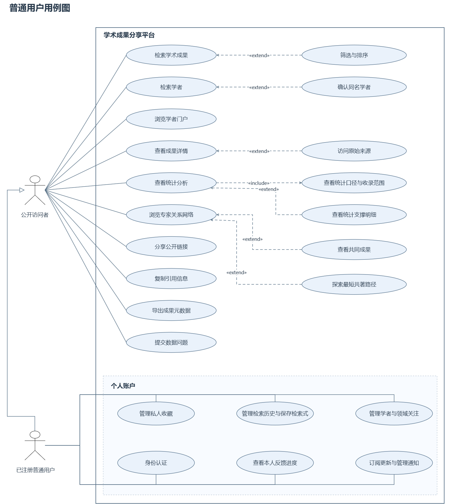

图 3-1 普通用户用例图

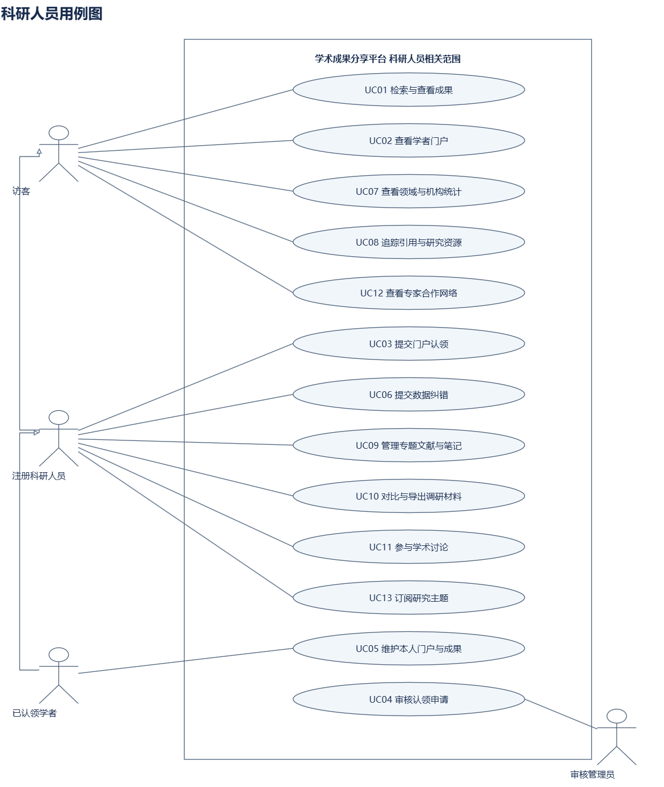

图 3-2 科研人员用例图

现有图中的 UC01 至 UC13、UC-AM 和 UC-ST 是各图的局部编号，不直接等同本版五包编号。对应关系见附录；P1、P2 能力出现在角色图中不代表全部成为一期必做。模型按当前 Draw.io 保存，不要求转换为 CodeArts Modeling。

### 3.2 用例规约

#### 3.2.1 用例包1 用户与认证服务

##### 3.2.1.1 UC1.1 注册账户

优先级：P0。关联原需求：FR-AUTH-001。

| 项目 | 分类 | 规约内容 |
| --- | --- | --- |
| 用例名称 |  | UC1.1 注册账户 |
| 简要描述 |  | 未注册用户建立平台账户，获得需要登录的个人功能入口；注册本身不授予科研人员身份或门户管理权。 |
| 参与者 |  | 普通用户 |
| 涉众 |  | 普通用户：希望任务结果准确、可解释且可恢复；平台管理与开发团队：需要一致的规则、权限和可追踪处理结果 |
| 前置条件 |  | 用户可访问注册页面，尚未使用该账户登录。 |
| 后置条件 | 成功 | 建立唯一平台账户，密码以合适的密码哈希方式保存；用户可进入登录流程。 |
| 后置条件 | 失败 | 未建立有效账户，不产生科研人员身份或门户授权。 |
| 事件流 | 基本路径 | 1. 用户打开注册页面，填写账号标识及必要资料。 2. 用户提交资料，系统检查必填字段、格式和账号重复情况。 3. 系统按账户安全策略处理密码并创建账户。 4. 系统返回注册结果和登录入口。 |
| 事件流 | 备选路径 | 2a.资料不合法：提示对应字段并保留可安全保留的输入，等待用户修正。 2b.账号已存在：提示使用登录入口，不重复创建账户。 3a.保存失败：返回错误及请求标识，不声称注册成功。 |

##### 3.2.1.2 UC1.2 登录系统

优先级：P0。关联原需求：FR-AUTH-002、FR-AUTH-003。

| 项目 | 分类 | 规约内容 |
| --- | --- | --- |
| 用例名称 |  | UC1.2 登录系统 |
| 简要描述 |  | 用户提交有效凭证建立认证会话，系统按角色和对象授权决定可访问的操作。 |
| 参与者 |  | 已注册普通用户、科研人员、管理员 |
| 涉众 |  | 已注册普通用户、科研人员、管理员：希望任务结果准确、可解释且可恢复；平台管理与开发团队：需要一致的规则、权限和可追踪处理结果 |
| 前置条件 |  | 账户已注册，用户进入登录页面。 |
| 后置条件 | 成功 | 建立有效会话；返回原任务或允许的首页，保留原查询上下文。 |
| 后置条件 | 失败 | 保持未登录或未授权状态，不暴露凭证或他人的私有资料。 |
| 事件流 | 基本路径 | 1. 用户输入账户凭证并提交。 2. 系统校验凭证，检查账户状态并建立安全会话。 3. 系统读取角色及有效的门户授权关系。 4. 系统返回原查询、反馈或管理任务，服务端继续校验操作权限。 |
| 事件流 | 备选路径 | 2a.认证失败：返回安全、可理解的错误提示，不建立授权会话。 3a.缺少对象管理权：公开查询可以继续，私有维护操作拒绝。 4a.会话失效：提示重新登录，保留允许恢复的任务条件。 |

##### 3.2.1.3 UC1.3 申请科研人员身份与机构登记

优先级：P0。关联原需求：FR-ADMIN-002、FR-AUTH-004、FR-INST-001、FR-INST-002、FR-INST-004。

| 项目 | 分类 | 规约内容 |
| --- | --- | --- |
| 用例名称 |  | UC1.3 申请科研人员身份与机构登记 |
| 简要描述 |  | 用户查询机构，必要时提出机构登记及科研人员身份申请，由管理员核验；身份通过仍不自动绑定门户。 |
| 参与者 |  | 已登录用户、审核管理员 |
| 涉众 |  | 已登录用户、审核管理员：希望任务结果准确、可解释且可恢复；平台管理与开发团队：需要一致的规则、权限和可追踪处理结果 |
| 前置条件 |  | 用户已登录，能够提供申请所需的来源或证明。 |
| 后置条件 | 成功 | 保存可追踪申请；管理员通过后更新相应机构记录或科研人员身份。 |
| 后置条件 | 失败 | 维持原有角色和机构状态，保留处理理由，不自动取得门户管理权。 |
| 事件流 | 基本路径 | 1. 用户查询所在机构并选择已有记录。 2. 不存在合适记录时，用户提交机构名称、公开来源和必要说明。 3. 用户提交科研人员身份申请及依据。 4. 系统校验资料及重复申请，登记申请编号和版本。 5. 管理员核对机构与身份依据，记录通过、驳回或补充要求。 6. 系统通知处理结果，后续门户认领按 UC3.1 单独执行。 |
| 事件流 | 备选路径 | 2a.机构疑似重复：返回候选记录，管理员复核后关联已有机构。 4a.资料不足：说明缺项并保留原有权限。 5a.身份不成立或发生版本冲突：记录理由或要求刷新，不越过审核授权。 |

#### 3.2.2 用例包2 学术信息服务

##### 3.2.2.1 UC2.1 检索与筛选学术成果

优先级：P0。关联原需求：FR-ACCESS-001、FR-ES-002、FR-ES-003、FR-OUTCOME-003、FR-SEARCH-001、FR-SEARCH-002、FR-SEARCH-003、FR-SEARCH-004、FR-SEARCH-005、FR-SEARCH-006、FR-SEARCH-007、FR-SEARCH-008、FR-SEARCH-009、FR-SEARCH-010。

| 项目 | 分类 | 规约内容 |
| --- | --- | --- |
| 用例名称 |  | UC2.1 检索与筛选学术成果 |
| 简要描述 |  | 用户按主题、标识及字段查询四类成果，组合筛选、稳定排序和分页，并继续核对详情与来源。 |
| 参与者 |  | 访客、普通用户、科研人员 |
| 涉众 |  | 访客、普通用户、科研人员：希望任务结果准确、可解释且可恢复；平台管理与开发团队：需要一致的规则、权限和可追踪处理结果 |
| 前置条件 |  | 用户可访问公开检索页面；存在当前可用的数据版本。 |
| 后置条件 | 成功 | 展示同一范围和版本下的结果、条件、总量、来源与更新时间，返回时可以恢复查询。 |
| 后置条件 | 失败 | 明确区分非法条件、有效空结果及服务失败；不把超时当作没有成果。 |
| 事件流 | 基本路径 | 1. 用户输入关键词或成果标识，选择成果类型、领域、年份等条件。 2. 系统校验字段、日期精度和分页参数；不同筛选维度按 AND，同维度多选按 OR。 3. 系统查询当前版本的成果索引，执行过滤、评分、稳定排序和分页。 4. 索引返回成果 ID、总数及数据版本，服务读取详情、来源和可见状态。 5. 系统展示列表，用户可调整条件或打开成果详情。 6. 用户返回列表时，系统保留条件、排序和页码。 |
| 事件流 | 备选路径 | 2a.条件非法：返回字段错误并保留原输入。 4a.返回零条：显示空结果和可调整条件，不显示服务错误。 4b.索引与业务版本存在差异：按公开版本和实时权限校验可展示记录。 3a.服务超时：返回错误及重试入口，不伪造空列表。 |
| 活动图 |  | 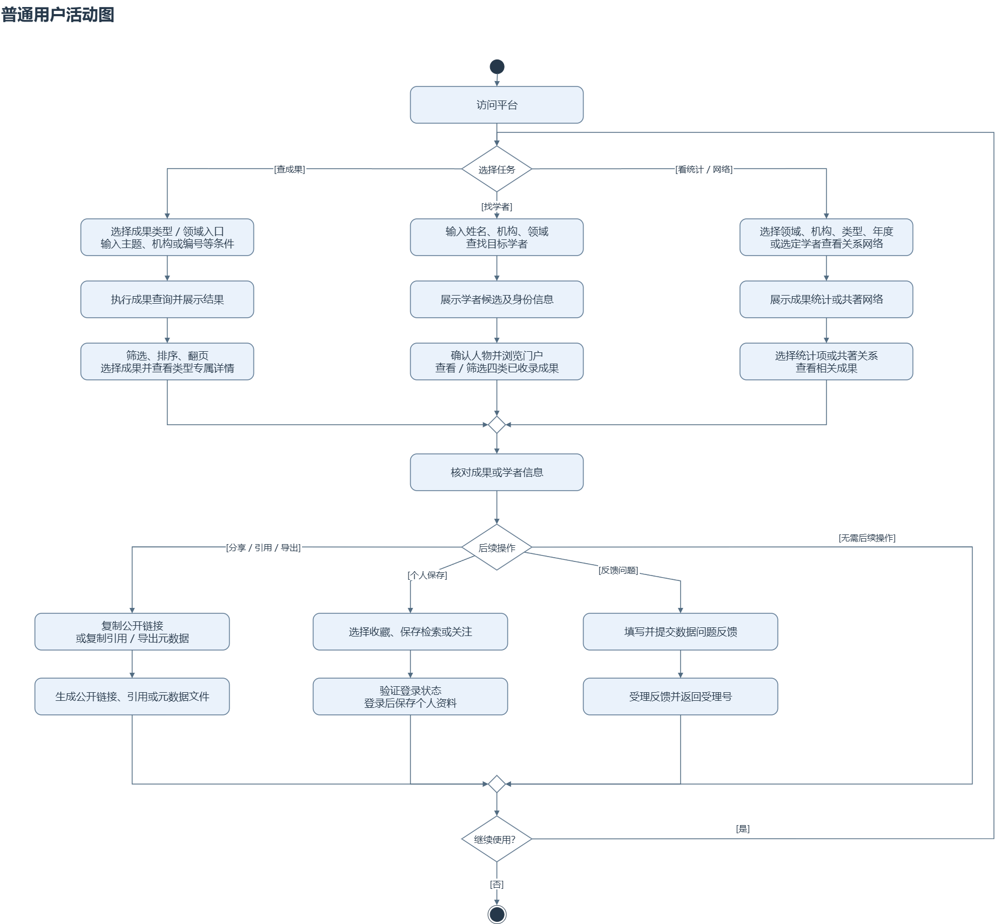 图 3-3 活动图 普通用户活动图.drawio |
| 时序图 |  | 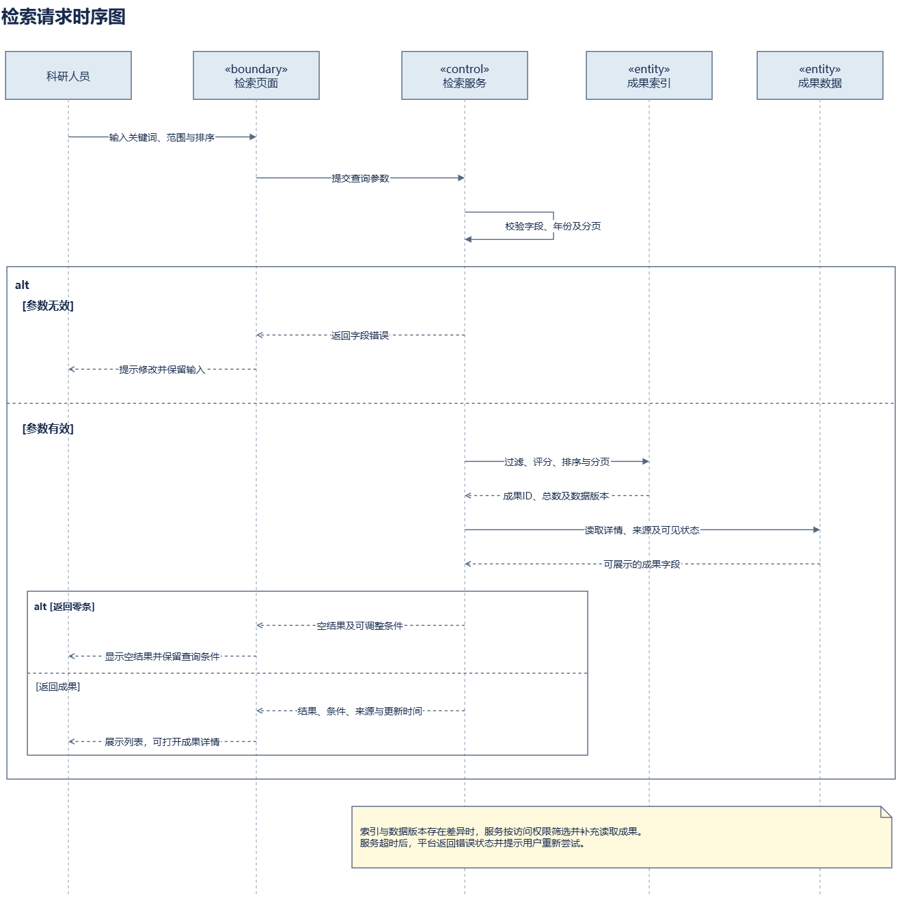 图 3-4 时序图 06_检索请求时序图.drawio |

##### 3.2.2.2 UC2.2 查找学者与浏览公开门户

优先级：P0。关联原需求：FR-PORTAL-001、FR-PORTAL-009、FR-SCHOLAR-001、FR-SCHOLAR-002。

| 项目 | 分类 | 规约内容 |
| --- | --- | --- |
| 用例名称 |  | UC2.2 查找学者与浏览公开门户 |
| 简要描述 |  | 用户查找人物候选、确认身份并浏览其四类成果、机构及公开统计，姓名相同不直接视为同一人。 |
| 参与者 |  | 访客、普通用户、科研人员 |
| 涉众 |  | 访客、普通用户、科研人员：希望任务结果准确、可解释且可恢复；平台管理与开发团队：需要一致的规则、权限和可追踪处理结果 |
| 前置条件 |  | 用户可访问人物查询或门户页面。 |
| 后置条件 | 成功 | 展示确认人物的公开资料与成果导航，保留候选身份及来源差异。 |
| 后置条件 | 失败 | 提示不存在、歧义或版本失效，不泄露门户私有管理材料。 |
| 事件流 | 基本路径 | 1. 用户输入姓名、机构或领域，系统展示候选人物及身份信息。 2. 用户核对机构、外部标识和代表成果，选择目标人物。 3. 系统按人物 ID 读取其公开门户和来源关系。 4. 系统分类型展示成果、公开信息、候选或确认标记。 5. 用户筛选成果，或进入详情、统计和合作网络。 |
| 事件流 | 备选路径 | 1a.存在多个同名人：分别保留候选，不按姓名合并。 2a.尚未确认人物：允许文本查询，但提示查询范围未确认身份。 3a.门户或记录已合并、失效：提供有效公开记录的导航或明确状态。 |
| 活动图 |  | 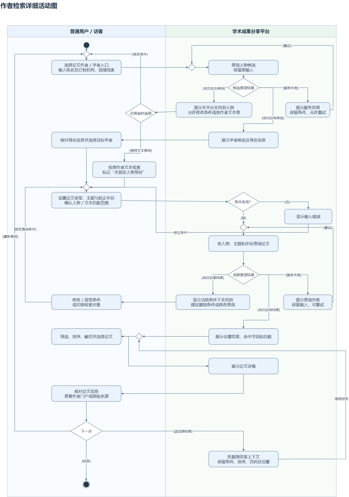 图 3-5 活动图 作者检索详细活动图.drawio |

##### 3.2.2.3 UC2.3 查看成果详情与来源入口

优先级：P0；相关推荐为 P1。关联原需求：FR-PAPER-001、FR-PAPER-002、FR-PAPER-003、FR-PAPER-004、FR-PAPER-005、FR-PAPER-006、FR-PAPER-007、FR-REC-001、FR-REC-002、FR-REC-003、FR-REC-004、FR-REC-005、FR-REC-006。

| 项目 | 分类 | 规约内容 |
| --- | --- | --- |
| 用例名称 |  | UC2.3 查看成果详情与来源入口 |
| 简要描述 |  | 用户读取类型专属详情、贡献关系和来源；论文可展示已有 DOI 出版入口、开放状态和引用资料。 |
| 参与者 |  | 访客、普通用户、科研人员 |
| 涉众 |  | 访客、普通用户、科研人员：希望任务结果准确、可解释且可恢复；平台管理与开发团队：需要一致的规则、权限和可追踪处理结果 |
| 前置条件 |  | 用户选择了一个允许公开访问的成果标识。 |
| 后置条件 | 成功 | 展示有依据的字段、来源、日期精度及访问入口；缺失值按实际状态解释。 |
| 后置条件 | 失败 | 不展示受限材料，不把未知引用数或外部请求失败改写为零。 |
| 事件流 | 基本路径 | 1. 用户打开成果详情。 2. 系统读取公开记录，展示四类成果共同信息和类型专属字段。 3. 系统展示贡献人或单位、时间含义、来源及同步时间。 4. 论文详情展示已有出版入口、OA 状态、参考文献与引用来源；用户选择是否跳转。 5. 若启用 P1 推荐，系统展示有理由的相关论文，并允许降级。 |
| 事件流 | 备选路径 | 2a.字段缺失：标为未知、待核实或不适用，不补造事实。 4a.开放状态请求失败：标记未知，不判断为确认非开放。 5a.推荐服务不可用：详情继续正常显示，不阻断主要任务。 |

##### 3.2.2.4 UC2.4 保存检索与管理私人收藏

优先级：P1。关联原需求：FR-TOOLS-001、FR-TOOLS-006。

| 项目 | 分类 | 规约内容 |
| --- | --- | --- |
| 用例名称 |  | UC2.4 保存检索与管理私人收藏 |
| 简要描述 |  | 用户保存检索式、收藏或关注，用于本人持续查阅，公开查询仍不要求登录。 |
| 参与者 |  | 已登录普通用户、科研人员 |
| 涉众 |  | 已登录普通用户、科研人员：希望任务结果准确、可解释且可恢复；平台管理与开发团队：需要一致的规则、权限和可追踪处理结果 |
| 前置条件 |  | P1 功能已启用，用户已登录并具备本人账户访问权。 |
| 后置条件 | 成功 | 个人资料只保存到本人账户，后续可读取、修改或删除。 |
| 后置条件 | 失败 | 私人资料保持不变，不越权读取他人的保存记录。 |
| 事件流 | 基本路径 | 1. 用户在查询或详情页面选择保存检索、收藏或关注。 2. 系统检查登录状态及账户归属。 3. 用户确认名称、目标对象和需要保存的条件。 4. 系统保存本人记录，并对重复保存执行幂等处理。 5. 用户进入个人资料页面查看或取消保存。 |
| 事件流 | 备选路径 | 2a.未登录：提示登录，成功后恢复原任务。 4a.目标已合并或版本失效：引导至有效记录或提示调整条件。 5a.请求他人资料：拒绝访问，不返回私人内容。 |

##### 3.2.2.5 UC2.5 整理研究资料并比较导出

优先级：P1。关联原需求：FR-TOOLS-002、FR-TOOLS-003、FR-TOOLS-004、FR-TOOLS-005、FR-TOOLS-007。

| 项目 | 分类 | 规约内容 |
| --- | --- | --- |
| 用例名称 |  | UC2.5 整理研究资料并比较导出 |
| 简要描述 |  | 用户建立私人专题、记录阅读笔记、比较成果并导出元数据；平台整理依据，不替代用户形成学术结论。 |
| 参与者 |  | 已登录普通用户、科研人员 |
| 涉众 |  | 已登录普通用户、科研人员：希望任务结果准确、可解释且可恢复；平台管理与开发团队：需要一致的规则、权限和可追踪处理结果 |
| 前置条件 |  | P1 功能已启用，用户已登录并选择本人可访问的资料。 |
| 后置条件 | 成功 | 保存本人专题及笔记，输出标明范围、来源和格式的比较或导出结果。 |
| 后置条件 | 失败 | 保留原私人资料，说明受限资源与失败原因，不生成虚构阅读记录。 |
| 事件流 | 基本路径 | 1. 用户确定研究问题、领域和时间，选择候选成果。 2. 用户阅读详情，记录纳入或排除理由及原文定位。 3. 系统展示可获得的引用关系与资源入口，用户核对版本、实验条件和使用说明。 4. 用户保存专题、笔记，选择 2 至 10 篇论文进行比较。 5. 系统标记缺失值、统计口径和更新时间，用户核对原文并形成自己的结论。 6. 用户导出文献清单、引用或元数据和允许导出的本人记录。 |
| 事件流 | 备选路径 | 3a.资源缺失或不可访问：记录缺失或受限状态，不声明已取得原文。 4a.比较数量或对象类型不符合要求：提示调整选择。 6a.引用字段不完整：保留缺失提示，不伪造 DOI、作者或日期。 |
| 活动图 |  | 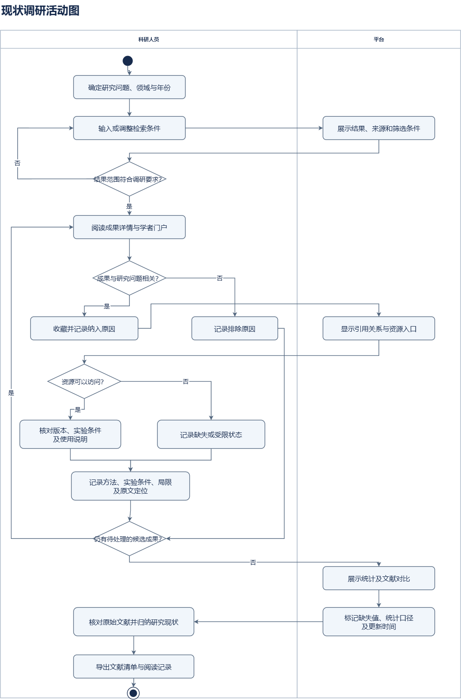 图 3-6 活动图 02_现状调研活动图.drawio |

#### 3.2.3 用例包3 学术门户管理

##### 3.2.3.1 UC3.1 认领个人门户

优先级：P0。关联原需求：FR-PORTAL-007。

| 项目 | 分类 | 规约内容 |
| --- | --- | --- |
| 用例名称 |  | UC3.1 认领个人门户 |
| 简要描述 |  | 科研人员提交门户管理申请，经校验、人工审核及唯一绑定取得指定门户管理权，不能用手填标识直接授权。 |
| 参与者 |  | 已通过身份审核的科研人员、审核管理员 |
| 涉众 |  | 已通过身份审核的科研人员、审核管理员：希望任务结果准确、可解释且可恢复；平台管理与开发团队：需要一致的规则、权限和可追踪处理结果 |
| 前置条件 |  | 申请人已登录并通过必要身份审核，存在待认领或经治理建立的目标门户。 |
| 后置条件 | 成功 | 申请为 APPROVED，指定门户的有效管理绑定、授权及审计一致保存。 |
| 后置条件 | 失败 | 保留原有权限，申请保持草稿、待审核或待补充，或按理由进入驳回、撤回终态。 |
| 事件流 | 基本路径 | 1. 科研人员登录并选择待认领门户，提交机构信息和身份依据。 2. 平台检查材料、重复申请与已有绑定；有效提交从草稿进入待审核。 3. 管理员核对身份和成果关联证据，必要时记录补充要求并转待补充。 4. 申请人补交后，平台重新校验，有效申请回到待审核。 5. 管理员通过前再次检查申请版本、账号与门户的唯一绑定条件。 6. 审核和唯一绑定同时成功，系统统一记录已通过、管理授权与审计，并通知申请人。 |
| 事件流 | 备选路径 | 2a.首次校验失败：保持 DRAFT，说明原因并保留原权限。 4a.补交校验失败：保持 NEED_MORE_INFO，不进入审核。 5a.绑定冲突：保持 PENDING_REVIEW，记录冲突并复核。 3a.身份或归属不成立：记录 REJECTED 及理由。 3b.申请人在待审核或待补充中撤回：进入 WITHDRAWN；终态再次申请另建编号。 |
| 活动图 |  | 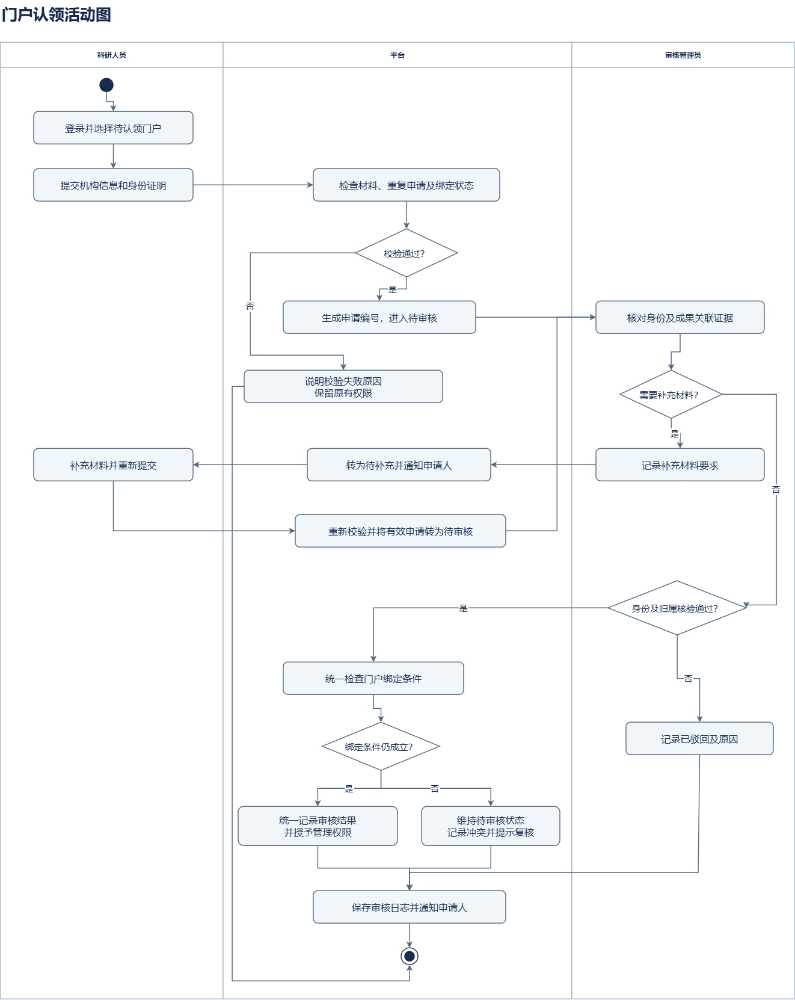 图 3-7 活动图 03_门户认领活动图.drawio |
| 状态图 |  | 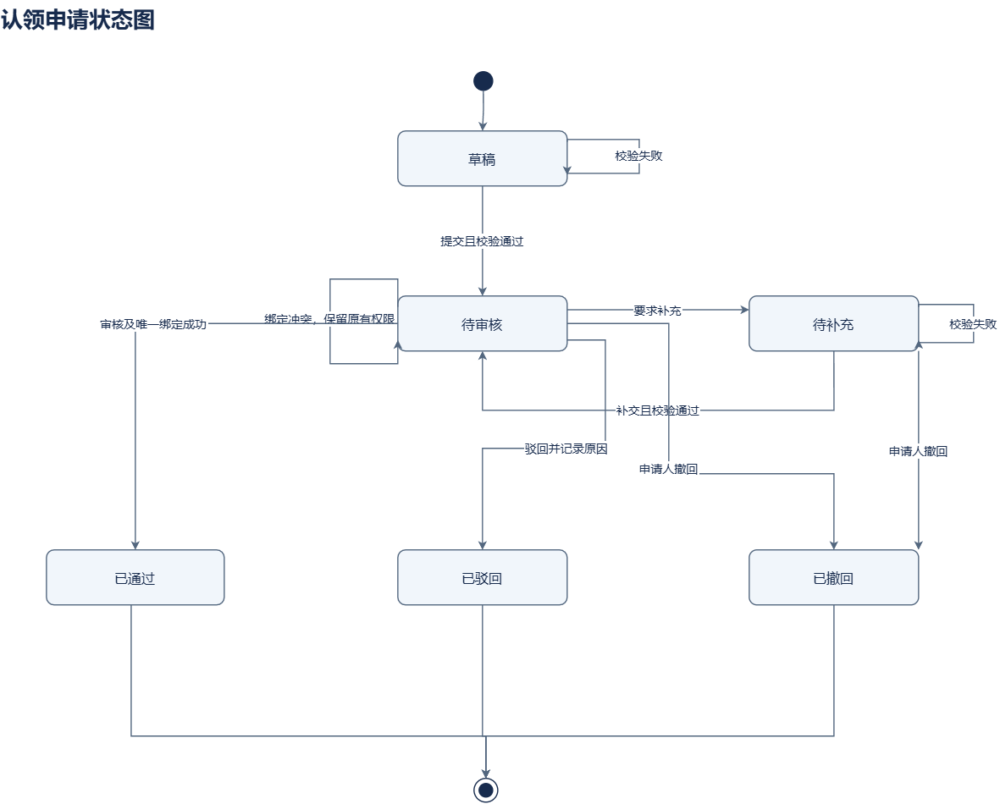 图 3-8 状态图 04_认领申请状态图.drawio |

##### 3.2.3.2 UC3.2 认领与补录本人贡献成果

优先级：P0。关联原需求：FR-OUTCOME-001、FR-OUTCOME-002、FR-PORTAL-002、FR-PORTAL-003。

| 项目 | 分类 | 规约内容 |
| --- | --- | --- |
| 用例名称 |  | UC3.2 认领与补录本人贡献成果 |
| 简要描述 |  | 科研人员关联已有成果或提交缺失成果及来源，由管理员审核本人贡献关系和新增公共记录。 |
| 参与者 |  | 已认领门户科研人员、审核管理员 |
| 涉众 |  | 已认领门户科研人员、审核管理员：希望任务结果准确、可解释且可恢复；平台管理与开发团队：需要一致的规则、权限和可追踪处理结果 |
| 前置条件 |  | 申请人具有指定门户有效管理权，能够提供成果标识或可靠来源依据。 |
| 后置条件 | 成功 | 建立唯一、有效的本人贡献关系，或审核后发布新成果；不影响其他真实贡献者。 |
| 后置条件 | 失败 | 不新增重复公共记录或未经审核的贡献，保留申请及处理理由。 |
| 事件流 | 基本路径 | 1. 科研人员查询已有论文、专利、项目或获奖记录。 2. 已有成果时提交认领依据；未收录时提交类型专属字段及来源。 3. 系统检查本人资格、同类在审申请、标识和重复候选。 4. 管理员核验贡献角色、来源、时间与已有记录。 5. 通过后关联已有成果或发布新记录，更新对应检索及统计工作。 6. 系统返回本人处理结果和来源信息。 |
| 事件流 | 备选路径 | 3a.同类申请已在审：返回本人已有申请，不重复创建。 4a.材料不足：要求补充；发现已存在记录时关联已有成果。 4b.论文有 DOI 但尚未收录：经审核发起定向补采，检索可见后才完成相应请求。 5a.发布或索引更新失败：显示真实处理状态并保留恢复工作。 |
| 用例图 |  | 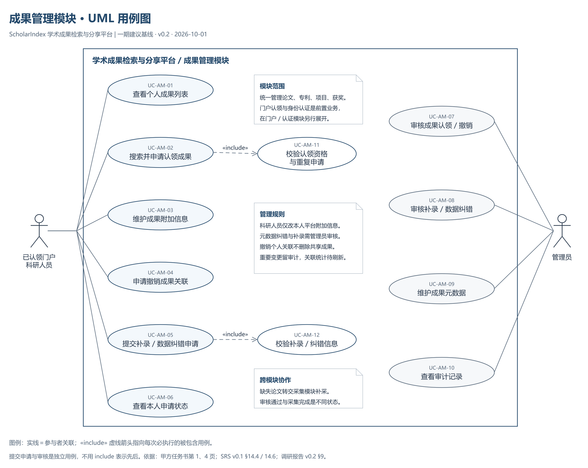 图 3-9 用例图 成果管理模块_UML用例图 |

##### 3.2.3.3 UC3.3 纠正成果归属并撤销错误关联

优先级：P0。关联原需求：FR-FEEDBACK-001、FR-PORTAL-005、FR-PORTAL-010。

| 项目 | 分类 | 规约内容 |
| --- | --- | --- |
| 用例名称 |  | UC3.3 纠正成果归属并撤销错误关联 |
| 简要描述 |  | 用户报告公共资料问题，科研人员申请纠正本人误关联，管理员依据证据维护公共事实和贡献关系。 |
| 参与者 |  | 已认领门户科研人员、普通用户反馈者、审核管理员 |
| 涉众 |  | 已认领门户科研人员、普通用户反馈者、审核管理员：希望任务结果准确、可解释且可恢复；平台管理与开发团队：需要一致的规则、权限和可追踪处理结果 |
| 前置条件 |  | 目标公开记录存在；本人关系撤销需拥有相应门户权限。 |
| 后置条件 | 成功 | 经审核纠正目标关系或字段，保留原始来源、其他人关联及审计。 |
| 后置条件 | 失败 | 保持公共成果和有效关系，记录驳回、待补充或处理失败原因。 |
| 事件流 | 基本路径 | 1. 用户在详情或本人门户发现错误，选择反馈、纠错或撤销本人关联。 2. 用户提供目标字段、建议值、理由及证据。 3. 系统登记受理号或私有申请，并保存目标版本。 4. 管理员核对来源、真实贡献角色和可能受影响的关系。 5. 审核通过后建立有依据的规范修订或撤销申请人的关系。 6. 系统登记索引与统计更新并反馈结果。 |
| 事件流 | 备选路径 | 2a.证据不足：列明补充要求，不改写公共事实。 4a.非本人或未授权修改：拒绝本人维护操作；可按公开反馈路径受理。 5a.多人共同成果：只处理目标关系，不删除公共成果或其他人的贡献。 |

##### 3.2.3.4 UC3.4 维护门户公开信息与个人说明

优先级：P0。关联原需求：FR-PORTAL-006。

| 项目 | 分类 | 规约内容 |
| --- | --- | --- |
| 用例名称 |  | UC3.4 维护门户公开信息与个人说明 |
| 简要描述 |  | 用户维护本人简介、成果说明、标签和展示顺序，来源事实与他人关系不由个人直接改写。 |
| 参与者 |  | 已认领门户科研人员 |
| 涉众 |  | 已认领门户科研人员：希望任务结果准确、可解释且可恢复；平台管理与开发团队：需要一致的规则、权限和可追踪处理结果 |
| 前置条件 |  | 用户已登录，对指定门户有有效管理权。 |
| 后置条件 | 成功 | 更新允许自主维护的本人附加信息，公开展示遵守字段及隐私规则。 |
| 后置条件 | 失败 | 保留原值，返回非法字段、权限失效或版本冲突说明。 |
| 事件流 | 基本路径 | 1. 用户进入本人门户管理页面，选择可编辑公开信息或附加说明。 2. 系统检查账号与门户的实时授权，展示允许编辑的字段。 3. 用户修改简介、标签、本人说明或展示顺序并提交。 4. 系统校验输入、安全展示与版本。 5. 系统保存本人附加信息，记录必要历史并显示最新结果。 |
| 事件流 | 备选路径 | 3a.修改公共题录、作者顺序、机构或归属事实：引导至审核纠错流程。 4a.授权已解绑或失效：拒绝保存，不以旧页面权限继续写入。 4b.并发修改或字段不合法：提示刷新或修正，原信息保持不变。 |
| 类图 |  | 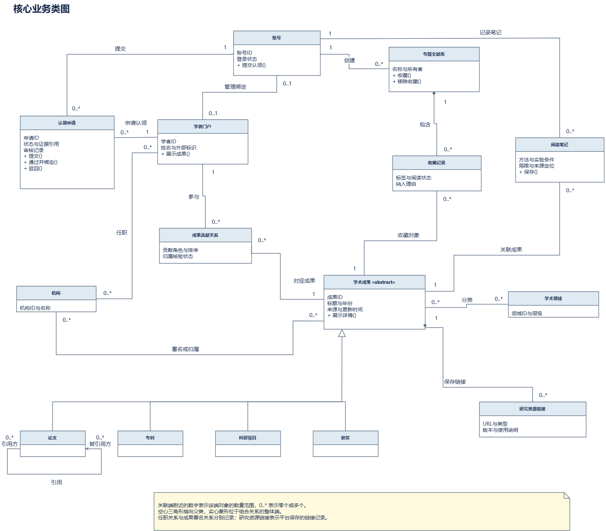 图 3-10 类图 05_核心业务类图.drawio |

##### 3.2.3.5 UC3.5 查看与处理本人申请

优先级：P0。关联原需求：FR-PORTAL-011、FR-PORTAL-012、FR-PORTAL-013、FR-STAT-008。

| 项目 | 分类 | 规约内容 |
| --- | --- | --- |
| 用例名称 |  | UC3.5 查看与处理本人申请 |
| 简要描述 |  | 用户查看本人申请、处理意见和管理统计，在允许状态补充或撤回，并对终态建立新的再次申请。 |
| 参与者 |  | 申请人、已认领门户科研人员 |
| 涉众 |  | 申请人、已认领门户科研人员：希望任务结果准确、可解释且可恢复；平台管理与开发团队：需要一致的规则、权限和可追踪处理结果 |
| 前置条件 |  | 用户已登录，目标申请属于本人。 |
| 后置条件 | 成功 | 展示真实状态、版本和理由；允许的补充或撤回仅执行一次合法迁移。 |
| 后置条件 | 失败 | 保留原申请历史，不泄露他人材料，不把受理写成解决。 |
| 事件流 | 基本路径 | 1. 用户打开本人申请列表，按类型和状态查询。 2. 系统检查申请归属，返回材料版本、意见及处理时间。 3. 用户在待补充状态提交新材料，系统校验后按对应生命周期处理。 4. 用户在允许状态撤回申请，系统与并发终审进行版本校验。 5. 终态需要再申请时，系统建立新编号并关联原记录。 6. 本人管理统计分别显示确认成果与各类申请，不混入公开产出总量。 |
| 事件流 | 备选路径 | 2a.请求他人的申请或材料：拒绝访问。 3a.材料校验失败：保持原业务状态并提示原因。 4a.终审已经生效：撤回失败，返回当前状态；通过后解绑另走治理。 |

#### 3.2.4 用例包4 科研态势分析

##### 3.2.4.1 UC4.1 查看平台与科研人员成果统计

优先级：P0。关联原需求：FR-STAT-001、FR-STAT-002、FR-STAT-005。

| 项目 | 分类 | 规约内容 |
| --- | --- | --- |
| 用例名称 |  | UC4.1 查看平台与科研人员成果统计 |
| 简要描述 |  | 用户查询四类成果概览、年度分布、人物统计与论文开放或引用信息，数据范围和缺失状态必须可解释。 |
| 参与者 |  | 访客、普通用户、科研人员 |
| 涉众 |  | 访客、普通用户、科研人员：希望任务结果准确、可解释且可恢复；平台管理与开发团队：需要一致的规则、权限和可追踪处理结果 |
| 前置条件 |  | 存在可用公开数据或统计版本。 |
| 后置条件 | 成功 | 统计和明细使用同一范围与版本，显示口径、覆盖率和更新时间。 |
| 后置条件 | 失败 | 明确区分未知、有效零值、无样本和计算失败，不虚构完整覆盖。 |
| 事件流 | 基本路径 | 1. 用户选择平台概览或目标人物，设置成果类型、年份与领域。 2. 系统固定筛选范围和统计快照版本。 3. 系统按规范成果或授权申请身份去重计算数量，按各类型实际时间解释年度。 4. 系统展示年度分布、引用或 OA 状态，同时显示缺失覆盖情况。 5. 用户选择统计项查看同条件的公开支撑成果。 |
| 事件流 | 备选路径 | 3a.日期精度不足或年份未知：单列未知或排除项并说明数量。 4a.引用或 OA 状态缺失：保持未知，不显示为确认零值或非开放。 5a.明细版本已失效：说明状态并要求重新查询。 |

##### 3.2.4.2 UC4.2 查看机构成果分类排名

优先级：P0。关联原需求：FR-STAT-003。

| 项目 | 分类 | 规约内容 |
| --- | --- | --- |
| 用例名称 |  | UC4.2 查看机构成果分类排名 |
| 简要描述 |  | 用户在固定类型、领域和时间范围内比较机构收录成果数量，排名不作为完整科研能力评价。 |
| 参与者 |  | 访客、普通用户、科研人员 |
| 涉众 |  | 访客、普通用户、科研人员：希望任务结果准确、可解释且可恢复；平台管理与开发团队：需要一致的规则、权限和可追踪处理结果 |
| 前置条件 |  | 存在可用机构关系与统计快照。 |
| 后置条件 | 成功 | 展示并列排名、数量、口径及同范围明细。 |
| 后置条件 | 失败 | 保留缺失机构和无数据状态，不把当前任职推断为所有历史成果署名。 |
| 事件流 | 基本路径 | 1. 用户进入机构排名，设置类型、领域、年份和机构范围。 2. 系统展示机构归属规则及快照时间。 3. 系统按成果发生时的可靠机构关系，在每机构内去重计数。 4. 系统按数量排序，同值并列，稳定次序使用机构标识。 5. 用户点击机构或数量，查看对应公开成果。 |
| 事件流 | 备选路径 | 3a.同一成果涉及多机构：可分别计入，机构数量之和不称为全库总量。 3b.机构未匹配：记录未匹配量，不凭网站归属补造。 1a.范围无有效数据或服务失败：分别显示空结果或错误提示。 |

##### 3.2.4.3 UC4.3 分析领域热点与年度趋势

优先级：P0。关联原需求：FR-STAT-004、FR-STAT-006。

| 项目 | 分类 | 规约内容 |
| --- | --- | --- |
| 用例名称 |  | UC4.3 分析领域热点与年度趋势 |
| 简要描述 |  | 用户查看同一语料范围内主题或关键词的成果频次、占比和变化，基础热点统计不声称完成预测。 |
| 参与者 |  | 访客、普通用户、科研人员 |
| 涉众 |  | 访客、普通用户、科研人员：希望任务结果准确、可解释且可恢复；平台管理与开发团队：需要一致的规则、权限和可追踪处理结果 |
| 前置条件 |  | 有明确的主题映射、分析语料和时间口径。 |
| 后置条件 | 成功 | 展示可复核的频次、分母、覆盖率和年度趋势。 |
| 后置条件 | 失败 | 无有效分析样本时说明原因，不显示误导性百分比。 |
| 事件流 | 基本路径 | 1. 用户选择领域、时间范围与成果类型。 2. 系统读取标题、摘要或已确认来源主题，固定提取规则版本。 3. 系统按不同成果计主题频次，重复词与重复采集不增加计数。 4. 系统计算各时间桶内占比，并展示语料样本量和覆盖率。 5. 用户查看支撑成果和来源，区分收录增长与实际成果变化。 |
| 事件流 | 备选路径 | 2a.摘要缺失：按已定义规则使用其他可用文本并显示覆盖情况。 3a.无分析文本或分母为零：显示不适用或无样本，不补造结果。 4a.年份未结束：标明截至日期，不按全年同比直接解释。 |

##### 3.2.4.4 UC4.4 查看合作网络与最短共著路径

优先级：P0 基础与拟定创新。关联原需求：FR-INNOV-001、FR-STAT-007。

| 项目 | 分类 | 规约内容 |
| --- | --- | --- |
| 用例名称 |  | UC4.4 查看合作网络与最短共著路径 |
| 简要描述 |  | 用户查看共同论文形成的作者网络、边权和证据，并在固定网络范围查询最短共著路径。 |
| 参与者 |  | 访客、普通用户、科研人员 |
| 涉众 |  | 访客、普通用户、科研人员：希望任务结果准确、可解释且可恢复；平台管理与开发团队：需要一致的规则、权限和可追踪处理结果 |
| 前置条件 |  | 有可区分人物和可靠论文署名关系，查询范围与节点截断规则明确。 |
| 后置条件 | 成功 | 显示网络或最短路径及其共同论文证据，结果只表达所选收录范围的连接。 |
| 后置条件 | 失败 | 说明无共著数据、无可达路径或服务错误，不据姓名推断合作关系。 |
| 事件流 | 基本路径 | 1. 用户选择学者、领域、机构或年份范围。 2. 系统以可识别作者为节点，以共同有效论文去重数为边权构建无向共著网络。 3. 系统展示节点、边及必要的截断说明，用户查看共同论文证据。 4. 用户选择起点和终点，请求最短共著路径。 5. 系统在相同范围内查询路径并逐段提供支撑论文。 |
| 事件流 | 备选路径 | 2a.同名人物尚未确认：保留不同节点或要求用户核对。 4a.没有路径：提示当前数据范围内不可达，不判定现实不存在合作。 5a.引用关系存在而无共同署名：不把引用转换为共著边。 |

#### 3.2.5 用例包5 平台运营与数据维护

##### 3.2.5.1 UC5.1 管理来源与执行采集任务

优先级：P0。关联原需求：FR-ADMIN-004、FR-CRAWL-001、FR-CRAWL-002、FR-CRAWL-003、FR-CRAWL-007、FR-CRAWL-008、FR-CRAWL-009、FR-SYNC-004。

| 项目 | 分类 | 规约内容 |
| --- | --- | --- |
| 用例名称 |  | UC5.1 管理来源与执行采集任务 |
| 简要描述 |  | 管理员配置访问条件和固定采集范围，触发任务、查询进度、重试或停止，按现有六状态模型保存历史。 |
| 参与者 |  | 平台管理员、外部数据源 |
| 涉众 |  | 平台管理员、外部数据源：希望任务结果准确、可解释且可恢复；平台管理与开发团队：需要一致的规则、权限和可追踪处理结果 |
| 前置条件 |  | 管理员具备来源与任务权限；访问配置、来源规则和必要凭证已核验。 |
| 后置条件 | 成功 | 范围内解析、清洗、去重、入库和校验完成后任务为 SUCCEEDED，可靠更新成功水位并登记后续工作。 |
| 后置条件 | 失败 | 任务为 FAILED、RETRYING 或 STOPPED，保留断点、错误和已提交批次，不推进整窗成功水位。 |
| 事件流 | 基本路径 | 1. 管理员选择来源、成果类型、范围和时间窗口，系统校验参数并创建 PENDING 任务。 2. 可用执行器在未停止时将任务调度为 RUNNING，记录尝试和心跳。 3. 执行器按来源允许的方式请求分页或清单，保存原始内容和来源依据。 4. 系统完成解析、字段清洗、去重入库及校验，登记后续索引和统计工作。 5. 范围完成且校验通过后，任务为 SUCCEEDED，并更新成功水位。 6. 管理员查看计数、日志和后续更新状态，必要时提交停止请求。 |
| 事件流 | 备选路径 | 3a.异常、超时或校验失败：转 FAILED，记录原因并保留有效断点。 3b.预算内且未人工停止：转 RETRYING，退避结束后重新调度。 3c.重试耗尽或人工终止：转 STOPPED，保留失败历史与停止原因。 6a.运行中强制停止：受控取消并安全退出；失效执行器不得回调推进水位。 |
| 状态图 |  | 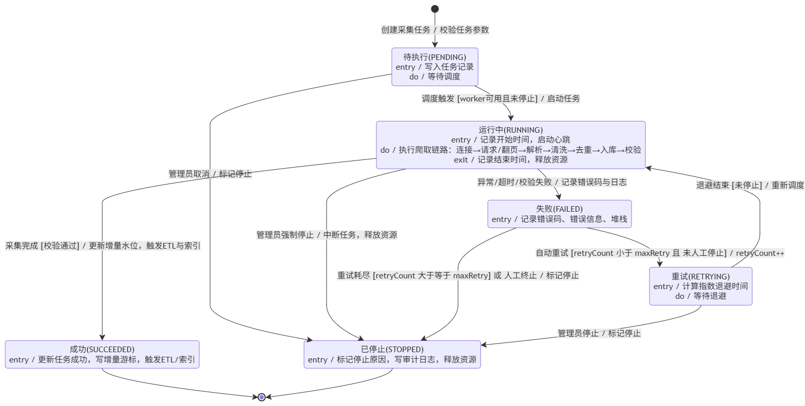 图 3-11 状态图 数据采集任务状态机.drawio |

##### 3.2.5.2 UC5.2 审核身份门户与成果请求

优先级：P0。关联原需求：FR-ADMIN-003、FR-AUTH-005、FR-INDEXREQ-003、FR-INST-003、FR-PORTAL-004、FR-PORTAL-008。

| 项目 | 分类 | 规约内容 |
| --- | --- | --- |
| 用例名称 |  | UC5.2 审核身份门户与成果请求 |
| 简要描述 |  | 管理员查看授权范围内的申请，核对身份、机构、门户或贡献证据，按申请类型提交可审计的处理结论。 |
| 参与者 |  | 授权审核管理员 |
| 涉众 |  | 授权审核管理员：希望任务结果准确、可解释且可恢复；平台管理与开发团队：需要一致的规则、权限和可追踪处理结果 |
| 前置条件 |  | 管理员已登录并具备相应审核权限，目标申请允许被处理。 |
| 后置条件 | 成功 | 申请状态、公共修订或授权关系按同一有效版本可靠提交，结果可追踪。 |
| 后置条件 | 失败 | 不产生未通过审核的授权或公共修订，保留意见和原有关系。 |
| 事件流 | 基本路径 | 1. 管理员进入审核列表，选择类型和目标申请。 2. 系统校验权限、版本和有效占用，展示必要的上下文与证据。 3. 管理员核对来源、身份、重复记录及可能受影响的对象。 4. 管理员决定通过、驳回或要求补充，并填写理由。 5. 系统原子校验目标约束，保存状态、关系或修订及审计。 6. 系统通知申请人并登记需要的后续更新工作。 |
| 事件流 | 备选路径 | 2a.无权限或版本过期：拒绝处理，要求刷新，不返回他人私人资料。 4a.证据不足：记录补充要求，不直接授权。 5a.门户绑定竞争或唯一性冲突：保持待审核，保留已有合法权限并复核。 5b.事务保存失败：保持原生效关系，报告失败并允许安全重试。 |

##### 3.2.5.3 UC5.3 清洗去重消歧与质量复核

优先级：P0。关联原需求：FR-ADMIN-005、FR-CRAWL-004、FR-CRAWL-005、FR-CRAWL-006、FR-CRAWL-010、FR-OUTCOME-004、FR-OUTCOME-005、FR-OUTCOME-006、FR-OUTCOME-007、FR-OUTCOME-008。

| 项目 | 分类 | 规约内容 |
| --- | --- | --- |
| 用例名称 |  | UC5.3 清洗去重消歧与质量复核 |
| 简要描述 |  | 平台处理来源字段、成果身份和人物机构候选，管理员复核冲突及合并结果，维护可回溯的公共资料。 |
| 参与者 |  | 平台管理员 |
| 涉众 |  | 平台管理员：希望任务结果准确、可解释且可恢复；平台管理与开发团队：需要一致的规则、权限和可追踪处理结果 |
| 前置条件 |  | 存在可读取的来源记录、规则版本和授权处理范围。 |
| 后置条件 | 成功 | 形成带来源、标识和版本的规范记录或明确复核、隔离结果，修订可追踪。 |
| 后置条件 | 失败 | 保留原始数据和有效实体，不静默覆盖字段、不因弱证据自动合并或授权。 |
| 事件流 | 基本路径 | 1. 系统校验来源内容与结构，规范文本、标识、日期及人员角色。 2. 系统按四类成果专属强标识或来源键检查重复，弱标识只形成候选。 3. 系统核对可信 ORCID、ROR 及冲突，人员相似度不直接授权账号。 4. 管理员查看重复或冲突候选、来源证据和受影响字段。 5. 管理员作出合并、保持独立或规范修订，记录依据和审计。 6. 系统保留重定向或修订历史，并登记索引及统计更新。 |
| 事件流 | 备选路径 | 1a.响应为网页外壳、权限限制或解析失败：记录对应错误，不当作有效空数据。 2a.强标识冲突或版本关系不同：阻断自动合并，进入人工复核。 5a.错误合并被发现：按保留的映射和历史执行有依据的恢复。 |

##### 3.2.5.4 UC5.4 增量更新与维护公开检索版本

优先级：P0。关联原需求：FR-ES-001、FR-ES-004、FR-INDEXREQ-001、FR-INDEXREQ-002、FR-INDEXREQ-004、FR-INDEXREQ-005、FR-SYNC-001、FR-SYNC-002、FR-SYNC-003、FR-SYNC-005。

| 项目 | 分类 | 规约内容 |
| --- | --- | --- |
| 用例名称 |  | UC5.4 增量更新与维护公开检索版本 |
| 简要描述 |  | 平台按固定窗口增量获取记录，维护可重建索引与统一公开版本，并处理定向补采请求。 |
| 参与者 |  | 平台管理员、外部数据源 |
| 涉众 |  | 平台管理员、外部数据源：希望任务结果准确、可解释且可恢复；平台管理与开发团队：需要一致的规则、权限和可追踪处理结果 |
| 前置条件 |  | 来源更新规则和断点契约明确，管理员具备索引及发布权限。 |
| 后置条件 | 成功 | 数据变更和后续工作可靠登记，校验后发布一致检索版本；补采请求在满足可见条件后完成。 |
| 后置条件 | 失败 | 保留上一可用公开版本和请求历史，失败不把补采申请标为完成。 |
| 事件流 | 基本路径 | 1. 管理员或已登记的计划创建固定时间窗口或经审核的定向补采任务。 2. 系统读取有效检查点，按来源标识和原文校验值幂等处理新增或变更。 3. 系统可靠提交规范数据与后续索引、统计更新登记。 4. 索引任务构建目标版本并执行完整性及查询校验。 5. 校验通过后切换可用版本，页面记录范围和生成时间。 6. 系统检查补采请求的检索可见条件，完成后反馈申请人。 |
| 事件流 | 备选路径 | 2a.原文未变但规则升级：允许按新版本重处理，并保留原版本。 4a.索引构建或发布失败：保留旧公开版本与重试入口。 6a.只有数据入库但尚不可检索：请求保持处理中，不提前完成。 |

##### 3.2.5.5 UC5.5 查看质量统计与更新统计快照

优先级：P0。关联原需求：FR-ADMIN-001、FR-STAT-009、FR-STAT-010。

| 项目 | 分类 | 规约内容 |
| --- | --- | --- |
| 用例名称 |  | UC5.5 查看质量统计与更新统计快照 |
| 简要描述 |  | 管理员查看来源、质量和运行指标，固定数据版本重建统计快照，校验后发布并保留失败状态。 |
| 参与者 |  | 平台管理员 |
| 涉众 |  | 平台管理员：希望任务结果准确、可解释且可恢复；平台管理与开发团队：需要一致的规则、权限和可追踪处理结果 |
| 前置条件 |  | 管理员具备相应质量或统计维护权限。 |
| 后置条件 | 成功 | 展示真实质量指标，发布通过校验的统计快照及其范围、口径和时间。 |
| 后置条件 | 失败 | 保留旧快照与任务失败记录，不声称已实时一致或通过数据质量验收。 |
| 事件流 | 基本路径 | 1. 管理员查看来源完整率、重复候选、未分类、机构未匹配和同步异常。 2. 管理员选择统计更新范围，系统固定规范数据版本。 3. 系统按统一集合和类型口径重新聚合并校验。 4. 通过后原子切换至新快照，记录版本和时间。 5. 管理员查询结果与异常，必要时安排复核或重试。 |
| 事件流 | 备选路径 | 1a.质量指标分母或标注依据不足：显示适用范围和缺失信息。 3a.聚合校验失败：保持旧快照，记录原因和恢复工作。 4a.目标数据版本失效：重新固定范围，不混用两个版本结果。 |

## 4. 补充规约

本章规定跨用例的全局要求。四类成果基础流程、公开检索门户、认领治理、基础统计及任务恢复为 P0；私人资料与推荐为 P1；讨论订阅、复杂网络预测和机构 SSO 为 P2。交易、支付及未经授权全文托管不在一期范围。

### 4.1 数据需求与业务规则

#### 4.1.1 公共数据契约

| 编号 | 需求或规则 | 约束与检查依据 |
| --- | --- | --- |
| DR-01 | 稳定业务标识 | 平台账号、学者、机构、成果、来源记录分别保存内部标识；姓名不是唯一键；规范记录保留来源和版本 |
| DR-02 | 四类成果差异 | 论文 DOI 与出版信息；专利申请、公开文献及家族分层；项目保留资助机构和编号；获奖保留奖项、授奖机构及完成人或单位 |
| DR-03 | 人员与机构消歧 | 可信、格式有效、无冲突的 ORCID 或 ROR 可以支持精确关联；姓名、域名或相似关系只形成候选，证据不足人工复核，不授予账户权限 |
| DR-04 | 时间及精度 | 年、月、日及日期含义分别保存；授权年、资助年、立项年、奖励年和公告日不能互换；未知不补成 1 月 1 日 |
| DR-05 | 分类与范围 | 采集范围不等于确认学科；来源主题、平台分类、版本和确认状态分别保存，未知分类单列，多标签按集合去重 |
| DR-06 | 来源与字段状态 | 原值、规范值和人工修订分离；缺失、零值、待核实、不适用不同；保留原始内容、字段依据和模拟标志 |
| BR-01 | 门户及贡献授权 | 一账号最多一个本人门户，一门户最多一个有效管理账号；门户管理权不自动确认所有成果；多人真实贡献可分别确认 |
| BR-02 | 个人维护边界 | 本人标签、说明和顺序可自主维护；公共元数据、归属、作者顺序、机构及合并需要审核；移除本人关系不删除公共成果 |
| BR-03 | 申请及并发 | 同人同对象同类在审申请去重；材料和对象版本校验；通过、授权和审计可靠提交；终态再次申请另建记录 |
| BR-04 | 可见性与私人资料 | 查询和统计固定范围与公开版本，同时校验当前对象权限；认领证明和私人笔记不作为公开字段 |
| BR-05 | 合并与恢复 | 保留来源映射、旧标识、修订及重定向；强标识冲突阻断自动合并，复核及恢复有依据 |
| BR-06 | 四类统计身份 | 论文、项目和获奖按规范成果 ID；基础授权专利按有授权依据的申请实体；公开文献与家族数量另列 |
| BR-07 | 统计解释 | 机构按成果发生时可靠关系全计数，领域允许重叠；引用不跨来源相加，缺失不等于零；当前年注明截至日期 |
| BR-08 | 共著与路径 | 共著仅由共同署名有效论文形成，边权为共同论文去重数；引用不是共著；最短路径不表示合作意愿 |

具体字段、类型关系和模拟校验样例仍在需求条目附录及 SPEC 保存，以本章规则解释，不据当前类图推定已经画出了全部数据库对象。

#### 4.1.2 门户认领六状态

本节以当前 `04_认领申请状态图.drawio` 和 `03_门户认领活动图.drawio` 为准。`PortalClaim` 使用六个业务状态，校验与人工审核是处理动作，不另设“待验证”“验证中”或“审核中”业务状态。科研人员身份审核与指定门户管理权仍分别校验。

| 状态 | 对应图中名称 | 含义及处理边界 |
| --- | --- | --- |
| DRAFT | 草稿 | 可编辑；提交校验失败仍为草稿，不进入审核 |
| PENDING_REVIEW | 待审核 | 首次提交或补交校验通过；管理员可审核、要求补充或驳回；申请人可撤回 |
| NEED_MORE_INFO | 待补充 | 管理员列明补充项；补交校验失败仍为待补充；可补交或撤回 |
| APPROVED | 已通过 | 审核与唯一绑定均成功，才授予指定门户管理权 |
| REJECTED | 已驳回 | 记录业务理由，本次申请结束 |
| WITHDRAWN | 已撤回 | 申请人在待审核或待补充时撤回，本次申请结束 |

| 当前状态 | 事件及条件 | 目标状态或处理结果 |
| --- | --- | --- |
| DRAFT | 提交且校验通过 | PENDING_REVIEW；保存申请编号及材料版本 |
| DRAFT | 校验失败 | 保持 DRAFT，提示原因，保留原有权限 |
| PENDING_REVIEW | 管理员要求补充 | NEED_MORE_INFO；记录补充要求并通知申请人 |
| NEED_MORE_INFO | 补交且校验通过 | PENDING_REVIEW；保存新的材料版本 |
| NEED_MORE_INFO | 校验失败 | 保持 NEED_MORE_INFO，说明原因 |
| PENDING_REVIEW | 审核及唯一绑定成功 | APPROVED；状态、绑定、授权和审计原子提交 |
| PENDING_REVIEW | 绑定冲突 | 保持 PENDING_REVIEW，记录冲突并复核，保留原有权限 |
| PENDING_REVIEW | 驳回并记录原因 | REJECTED；不授予管理权 |
| PENDING_REVIEW 或 NEED_MORE_INFO | 本人撤回且版本校验成功 | WITHDRAWN；与并发终审最多一个操作成功 |

已通过、已驳回、已撤回均为本次申请的终态。终态再次申请使用新编号并保留历史；草稿放弃仅结束编辑，不增加图中没有的“草稿到已撤回”迁移。审核占用及到期时间作为内部锁记录，领取或释放审核不改变待审核业务状态。材料验证服务异常只记录原因和重试安排，不直接判为身份不合法，也不创建额外业务状态。账号与门户授权唯一性、私有证据访问及多人真实贡献规则继续生效。

#### 4.1.3 采集任务六状态

本节以当前 `数据采集任务状态机.drawio` 为准，采用 PENDING、RUNNING、SUCCEEDED、FAILED、RETRYING、STOPPED 六个状态。SUCCEEDED 为图中的成功状态。任务执行连接、请求或翻页、解析、清洗、去重、入库和校验，完成后更新成功水位并触发后续 ETL 或索引任务；检索可见性与统计更新另记状态。

| 当前状态 | 图中的触发事件及条件 | 目标状态与处理 |
| --- | --- | --- |
| 创建任务 | 校验任务参数 | PENDING；写入任务记录并等待调度 |
| PENDING | worker 可用且未停止时调度 | RUNNING；记录开始时间并启动心跳 |
| PENDING | 管理员取消 | STOPPED；记录停止原因和审计 |
| RUNNING | 采集完成且校验通过 | SUCCEEDED；可靠保存处理结果后更新增量水位并触发后续工作 |
| RUNNING | 异常、超时或校验失败 | FAILED；记录错误码、信息和日志，保留已提交批次及断点 |
| RUNNING | 管理员强制停止 | 中断执行；在已提交批次与事务边界安全退出后置 STOPPED，释放资源，不推进成功水位 |
| FAILED | retryCount 小于 maxRetry 且未人工停止 | RETRYING；增加重试计数并计算指数退避时间 |
| RETRYING | 退避结束且未停止 | RUNNING；重新调度并从有效断点恢复 |
| RETRYING | 管理员停止 | STOPPED；不再调度 |
| FAILED | 重试耗尽或人工终止 | STOPPED；保留失败历史及停止原因 |

SUCCEEDED 和 STOPPED 结束本次任务，再执行需创建关联旧任务的新任务。成功水位与分页断点分别保存；停止请求不能允许失效执行器继续写入或成功回调。图中的“强制停止”通过受控取消与安全退出实现，不能破坏已提交数据。非重试错误先记 FAILED，再由管理员终止；重试耗尽按图转 STOPPED，不再保持 FAILED 作为最终状态。索引与统计尚未完成时不能声明整个补采申请已经完成。

### 4.2 非功能性需求

| 需求类别 | 需求 ID | 需求描述 | 验收标准 |
| --- | --- | --- | --- |
| 可用性 | USA-01 | 公开任务无需统一登录，查询返回保留上下文 | 匿名完成查询、详情和门户；登录、返回与反馈后条件、排序和页码可恢复 |
| 可解释性 | USA-02 | 结果状态与统计范围明确 | 固定用例分别检查未知、零值、无样本、空结果、处理失败及版本失效，不混淆含义 |
| 性能 | PER-01 | 检索与详情具有可测响应目标 | 至少 10000 条数据、20 并发，预热并固定查询运行至少 5 分钟；检索 P95 不超过 2 秒，详情 P95 不超过 1 秒，记录环境、缓存、参数及失败率 |
| 性能 | PER-02 | 冷启动与扩充规模另行验证 | 冷启动单列记录，基础检索目标 P95 不超过 3 秒；10 万级扩充不能仅据小样本声明达标 |
| 可靠性 | REL-01 | 更新、重试及停止保持数据连续性 | 断点、水位、执行尝试和幂等恢复分别检查；故障和停止不导致旧执行器推进成功水位 |
| 一致性 | REL-02 | 公开版本和实时权限不混用 | 固定范围的查询、明细和统计一致；权限解绑立即生效，索引失败保留恢复入口 |
| 安全性 | SEC-01 | 账户与对象权限有效 | 密码不明文保存；管理员、本人资料和对象操作分别鉴权；越权输入被拒绝并保留必要审计 |
| 安全性 | SEC-02 | 输入与外部访问受控 | 参数、文件类型和大小按配置校验；外部 URL 通过受控采集，不无限制服务器抓取；不公开凭证、完整证明或私人笔记 |
| 数据质量 | DQ-01 | 核心字段完整性和来源可追踪 | 按成果类型和适用字段计算完整率目标至少 95%；公开规范成果来源追踪目标 100%，模拟材料单列 |
| 数据质量 | DQ-02 | 清洗和候选算法经固定样本验证 | 分层人工标注 500 条清洗样本目标至少 99%；启用自动去重时准确率至少 98%，作者自动关联至少 97%，样本不足注明适用范围 |
| 数据质量 | DQ-03 | 精确查询与异常状态可以复核 | 固定合法、缺失、错误和冲突标识查询至少 50 组；存在合法标识命中目标 100%；至少 95% 异常有可查处理状态 |
| 性能 | PER-03 | 基础预聚合统计和推荐分别设定目标 | 10000 条成果、20 并发预热运行 5 分钟，基础统计 P95 不超过 3 秒；推荐设置 1 秒级超时并降级，不阻塞主详情 |
| 可扩展性 | SCA-01 | 支持数据规模与来源扩充 | 10 万级论文无需改变基础架构运行；四类成果和来源适配独立扩展，扩充后的性能单独实测 |
| 数据质量 | DQ-04 | ROR 精确映射需要来源依据 | 固定分层样本抽查，正确率目标至少 99%，记录样本量、标注依据与实际结果 |
| 可观测性 | OBS-01 | 处理过程留有可查询记录 | 记录请求错误、采集和 ETL 状态、索引异常、任务耗时与来源失败；受理与解决分别统计 |

以上均为待验证的验收要求，当前调研样本、模型文件和文档重构不能证明系统已经达标。完整原 AC 场景、模拟数据及预期结果在附录保存。

### 4.3 设计约束

- DC-01 实体分离：账号、来源人物、门户授权、具体贡献及机构关系分别建模。类图中的当前任职与成果署名或归属关系分别保存时间和来源。
- DC-02 数据与索引：关系业务数据为权威来源，索引可由其重建，统计保留快照；提交与后续工作可靠登记，公开版本校验后切换。
- DC-03 参数与架构：数据库、搜索引擎、分词、候选阈值、来源适配及更新周期为需要验证的设计决策，遵循 SPEC 与评审记录，不将候选方案写成已实现。
- DC-04 模型与图源：只采用当前 images 中的 PNG 与 Draw.io 文件。缺少统计分析图、模块可编辑图源及其他支撑图时如实标记；不从参考仓库复制模型作为本组成果。
- DC-05 访问与工程证据：来源访问、公开展示和私有材料分别按授权与项目规则处理；核心模块 SPEC、实现对应、真实 AI 使用与人工修正、测试记录在后续交付中保存。原定核心模块覆盖率目标至少 80%，结果以测试报告为准。

本版新用例编号、原 FR 与 AC 条目的对应见《需求条目与验收场景》，不得仅凭编号格式相似将现有图上的局部用例编号改解释为另一项任务。
