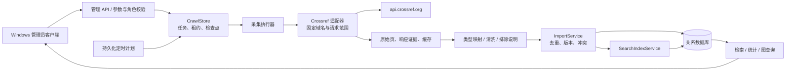
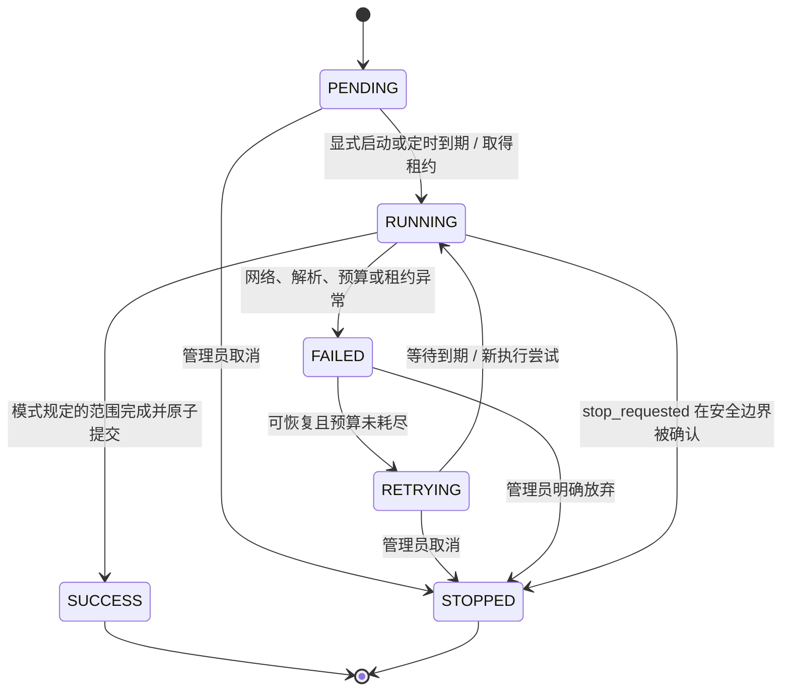
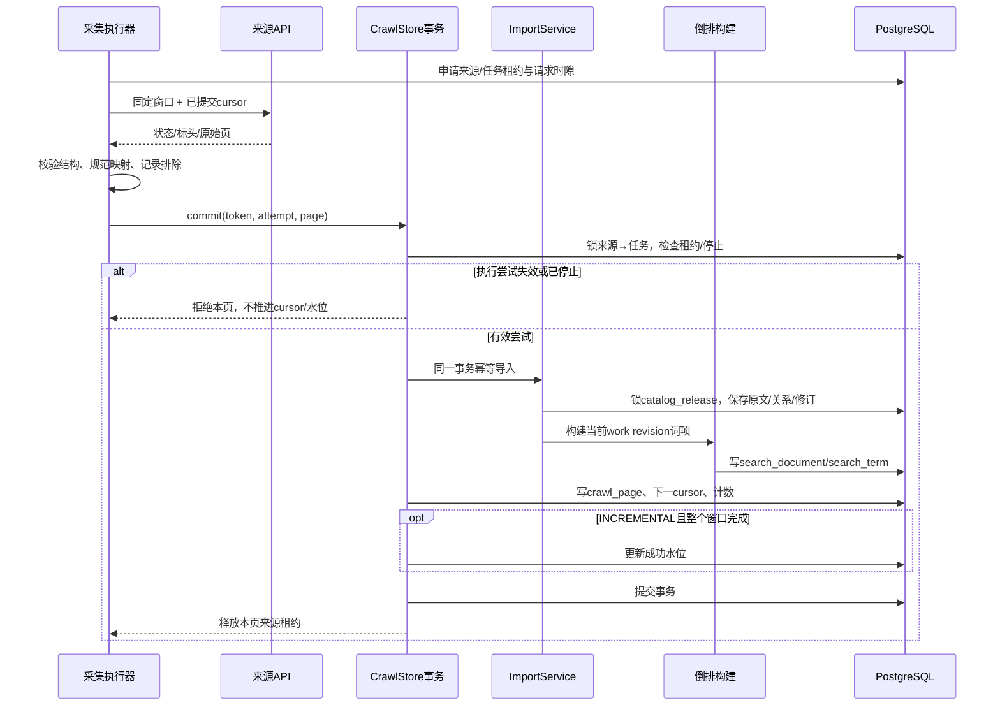

# 采集、增量、检索与统计构件设计

版本：Group2 / v0.3 设计与实现契约  
核验日期：2026-11-11  
需求基线：[SRS](../../前期成果/需求调研和建模/docs/系统需求规格说明书_SRS.md)、[SPEC](../../前期成果/需求调研和建模/docs/核心模块开发规范_SPEC.md)、[调研报告](../../前期成果/需求调研和建模/docs/需求调研报告.md)。数据库见 [ER 设计](database-er.md)。

## 1. 交付范围与设计决定

Windows WPF 客户端继续负责交互；Java 21 / Spring Boot 模块化单体负责业务、采集调度和查询；PostgreSQL 是生产权威库，H2 用于功能测试。4 核 4 GB 服务器初始使用单个 API 副本，避免为每个构件单独部署服务。

| 构件 | 本轮实现范围 | 尚未实现的扩展 |
| --- | --- | --- |
| 采集适配 | Crossref HTTPS API、DOI 定向、ISSN/关键词与固定索引日期窗、游标分页 | OpenAlex、DBLP、专利/项目/获奖站点专用适配器 |
| 调度与恢复 | 持久化任务、显式启动/停止/重试、定时计划、跨副本来源租约、执行尝试校验、原始页与检查点 | 消息队列、多来源大规模并行、通用网页发现 |
| 数据修订 | 来源原文版本、稳定映射、变更检测、规范元数据版本、冲突登记 | 弱标识自动合并、治理撤销/合并/软删除完整工作流 |
| 检索 | 同库倒排、加权词频 BM25、固定公开版本、确定性分页、中英词项 | 独立 Elasticsearch/OpenSearch、语义向量、经过人工评价的学科专属权重 |
| 统计 | 同版本 SQL 聚合、有界缓存、分类型/年度/机构/领域、引用覆盖、文本热点、共著路径 | 异步预聚合快照、预测、行为个性化推荐 |

“设计完成”不等于全部 SRS 目标已通过验收。非论文既有结构化导入仍可使用；表中未接入的来源不能因存在类型枚举而显示为“爬虫已接通”。

### 1.1 构件协作



网络请求在数据库事务外执行。原始页、规范记录、倒排与公开版本的提交在短事务内完成；不把外部 HTTP 等待放在持有目录发布锁的事务中。来源的请求间隔与租约保存于数据库，不能只用进程内锁控制跨副本流量。

## 2. 来源矩阵与启用条件

下表的 HTTP 状态只说明本次少量文档核验的结果；不代表持续可用性、批量采集许可或数据再发布许可。每个适配器启用前登记：来源 ID、固定入口、访问方式、用途/许可依据、凭证引用、频率上限、字段映射版本、允许展示的内容和最近核验时间。凭证不写入任务日志或客户端配置。

| 来源 | 已核实能力 / 样本 | 本轮状态与启用边界 |
| --- | --- | --- |
| Crossref REST API | 官方说明支持 cursor 与 index-date 窗口；本次文档和单次 rows=0 响应均 200 | 本轮实际适配；保留 DOI、源记录、原始 item 和修订时间；元数据访问不自动授权托管全文 |
| OpenAlex | 官方文档目前支持游标；第二页起需要已激活的 API key；支持的 per_page 最大 100 | 候选设计，未接入；账户预算、字段许可、快照存储成本另行确认，密钥从服务端 Secret 注入 |
| DBLP | 前期材料将其用于计算机书目补充 | 官方下载/FAQ 本次返回 202 验证挑战，未取得可用说明；未绕过验证，当前自动适配保持未启用 |
| CNIPA 主检索服务 | 前期实验记录为 HTTP 412 | 需获得来源允许的访问方式或数据服务条件后接入；登录、验证码和访问限制不绕过 |
| CNIPA 专利奖公告及附件 | 官方 2025 年授奖公告本次 200；可追溯正式名单 | 公开公告候选；专利号/发明人/权利人不等于已取得授权日期、当前法律状态；附件逐一核验后人工导入 |
| NSFC 项目清单 | 官方 2019 年生命科学部重点项目清单本次 200；列“科学部编号”、负责人、依托单位 | 独立 HTML 表格适配契约，尚未接入；科学部编号不能改称批准号，2020 发布日不能替代 2019 资助年 |
| MOST 获奖目录 | 官方 2023 年国家自然科学奖目录本次 200；项目编号、主要完成人、提名者 | 独立公告适配契约，尚未接入；正式获奖/提名分开，奖励年度 2023 与发布年 2024 分开 |
| 洛阳师范学院专利清单 | “2025 年获得授权的专利清单”本次 200，含申请号、申请日、授权公告日、发明人 | 补充公开来源候选；不归为 CNIPA 返回数据，不据此推断当前法律状态；页面声明的内容再利用条件仍须核对 |

核实依据：[Crossref API 使用建议](https://www.crossref.org/documentation/retrieve-metadata/rest-api/tips-for-using-the-crossref-rest-api/)、[OpenAlex 当前访问与限流说明](https://docs.openalex.org/how-to-use-the-api/rate-limits-and-authentication)、[OpenAlex 分页说明](https://docs.openalex.org/how-to-use-the-api/get-lists-of-entities/paging)。OpenAlex 旧的 per_page=200 行为已被官方标为弃用，本项目不将旧配额写死在未来适配器中。

非论文页面依据：[CNIPA 正式授奖决定](https://www.cnipa.gov.cn/art/2025/6/5/art_552_199973.html)、[NSFC 2019 清单](https://www.nsfc.gov.cn/p1/2853/3102/72645.html)、[MOST 2023 获奖目录](https://www.most.gov.cn/cxfw/kjjlcx/kjjl2023/202406/t20240624_191176.html)、[高校授权专利清单](https://sites.lynu.edu.cn/kycx/info/1221/5141.htm)。这些是已核实的来源内容，不是对未来所有自动采集/再发布用途的许可判断。

### 2.1 非论文适配契约

| 类型 | 稳定来源键 | 业务日期 | 人员/机构映射 | 必须保留的缺失与冲突 |
| --- | --- | --- | --- | --- |
| PATENT | 来源+原公告记录号；公开文献另含主管机构、公开号、文献种类 | 授权日/授权年；仅申请日则明确其含义 | 发明人与申请人/权利人分开 | 日期缺失、当前法律状态未核验、同申请不同阶段 |
| PROJECT | 来源+清单批次+原记录号；可信批准号另与资助机构组合 | 资助年、立项年、计划起止分别保存 | 负责人、依托单位分开 | 科学部编号不冒充批准号；数字标识保留前导零 |
| AWARD | 奖励体系+年度+项目编号；无编号进入人工复核 | 奖励年度 | 完成人、完成单位、提名者分开 | 单位奖不强造个人；公示/提名不冒充正式获奖 |

未来 HTML/PDF 适配器应输出与当前导入相同的规范契约，并保存原附件哈希、页码/行定位和解析器版本。不得把网页壳、验证码、登录提示、空白 PDF 解析结果当成“零条有效记录”。人工上传经允许使用的快照，是未接通来源的当前入口。

## 3. 任务调度与反爬应对

### 3.1 范围、数量与两个完成概念

管理员明确填写来源、DOI 或 ISSN/关键词、固定索引起止日期、可选出版年范围、每页条数、页预算及原始记录预算。DOI 定向不能同时附加 ISSN/关键词；列表时间窗使用索引更新时间，跨度最多 31 个自然日，不能将期刊/关键词范围自动写成学科标签。

| 模式 | 完成条件 | 达到预算但上游仍有结果 | 成功水位 |
| --- | --- | --- | --- |
| BOUNDED 限量采集 | 已完整提交指定原始条数/页额度，或来源已结束 | 可以按“限量完成”结束；明确实际扫描范围 | 不推进 |
| INCREMENTAL 全窗同步 | 固定时间窗全部分页处理完成 | 预算耗尽为未完成，不能宣称整窗同步成功 | 仅完整成功后推进 |
| 单 DOI 定向 | 该 DOI 的有效响应已处理；未找到单独报告 DOI_NOT_FOUND | 不适用批量水位 | 不推进 |

数量预算是源返回的原始记录数，新增数可能小于预算。任务独立展示 received / inserted / updated / unchanged / excluded / conflicts，不能把接收数量或去重数量当新增成果。定时任务采用 INCREMENTAL；被停止或成功任务再次执行，创建关联 parent_task_id 的新任务，保留原终态。

### 3.2 六状态和执行尝试



重试耗尽保持 FAILED；STOPPED 只表示显式取消/放弃或停用来源后的安全停止。RUNNING 收到停止请求先记录 stop_requested，执行器在下一次请求前和事务提交前检查。已经提交的页面保留；未提交页面不推进游标。错误码、首次及历次尝试写入任务日志。

### 3.3 跨副本互斥、请求预算和公平性

- 每个来源一份数据库租约；任务同时记录 lease_token、lease_until、attempt。新尝试生成新令牌，旧执行器不能凭旧令牌提交页面、写缓存或推进水位。
- 加锁顺序固定为来源 → 任务 → 目录发布，避免不同路径反向加锁。
- 页面完成后释放来源租约，下一次调度从可执行任务中按创建时间/ID选择。某个任务页数多，不意味着允许独占来源并发。
- 来源 next_request_at 持久化；配置间隔、Retry-After 与响应公布的限制取更保守等待值。默认请求间隔 1500 ms，来源最大并发先限制为 1。
- 任务创建与执行分开，默认定时计划关闭。定时调度持有来源锁检查到期时间和现有活动任务，避免多副本重复创建同一轮采集。访问拒绝/robots 拒绝/验证挑战会关闭来源计划并递增配置版本，防止持续生成失败任务；执行尝试和配置版本须仍有效，旧回调不能关闭新配置，普通429仅退避。

一次 Crossref 公共池 rows=0 请求在本次核验返回：x-rate-limit-limit=1、x-rate-limit-interval=1s、x-concurrency-limit=1、x-api-pool=public-array。这只是当前请求池的观察，不是永久配额；运行时读取标头，不能以增加 API 副本突破来源额度。

### 3.4 反爬与访问异常处理

本构件通过降低请求频率、复用合法缓存、固定范围和明确失败原因应对访问限制。只请求登记的 HTTPS 域名与路径，不抓取管理员任意填写的 URL，不跟随未知重定向；网络层设连接/请求超时和响应体大小上限。

| 响应/异常 | 处理 |
| --- | --- |
| 200 且结构正确 | 验证 API status、message 类型、字段与页记录数，再进入解析 |
| 有效空页 | 保留原文和状态后判断扫描完成；与非 JSON、结构变化分开 |
| 304 | 仅在持有对应已验证缓存体时复用；不能把空响应当空数据 |
| 429 | 解析 Retry-After 秒数或 HTTP 日期；保存下一次允许执行时刻，在预算内退避，不持续请求，也不因普通限流关闭定时计划 |
| 连接/读取超时、临时 5xx | 在预算内退避；保留固定窗口与最近已提交 cursor |
| 401/403/412、验证挑战、robots 拒绝 | 有效执行尝试且配置版本匹配时关闭来源定时计划并递增 configVersion；来源 enabled 不变，管理员核实后显式恢复或创建人工任务 |
| JSON 结构整体变化、响应过大 | 不盲重试；保存可诊断错误，调整解析器或缩小页范围 |
| 用户停止、租约失效 | 放弃本次未提交结果；旧成功回调不再生效 |

不使用验证码破解、代理池轮换、伪装登录态或提高并发来绕过限制。robots 与来源条款是独立约束；可访问页面也不能自动解释为可再发布全文。Crossref 联系地址仅在配置了真实维护者邮箱后使用 mailto，不伪造联系信息。

### 3.5 重试算法

SPEC 将请求级短重试和任务级重试区分。本轮每次领取只发送一次业务请求，失败交由持久化任务级退避，不叠加隐藏的 HTTP 自动重试。未来启用请求级短重试时须另设计数和总预算，不能与任务重试相乘失控。所有等待都服从来源下一请求时刻及有效执行租约：

```text
delay(n) = min(maxBackoff, base × 2^n) + boundedJitter
nextRun = max(now + delay(n), RetryAfter, source.next_request_at)
if permanentAccessOrSchemaError:
    FAILED; runnable = false
else if retryBudgetExhausted:
    FAILED(RETRY_EXHAUSTED); runnable = false
else:
    FAILED → RETRYING; retry_count += 1; next_run_at = nextRun
```

当前任务重试预算最多 3 次，基准退避 2 秒指数递增、上限 60 秒，附加 0–499 ms 抖动；连接超时 8 秒、单请求超时 20 秒，响应体上限 2 MiB。来源要求长时间等待时应释放执行资源并延期，不用持有连接或数据库锁的长时间 sleep。若 cursor 失效，当前实现保持固定范围，重试时将 cursor 重置为 * 并幂等重扫；重复接收也计入原始请求预算。预算不足时由管理员新建关联任务，不改用无限偏移分页。

## 4. 增量、去重和原始证据

### 4.1 三种进度

1. next_cursor / committed_pages：当前任务已提交页面的恢复位置。
2. crawl_checkpoint.successful_until：某来源+范围已经完整处理的时间窗上界。
3. catalog_release.revision：检索、详情和统计可以读取的公开数据版本。

三者不能相互替代。部分页已经公开并不意味着整个窗口已完成；限量完成也不证明水位之前所有变更都已同步。

### 4.2 固定窗口与重叠扫描

Crossref 官方建议同时指定 from-index-date 与 until-index-date；index-date 覆盖成员及 Crossref/第三方的更新，可能包含引用变化。created-date 只看新注册，publication date 是业务日期，均不能代替增量索引时间。[官方增量建议](https://www.crossref.org/documentation/retrieve-metadata/rest-api/tips-for-using-the-crossref-rest-api/)

自动计划优先扫描已结束的 UTC 日期，首次采用配置的回看天数；之后从最近成功日期开始重叠重扫，长空档拆成不超过 31 天的窗口。日期边界有重叠，必须依靠幂等处理消除重复。上游索引不是不可变快照，固定日期窗只能降低扫描期间变化风险；重叠重扫和后续对账仍有必要，不能承诺上游的事务级快照。

```text
scopeKey = SHA256(规范化ISSN + 换行 + query + 换行 + DOI
                  + 换行 + 出版起年或空串 + 换行 + 出版止年或空串)
from = checkpoint 存在 ? checkpoint.successful_until : 首次回看起点
until = min(已结束UTC日期, from + 30天)
cursor = "*"
循环:
    在事务外请求固定范围的下一页
    验证结构、解析记录、记录每一项排除原因
    原子提交当前页、规范修订、索引、下一cursor和计数
    来源确已结束 → 全窗成功；只在INCREMENTAL列表任务推进watermark
    限量模式达到recordBudget或页预算 → LIMIT_REACHED完成，不推进watermark
    全窗模式达到预算且有剩余 → FAILED，保留断点和已提交数据
```

每次请求从任务的固定范围与已提交 cursor 构造 URI，游标作为不透明值编码；官方契约没有要求游标文本每页变化，不能仅凭相等判定失败。不自己解释游标内容，不用 total-results 判断最后一页。按有效响应的实际返回项数与游标终止条件结束。

### 4.3 三层哈希与版本

| 标识 | 对象 | 用途 |
| --- | --- | --- |
| response_checksum | 原始整页响应 | 审计页内容与恢复证据 |
| source_record.checksum | 单来源 item 原文 | 同来源键+相同原文复用版本，追加观测 |
| work.metadata_hash | 规范化可展示内容 | 区分真正元数据变更与仅采集时间变化 |

source_head 固定“来源名+来源稳定键 → 规范 work ID”的映射；不能因为源标题修改就新建一个成果。相同原文仍写入新的 source_observation / last_seen；原文变化保留新的 source_record，旧原文不覆盖。

同来源可信更新、规范内容变化且未锁定时，生成新的 work_revision；来源更新时间倒退、跨来源冲突、强标识冲突或人工锁定时保留候选原文并登记 metadata_conflict。不能用“更晚抓到”替代“来源更晚更新”，也不能覆盖已确认主值。来源记录在一次采集中缺席不触发自动删除。

source_processing 按 source_id、parser_version、rule_version、normalized_hash 登记规范处理提案。相同原文但规范输出变化时仍保留提案，并进入 REPROCESS_REVIEW_REQUIRED；不因 source_record 去重丢掉新输出，也不直接覆盖已发布主值。当前没有通用重处理管理页面；规则配置、字段主值评审和人工冲突裁决的完整产品工作流仍是后续治理能力。

### 4.4 页提交时序与故障点



故障恢复：HTTP 成功但提交前崩溃会再次读取同页；提交成功但响应丢失由任务断点与批次幂等键避免重复入库；索引失败使本页所有业务写入回滚；旧执行器恢复后因 token/attempt 不符无法提交。原始页目前存数据库 TEXT，体积有上限；迁移对象存储需增加已写对象与事务登记之间的幂等回收方案。

## 5. 检索排序构件

### 5.1 词项与字段

SearchTerms 的规范化使用 Unicode NFKC 与 Locale.ROOT 小写；拉丁字母/数字按连续词项切分，保留 C++ 等后缀；汉字索引包含单字和相邻二元词。多字汉语查询用二元词，独立单字保留；词项去重后按 AND 检索，最多 40 个不同词项。

二元词切分不等同于词典分词，可能出现跨词边界命中，不能声称已经具备专业中文实体理解。当前不做同义词扩展或词干还原。改变分词规则必须变更规则版本并重建倒排，不能静默混用旧索引。

| 字段 | 当前权重 |
| --- | ---: |
| title | 4 |
| contributor names | 2.5 |
| venue | 2 |
| abstract | 1 |
| field labels | 2 |
| DOI / 类型专属 identifier | 6 |

词频按上述权重合并为 weighted_tf，文档长度取所有词项加权频次之和，最低为 1。本实现是一个加权词频的 BM25 变体；不宣称与 Lucene 的独立字段实现或严格 BM25F 完全相同。

### 5.2 BM25 与全语料统计

令 Q 为去重后的查询词项集合，F(t,d) 为加权词频，L(d) 为加权文档长度；N、df(t)、avgL 均来自同一公开 revision、同一真实/模拟范围下的完整有效语料，不在当前返回页上计算：

```text
idf(t) = ln(1 + (N - df(t) + 0.5) / (df(t) + 0.5))

score(d,Q) = Σ[t∈Q] idf(t) ×
             F(t,d) × (k1 + 1)
             ──────────────────────────────────────────
             F(t,d) + k1 × (1 - b + b × L(d) / avgL)

k1 = 1.2, b = 0.75
```

数据库 CTE 先求 corpus / population / frequency，再连接倒排求得分；HAVING 命中词项数等于 |Q| 实现 AND。机构、人物、领域、类型和时间筛选保持可组合，姓名先由用户确认独立学者 ID；人物与机构组合必须来自同一贡献关系。

BM25 的概率 IDF、平均长度概念和常用默认参数可在 [Apache Lucene 官方实现](https://github.com/apache/lucene/blob/main/lucene/core/src/java/org/apache/lucene/search/similarities/BM25Similarity.java) 核对。本项目字段权重来自 SPEC 候选，作为本轮固定基准；其业务优劣仍需固定查询集的人评/排序评测支持，不把候选参数称为最优。

### 5.3 稳定排序与版本

- 合法 DOI 优先精确定位；标识的精确命中与普通文本得分分开处理。
- 有关键词默认按相关度；并列按业务年份降序、未知年份置后、规范 ID 升序。
- 完全空条件采用最新收录/发布顺序并以 ID 打破并列；日期、题名、引用排序保留明确规则。
- 引用未知排在已知值之后，0 是已知值；不得将不同来源的引用量混加成统一质量分。
- 每次检索绑定公开 revision，后续分页/详情/统计携带同一版本。旧版本读取对应的 work_revision 与关系版本，不拼接当前字段。
- 权限实时读取，不因旧目录版本恢复撤销的账号或门户权限。

SPEC 的“0.80 文本 + 0.10 引用 + 0.05 新近度 + 0.05 质量”仍是未启用候选。没有跨完整排序集的归一化与对照实验前，不将 BM25 原始分直接加引用次数。跨类型结果使用共同的文本语料和当前统一权重，不使用不同独立索引的未经校准原始分。

### 5.4 索引一致性与资源边界

一个 work revision 对应一个 search_document，词项表以 (work_id, revision, term) 唯一。倒排可由不可变元数据重建；数据提交路径同步更新倒排，全部成功才切换 catalog_release。升级已有库时，启动阶段分批补建缺失索引，完成后进入就绪状态。

本轮以同库事务实现原子发布，没有独立索引服务、异步发布任务表或外部 READY 别名切换。查询缓存含全部筛选、排序、范围与 revision，限定条数和生存期；旧 revision 缓存仍有明确语义，新公开版本使用新键。未来独立搜索服务必须补 outbox、构建状态、版本校验、发布失败保留旧版等机制后才能替代当前事务路径。

## 6. 统计分析构件

### 6.1 统一分析集合

先固定 revision、real/demo、类型、业务时间、人物、机构和领域筛选，按规范 work ID 去重，再计算各指标。公开产出、本人已确认成果、管理员申请/质量指标是三套权限与分母，不能混合展示。

| 指标 | 聚合口径 | 必须说明 |
| --- | --- | --- |
| 总量 / 类型 | 不同规范成果数；四类分别计数 | 不按来源记录数累加 |
| 年度 | 论文出版年、专利授权年、项目资助年、奖励年度 | 未知年单列；来源网页发布日期不是替代值 |
| 机构 | 成果发生时关系全计数，同成果同机构一次 | 合作成果导致机构合计可大于全库总量 |
| 领域 | 规范/来源明确的多标签，各标签每篇一次 | 未分类单列；标签合计可能超过总量 |
| 排名 | 数量相同并列，稳定顺序机构 ID | 名称为成果数量排名，不解释为科研质量 |
| 引用 | PAPER；按 citation_source 分组汇总已知值 | 展示覆盖数/论文数；未知不填 0，不跨来源合计 |
| OA | 已开放 / 未开放 / 未知 | 分母为适用论文集合；访问失败不是“未开放” |

字段精度为 year 的记录不能进入月/日分析；未结束年度的图注明截至时间。缺机构不根据出版社或采集站点强行补造机构。

### 6.2 文本热点与趋势

热点输入只取 title / abstract 的词项，排除纯数字、单字和固定停用词；作者名、机构、DOI、期刊和分类标签的倒排权重不直接成为热点次数。

```text
df_bucket(t) = 当前业务年度桶内含t的不同成果数
share(t) = df(t) / textEligibleDocuments
coverage = textEligibleDocuments / selectedDocuments
```

同一成果中一个词出现十次仍只计一次。返回规则版本、文本可分析数量、选定成果数量、覆盖率和时间桶；分母为 0 时百分比为空，不伪造 0%。“热点”表示本库文本出现频率，不等于外部学科认定、学术质量或未来趋势预测。来源覆盖变化会影响趋势，图表必须保留数据范围与生成时间。

### 6.3 共著网络和最短路径

仅用所选版本中已识别学者的有效论文署名构建无向图；多人论文为每对不同学者形成边，边权为不同共同论文数。重复来源不增加权重，引用或同机构不构成共著。

BFS 计算最少边数路径，邻接节点按学者 ID 稳定遍历；起终点相同为 0 边，多条最短路径选稳定的一条。每条边返回同版本共同论文证据。规模/跳数/超时上限达到时返回“范围受限/未完成”，不能把被截断的图说成全库不存在路径。现有最大六跳等限制属于工程边界，不能宣称无限制全图检索。

### 6.4 统计一致性

公开统计直接读取同版本关系快照，缓存以 revision 和所有筛选条件为键。更新元数据时，来源、规范字段、关系版本与倒排在一个事务发布；失败全部回滚，已成功版本继续查询。当前没有物理 statistics_snapshot 表，缓存不是权威数据源。

管理员全平台统计独立鉴权；来源完整率、未分类、机构未匹配、冲突和失败任务等质量项按真实可算字段展示。未实现/未获取的指标显示未支持或未知，不能返回 0 冒充无异常。

## 7. 数据库与并发不变量

详细表关系、版本可见性条件和约束见 [database-er.md](database-er.md)。关键不变量：

1. app_user、scholar、portal_binding、outcome_binding 分别表达账号、来源人物、门户管理与确认贡献。
2. source_record 保留原文版本；source_head 保持稳定来源映射；source_observation 表达本次批次见到该版本。
3. catalog_release 单行锁串行分配公开 revision；业务 ID 不随修订变化。
4. 可见版本满足 start_revision ≤ requested_revision < valid_to；valid_to 为空表示当前开放区间。
5. 采集提交同时检查有效 source/task 租约与 attempt；表唯一键和事务是跨副本保障，虚拟线程不代替并发控制。
6. 审核版本、绑定唯一性、授权与审计在同一事务提交；公开检索的历史版本不能绕过最新权限。

## 8. 验证与可观测性

### 8.1 功能验收清单

| 类别 | 必须覆盖的情景 |
| --- | --- |
| 来源适配 | 正常 JSON、有效空结果、200 HTML 外壳、访问拒绝、429/Retry-After、5xx、超时、超大页、结构缺失 |
| 调度 | 双执行器竞争租约、运行停止、旧执行尝试回调、禁用来源、耗尽保持 FAILED、手动重试和新任务关联 |
| 增量 | 相同原文重扫、新原文/同规范内容、规范更新、过旧源更新、冲突保留、页提交失败、失败不推进水位 |
| 数量语义 | 限量模式达到预算、全窗模式预算不足、最后不足一页、全部重复/全部排除、DOI不推进水位 |
| 公开版本 | 旧列表/详情/统计稳定；索引异常回滚；新版本不改旧字段、贡献和来源 |
| 排序 | 至少 50 组人工可解释查询；精确 DOI、中英词项、同词频不同长度、AND、缺失年份、稳定并列分页 |
| 统计 | 两论文手算、多机构/多领域、未知与0、来源引用分组、重复原文、热点每篇去重、年度精度 |
| 权限 | 访客和科研用户不可管理采集；原始响应、任务日志、冲突队列及私有申请按后台权限访问 |

测试中使用固定响应夹具和两请求的并发正确性检查，不在本机执行负载测试。外部来源仅做低频、小范围接通核验；“某次真实请求成功”不能替代分页恢复或规模验收。

### 8.2 服务端性能验收

服务器部署后，按至少 10,000 条标注数据、20 并发、预热 5 分钟的基线运行脚本，记录固定查询集、命中范围、缓存冷热、机器/JVM/数据库版本、错误率与 p50/p95/p99。目标为检索 P95 ≤2 秒、详情 ≤1 秒、基础统计 ≤3 秒；这些是目标，不是本地已有结果。

监测请求耗时、SQL 耗时、连接池占用、采集排队/重试/失败、来源限流等待、页提交时间、倒排体积、缓存命中率和版本发布时长。采集限流优先保护源站与交互请求；HPA 扩副本不会提高单个来源配额，也不会增加单机物理容量。

## 9. 官方核验记录与待决策项

| 核验项 | 2026-11-11 结果 | 项目决定 |
| --- | --- | --- |
| Crossref tips / REST 说明 | HTTP 200；cursor、固定上界和 indexed-date 语义已核对 | 使用固定小窗与持久化断点 |
| Crossref rows=0 | HTTP 200；公共数组池 1 请求/秒、并发1 | 默认1500ms，运行时尊重更严格等待 |
| OpenAlex authentication / paging | HTTP 200；文档更新于 2026-11-03，游标后续页须key；100为支持页上限 | 仅适配设计，不申请/使用未知用户凭证 |
| DBLP 下载 FAQ | HTTP 202 验证挑战，未取到正文 | 不绕过；当前自动接入未启用 |
| 四个非论文公告 | HTTP 200，正文标题和日期/字段与前期样本一致 | 作为候选映射证据；非批量许可确认 |
| Stanford BM25 教材 | TLS 传输失败，未取得本次内容 | 不声称已核验该页；使用 Apache 官方源码核对公式 |
| Apache Lucene BM25Similarity | 官方 GitHub 源码 HTTP 200 | 核对 IDF、平均长度、k1/b；本项目加权变体另述 |

后续评审：独立来源许可与凭证、PDF/HTML 解析器样本、人物/机构消歧阈值、人工冲突裁决、软删除传播、旧版本保留/过期、数据库原文存储迁移、统计预聚合阈值、BM25 查询集与分词版本评价。没有实施和验证前不将这些项标为完成。
