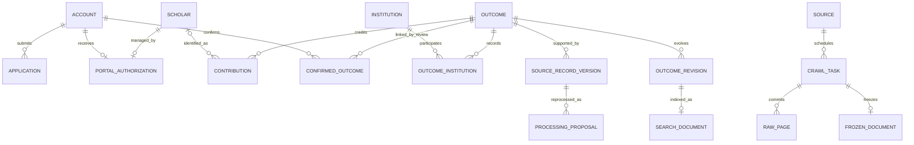

# 数据库 ER 与版本模型

版本：Group2 / v0.5，结构核对日期：2026-11-18。

本设计将需求概念映射到实际 Flyway V1–V7 迁移。图中的实体均已在迁移中定义；计划扩展单独列出。生产使用 PostgreSQL，H2 提供兼容的开发和功能测试环境。

## 1. 图文件

- [完整 Mermaid ER 源文件](database-er.mmd)：32 张表、297 个字段、44 条真实外键关系，含 PK/FK 与单列 UK。
- [可编辑 draw.io ER 图](database-er.drawio)：三页分别组织账号/成果/审核、采集调度、元数据版本/检索；实体和连接均可编辑；连线用1:N等紧凑基数，字段外键标记与下方约束表共同说明引用列。
- [构件设计](component-design.md)：调度、增量、检索排序、统计和事务边界。

draw.io 为未压缩 XML，直接使用 diagrams.net 或 draw.io 桌面版打开。重复出现在分图中的表是同一物理实体的引用视图。Mermaid 只画真实外键；版本指针、多态目标等逻辑关联见后文。

## 2. 需求概念层



概念 SOURCE 对应采集来源配置；既有人工导入仍使用 source_name，不必强制属于联网适配器。来源人物、登录账号、门户管理授权和人工确认成果是独立对象；解析到作者姓名/ORCID 不赋予用户身份或管理权。

## 3. 逻辑表与关键约束

完整字段见图文件。下表来自实际迁移；没有声明为 FK 的字段不能仅凭名称当成外键。UK 为独立唯一约束，复合唯一必须整体理解。

| 表 | 首次迁移 | PK | UK（不含 PK） | 实际 FK |
| --- | --- | --- | --- | --- |
| catalog_release | V1 | (id) | 无 | 无 |
| app_user | V1 | (id) | (username) | 无 |
| auth_session | V1 | (token_hash) | 无 | (user_id) → app_user(id) |
| institution | V1 | (id) | 无 | 无 |
| scholar | V1 | (id) | 无 | (institution_id) → institution(id) |
| work | V1 | (id) | (canonical_key) | 无 |
| contributor | V1 | (work_id,position) | 无 | (work_id) → work(id)；(scholar_id) → scholar(id)；(institution_id) → institution(id) |
| work_institution | V1 | (work_id,institution_id) | 无 | (work_id) → work(id)；(institution_id) → institution(id) |
| work_field | V1 | (work_id,field_name) | 无 | (work_id) → work(id) |
| import_task | V1 | (id) | (request_key) | (created_by) → app_user(id) |
| source_record | V1 | (id) | (source_name,source_key,checksum) | (work_id) → work(id) |
| source_observation | V1 | (task_id,source_id) | 无 | (task_id) → import_task(id)；(source_id) → source_record(id) |
| claim | V1 | (id) | (active_key) | (user_id) → app_user(id)；(reviewer_id) → app_user(id) |
| portal_binding | V1 | (user_id) | (scholar_id) | (user_id) → app_user(id)；(scholar_id) → scholar(id) |
| outcome_binding | V1 | (user_id,work_id) | 无 | (user_id) → app_user(id)；(work_id) → work(id)；(scholar_id) → scholar(id) |
| audit_event | V1 | (id) | (sequence_no) | (actor_id) → app_user(id) |
| crawl_source | V3 | (id) | 无 | (schedule_user_id) → app_user(id) |
| crawl_task | V3 | (id) | 无 | (source_id) → crawl_source(id)；(created_by) → app_user(id)；(parent_task_id) → crawl_task(id) |
| crawl_checkpoint | V3 | (source_id,scope_key) | 无 | (source_id) → crawl_source(id)；(task_id) → crawl_task(id) |
| crawl_page | V3 | (task_id,page_no) | 无 | (task_id) → crawl_task(id)；(import_task_id) → import_task(id) |
| crawl_task_log | V3 | (sequence_no) | 无 | (task_id) → crawl_task(id) |
| crawl_http_cache | V3 | (url_hash) | 无 | 无 |
| source_head | V4 | (source_name,source_key) | 无 | (work_id) → work(id)；(last_source_id) → source_record(id) |
| metadata_conflict | V4 | (id) | (work_id,source_id,reason) | (work_id) → work(id)；(source_id) → source_record(id) |
| work_revision | V4 | (id,revision) | 无 | (id) → work(id) |
| contributor_revision | V4 | (work_id,revision,position) | 无 | (scholar_id) → scholar(id)；(institution_id) → institution(id)；(work_id,revision) → work_revision(id,revision) |
| work_institution_revision | V4 | (work_id,revision,institution_id) | 无 | (institution_id) → institution(id)；(work_id,revision) → work_revision(id,revision) |
| work_field_revision | V4 | (work_id,revision,field_name) | 无 | (work_id,revision) → work_revision(id,revision) |
| source_processing | V4 | (id) | (source_id,parser_version,rule_version,normalized_hash) | (source_id) → source_record(id) |
| search_document | V5 | (work_id,revision) | 无 | (work_id,revision) → work_revision(id,revision) |
| search_term | V5 | (work_id,revision,term) | 无 | (work_id,revision) → search_document(work_id,revision) |
| crawl_document | V6 | (task_id) | 无 | (task_id) → crawl_task(id) |

## 4. 公开目录与修订可见性

work 保存规范成果的稳定 ID 与当前主值；claim、outcome_binding、source_record 始终指向该 ID。work_revision 保存公开内容快照，以 (id, revision) 为主键；contributor_revision、work_institution_revision、work_field_revision 保留同次修订中的关系。

请求版本 R 的可见区间：

```sql
revision <= :R AND (valid_to IS NULL OR :R < valid_to)
```

valid_to 是后继修订号的独占上界；历史内容不改写，只在后继发布时封闭旧区间。一项成果在同一公开版本最多有一个有效快照。CHECK 防止反向区间；区间不重叠目前由发布锁与统一发布逻辑保证，没有 PostgreSQL exclusion constraint。

catalog_release 只有 id=1 的单行发布指针。其 revision 不是 work_revision 的单列外键，也不是发布历史表。公共请求先固定 R，再查询对应内容；所有导入/修订路径持有该行锁分配新版本，规范主值、关系快照、来源、倒排和指针在同一事务提交。

search_document / search_term 通过 (work_id, revision) 绑定内容快照，历史查询使用对应倒排。当前没有 statistics_snapshot 或独立 search_index 表；统计由同版 SQL 聚合和进程内有界缓存提供，缓存不是权威持久化数据。历史版本尚未自动过期回收，不能直接清理仍被客户端引用的修订。

## 5. 来源证据、重处理与冲突

| 对象 | 含义与约束 |
| --- | --- |
| source_record | 某来源稳定键的一份原始 item，(source_name, source_key, checksum) 唯一；raw_json 保存原文，normalized_json 保存首次规范映射，accepted 标明是否接纳进入公开路径 |
| source_head | 来源键到规范成果的固定映射及最近观测指针；last_seen_at 是观察时间，source_updated_at 是来源更新时间，两者不混用 |
| source_observation | 某导入批次本次看见某原文版本；相同原文重扫追加观测，不重复增加成果 |
| source_processing | 同份原文经 parser_version / rule_version 处理后的规范提案；按 source + parser + rule + normalized_hash 幂等，保留 normalized_json 与处理结果 |
| metadata_conflict | 跨源差异、更新倒退、人工锁定、标识冲突或重处理待复核；保留来源证据、base_revision、reason，避免重复排队 |
| import_task | 受控导入/采集页批次；request_key + request_hash 处理幂等及不同内容冲突；接收、新增、更新、未变、重复、冲突分别计数 |

同源 raw_checksum 不变但规则/解析器输出改变时，仍登记 source_processing，不因原文去重丢掉重处理提案；当前主值不被静默覆盖，进入 REPROCESS_REVIEW_REQUIRED 复核。source_record 的原始版本保持不变。

source_record.revision 表示证据进入相关发布范围的编号；旧版详情不能仅按 fetched_at 或最近 source_head 拼接来源。相同 source_key 的 raw_checksum 变化也不必然导致主值更新：规范内容不变、源更新更旧或发生冲突时保留证据即可。

work.metadata_locked 当前为整条规范记录的锁定标志，不是逐字段人工覆盖表。metadata_conflict 已登记，但完整人工裁决/合并/回滚工作流仍待实现；图不暗示这些管理接口已经存在。

## 6. 采集执行模型

crawl_source 保存来源配置、下一请求时刻、来源租约和可选定时计划。来源目录保留 Crossref 与四个公告来源定义；当前可用公告为NSFC、MOST、CNIPA，LYNU已弃用仅用于历史解释。固定批次 URL、能力及弃用策略由 CrawlSourceCatalog 注册。实际范围见 [v0.5 来源说明](sources-v0.5.md)，注册批次不代表通用站点搜索能力。

crawl_task 固定一次任务的来源、可选 batch_id、DOI/ISSN/关键词、索引日期窗、可选出版年过滤、mode、max_records、页预算、执行尝试、停止请求、断点、计数与 completion_reason。parent_task_id 关联重开任务；创建者执行时仍需 ADMIN 权限。

BOUNDED 是限量采集，达到原始条数或页额度可按 LIMIT_REACHED 完成，不能推进成功水位；INCREMENTAL 是全窗同步，预算不足仍有结果时失败，只有完整结束才能推进水位。DOI 定向不推进水位。出版年过滤属于选择范围，不替代索引更新日期窗；不同范围不能共用未区分的 scope_key。

crawl_page 的 (task_id, page_no) 防止同任务同页重复提交，保存原始响应、HTTP 证据、排除项、规范导入批次。crawl_task_log 保留有序状态/尝试历史。crawl_checkpoint 的 (source_id, scope_key) 区分不同完整扫描范围的成功水位，task_id 指向产生该水位的任务。

V6 新增 crawl_task.batch_id VARCHAR(80)，允许旧 Crossref 任务为空。它由应用按 source_id + batch_id 校验固定注册目录；数据库没有 crawl_batch 表，因此 **batch_id 不是 FK**。注册目录更新须保留已有任务引用的批次，不能把用户输入拼成抓取地址。

crawl_document 使用 task_id 同时作为 PK 与 crawl_task FK：每个任务最多一份不可变整页/附件快照，Crossref 任务不需要此行。保存 request_url、raw_body、content_type、body_encoding、response_checksum、byte_checksum、http_status、etag、last_modified、record_count、parser_version、fetched_at。HTML 的 raw_body 是 UTF-8 等价正文；PDF 是原始字节的 Base64，body_encoding 区分 utf-8/base64。byte_checksum 对原始响应字节计算，response_checksum 对保存的 raw_body 文本计算，二者不能互换；fetched_at 只表示抓取时刻。

固定公告首次页提交在同一事务内保存 crawl_document、成果/修订/倒排、crawl_page 与断点；首批事务失败不留下可推进的正文或断点。后续页读取任务已冻结原文，恢复前核对 parser_version、总行数、登记 URL 和行断点；不重新下载并拼接另一版本；内容发生变化时新建任务。crawl_page.raw_json 此时是 documentTaskId/batchId/offset/count/documentChecksum 切片定位；与 crawl_document 的关系由 task_id 关联、由应用校验，**没有额外 FK**。后台原始页接口解引用全文并另返 sliceMetadata/contentType/bodyEncoding。BOUNDED 的 max_records 控制处理行数，不限制固定 HTML/PDF 下载字节数；响应体另有硬上限。

公告源不创建 crawl_checkpoint，也不支持 INCREMENTAL 或定时计划。document.record_count 是冻结正文中可解析的原始行数，task.received 是实际处理的预算内行数，inserted 是新增规范成果数；三者应分别展示。业务时间来自授权日期/资助年度/奖励年度，本轮公告 source_updated_at 为空；来源发布日期与修订时间不等价，fetched_at 更不能充当可信更新先后依据。变更无更新时序证据时保留冲突复核，不静默覆盖主值。

crawl_http_cache 是传输缓存，不是永久证据；URL 哈希为键，受条数、体积、有效期限制。ETag/Last-Modified 与响应体保存以供 304 复用；永久证据以 crawl_document/crawl_page/source_record 为准。缓存没有 task FK，允许来源请求跨任务复用。

来源和任务的 lease_token / attempt 均有效才可提交；lease_until 限定当前尝试的有效时间。锁顺序为来源 → 任务 → 目录发布。页面提交、游标和水位受同一尝试校验保护，迟到的成功回调不能改变任务状态。

### 6.1 V7 来源弃用迁移

V7只修改既有数据，不增加表、字段或外键。它将LYNU的 `enabled/schedule_enabled` 关闭、`config_version` 递增并释放来源租约；将该源PENDING/RUNNING/RETRYING任务转为STOPPED，追加SOURCE_DEPRECATED日志，失效任务租约并设置停止/完成原因。旧终态和已提交成果、修订、原始文档、页及审核关系保留。

`available/deprecated/deprecationReason` 是应用注册目录派生的API字段，不能画成 `crawl_source` 的物理列。弃用来源行和旧批次定义仍存在，用于已有FK及历史解释；不能删除来源行来表达弃用。图结构与V6相同，仍为32表、297字段、44条实际FK；本轮已在H2与PostgreSQL执行V1–V7回归，生产迁移状态见 [v0.5验证](../verification/server-v0.5.md)。

## 7. 账号、人物、权限与多态关联

app_user 保存密码摘要和本人资料，auth_session 仅保存令牌摘要。websites_json 是经服务端校验的链接数组；profile_version 用于资料乐观锁，与公开目录 revision 分离。

portal_binding 两端唯一：一个账号至多一个有效门户，一个 scholar 至多一个管理账号。outcome_binding 的 (user_id, work_id) 唯一允许多位真实贡献者分别确认同一成果。contributor 是来源署名，outcome_binding 是审核确认关系，不能合并为同一种授权。

claim.target_id 按 kind 指向账号、学者或成果，是多态目标，SQL 没有跨表 FK；创建、提交和批准时按 kind 校验。audit_event.object_id 同样是多对象审计引用。reviewer_id 是可空 app_user FK；审核租约不是永久权限。

角色 USER / RESEARCHER / ADMIN 与来源 scholar 分离。原始 ORCID 可以是来源断言或格式合法，但不证明账号控制。公开历史版本不恢复已经撤销的身份、门户或私有资料访问权。

## 8. 索引与查询代价

现有索引覆盖：

- work_revision 的模拟范围、类型、年份、版本区间与 DOI。
- contributor_revision 的 scholar / institution / work / revision 组合。
- 机构、领域关系反向查找与 search_term(term, work_id, revision) 倒排。
- crawl_task 的状态、runnable、next_run_at、创建时间，以及任务日志的 task / sequence。
- claim 的本人更新时间分页、后台队列、source_record 的 work / revision 与原文唯一性。
- metadata_conflict 状态队列、source_processing 处理提案唯一性。

同库事务和索引面向初始 4 核 4 GB 服务器。原文、版本与倒排持续增长，需要监测表体积、连接池及慢查询；这些索引不代表已经达到目标数据量下的 P95。数据库执行计划须在服务器上评估，不能用 H2 小样本替代 PostgreSQL 结论。

## 9. 计划扩展（当前未建表）

以下对象来自完整需求或规模化设计，明确不在当前物理图中：机构注册申请、来源访问政策/凭证引用、规则版本目录、字段级人工覆盖、通用清洗任务、合并历史、软删除治理、统计快照、发布 outbox、专利公开文献/申请/家族分层、私人收藏/笔记。

若引入异步索引/统计快照，需要可靠登记、构建状态和原子版本切换，不能只删除当前同事务索引调用。专利公开文献、申请和家族也不能复用一个 canonical_key 表示三种身份。

## 10. 图验证

字段与连线从 Flyway V1–V7 的 CREATE TABLE、ADD COLUMN、PRIMARY KEY、UNIQUE、REFERENCES 生成；每条 FK 目标表和列均校验。draw.io XML 已重新解析；图中声明字段数量与迁移解析数量一致。数据库实际迁移和业务事务测试由后端验证，图的静态检查不能替代数据库运行结果。
