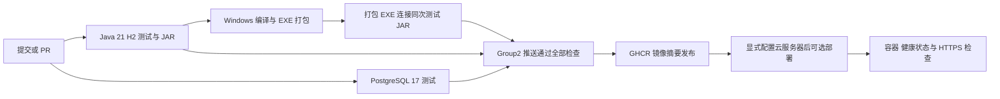

# 系统运行流水线

当前基线为 Group2 的 v0.5.1，服务端使用 Java 21、PostgreSQL 17 和 Docker Compose，客户端为 .NET 9 WPF。当前交付采用本地运行，GitHub Release 提供包含 Java 运行时的一键启动包。用户已于2026年11月27日确认暂未配置自己的云服务器。

## 下载后的本地运行

下载 Release 的 `AcademicPlatform-local-windows-x64.zip`，完整解压后双击 `Start.cmd`。它使用包内 Java 运行时启动 API，再打开自带 .NET 运行时的桌面客户端。无需安装开发工具、Java 或 Docker。默认端口为18082/18083，数据保存在包内 `backend/data`。退出桌面后双击 `Stop.cmd` 停止后端。

## 源码开发

在仓库根目录执行以下命令。

```powershell
# 编译前后端并执行后端功能测试
.\scripts\build.ps1

# 启动本机 H2 演示 API 和桌面窗口
.\scripts\start-local.ps1 -NoBuild

# 生成自带运行时的 Windows x64 EXE
.\scripts\publish-desktop.ps1 -IsolateNuGetSettings

# 对本机演示环境执行 public/login/workspace/crawl 四组桌面验收
.\scripts\verify-desktop-workspace.ps1

# 停止启动脚本登记的本机 API
.\scripts\stop-local.ps1
```

Java 按 `-JavaHome` 显式参数、`JAVA_HOME`、PATH 和原有 `D:/tool/java21` 兼容目录寻找，验证主版本为 21。构建统一使用仓库 Gradle Wrapper，可通过 `-Gradle` 指定已有发行版。桌面构建按 PATH、`DOTNET_ROOT`、项目 `.dotnet-home/sdk-*/dotnet.exe` 寻找含 .NET 9 SDK 的工具。仅安装运行时会给出缺少 SDK 的错误。

`.NET` 发布沿用现有 NuGet 隔离与离线参数，见 [发布脚本](../scripts/publish-desktop.ps1)。首次 Wrapper、Maven 和 NuGet 还原需要可用网络，后续复用缓存。`start-local.ps1 -NoBuild -NoDesktop` 仅要求后端 JAR，可用于后端及 CI 场景。

已有程序占用默认端口时，可用 `./scripts/start-local.ps1 -NoBuild -ApiUrl http://127.0.0.1:18082 -ManagementPort 18083` 启动另一组本机端口。脚本会提前报告端口占用。本机四组写入型桌面验收仍使用默认8080演示地址，自定义端口可通过 EXE 的只读 `--connection-check` 检查连接。

本机默认演示账号为 `admin`、`researcher`、`reader`，密码 `DemoPass2026!`。桌面验收会创建明确标记的合成账号和审核记录，目标限定为本机演示 API。正式服务器使用独立数据库与管理员凭据。

## GitHub 流程

[工作流](../.github/workflows/ci.yml)在向 Group2 推送、向 Group2/main 提交 PR 或手动触发时运行检查。



| 作业 | 检查及产物 |
| --- | --- |
| backend-h2 | H2 功能测试、部署失败/回滚模拟、JAR 与 SHA-256、JUnit/HTML 报告 |
| backend-postgres | 同一测试集在独立 PostgreSQL 17 数据库运行、JUnit/HTML 报告 |
| windows-desktop | Release 编译、自带运行时 EXE 及校验值、下载同次 H2 作业 JAR 启动 API、执行 EXE `--connection-check` |
| publish | 三个检查作业均成功后，用同次 JAR 构建镜像，按提交 SHA 推送 GHCR，取得不可变摘要 |
| deploy | 根据摘要和提交号部署，升级前备份，核对容器/readiness/后端/API TLS；失败恢复上一应用镜像 |

PR 和手动运行执行检查，Group2 推送额外执行镜像发布。服务器部署仅在仓库变量 `ENABLE_SERVER_DEPLOYMENT=true` 且已配置用户自己的服务器时执行，当前该变量为 false。部署按服务器已有受限 SSH 网关进行，凭据由 GitHub Secrets 提供。生产配置和回滚边界见 [部署说明](deployment.md)。

Windows 集成探测使用最终 EXE 的实际 `ApiClient`，通过公开接口读取本机 API，失败会阻断镜像发布。JSON 结果和 API 日志保存在 `desktop-api-integration` artifact。交互式完整桌面验收通过本机脚本执行。

## 查看结果和下载

在 GitHub 仓库的 Actions 中打开对应运行，查看作业和 Artifacts。`api-jar-<SHA>` 与 `windows-x64-<SHA>` 分别包含后端和桌面产物，保留 14 天。日常使用下载本地启动 ZIP，解压后运行 Start.cmd。独立 EXE 用于已经启动了 API 的环境。

运行链接、提交 SHA、产物校验值和测试报告应一起保留到验收记录。部署记录以镜像摘要与提交标签关联同次 CI 的 JAR。工作流通过表示其实际检查通过，最终业务范围继续按 [验收映射](acceptance.md)逐项验证。

## 2026 年 11 月 25 日历史验证

2026 年 11 月 25 日同步远端 Group2 `9b77cb7` 后，H2 后端功能测试 83 项全部通过，重新发布 Windows x64 EXE。Java 17 拒绝、Java 21 自动发现、系统仅有 .NET 运行时而回退到项目 SDK 的检查通过。PowerShell 语法和工作流依赖结构检查通过。

正式服务器通过受信任 CA 的只读 HTTPS 探测，`/api/reference` 和公开目录为 200，匿名管理员接口为 401，公网管理端点为 404。当前正式真实目录数量为 0，功能数据建设按后续迭代实施。

已有完整五作业发布部署证据为 [Group2 运行 44227567298](https://github.com/caw111/SoftwareAnalyse/actions/runs/44227567298)，日期为 2026 年 11 月 18 日。本轮新增 Windows EXE/API 集成检查的运行结果在 PR 检查及后续验收记录中补充。性能、真实故障回滚和数据库恢复演练各按独立计划验收。

## 2026 年 11 月 27 日无服务器交付

PR #2 已合入 Group2。首次合并运行的测试、EXE集成和镜像发布通过，远程部署在拉取GHCR镜像层时重试并超时。根据用户确认暂未配置云服务器，已停止远程重试并关闭自动服务器部署；原服务器记录仅作为历史证据。

新增 `scripts/package-local.ps1` 使用 jlink 创建 Java 运行时，将同次测试JAR、最终EXE、运行时和启动/停止脚本打成ZIP。Windows CI会解压实际ZIP、使用包内Java启动API，再用包内EXE读取公开接口，结果保存在 `local-package-connection.json`。测试通过后的制品上传GitHub Release。

[2026年11月27日最终验证](verification/pipeline-2026-11-27.md)记录本地完整包的实际运行结果、制品校验值和[通过的流水线](https://github.com/caw111/SoftwareAnalyse/actions/runs/45956179972)。
