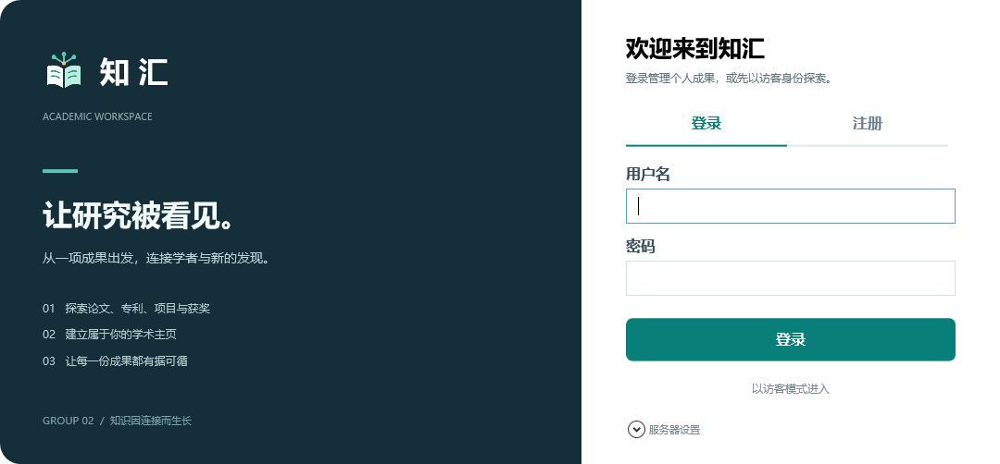
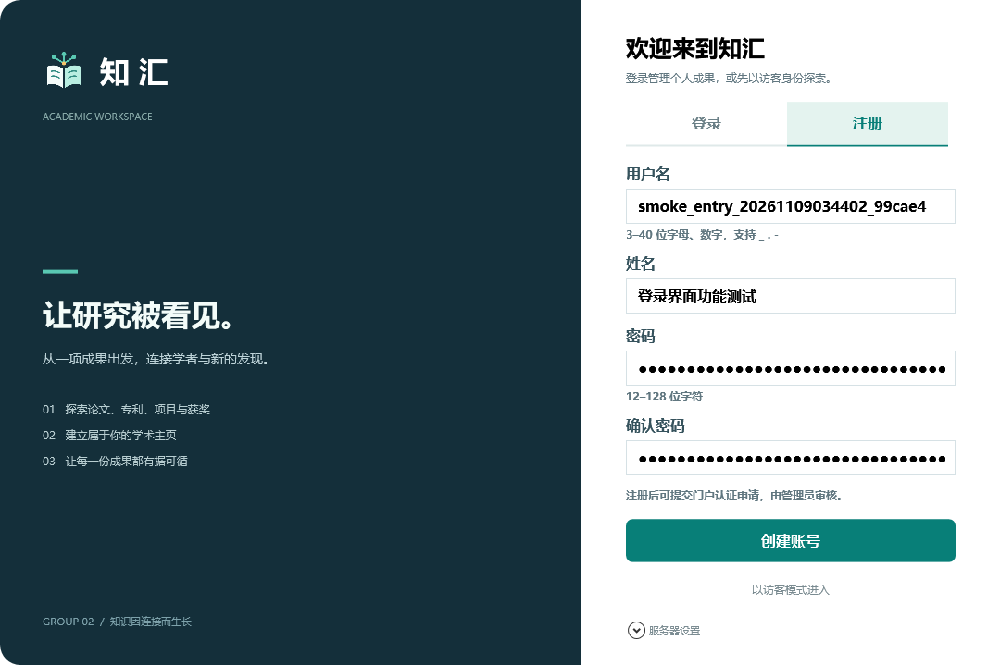
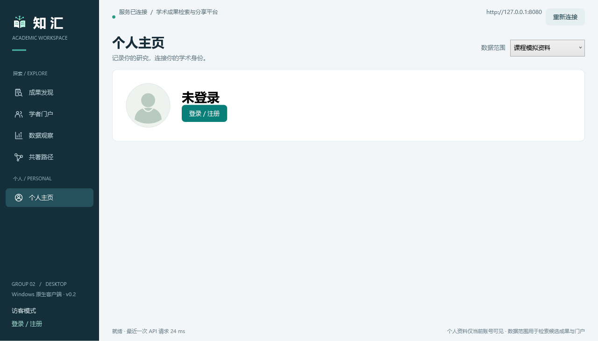
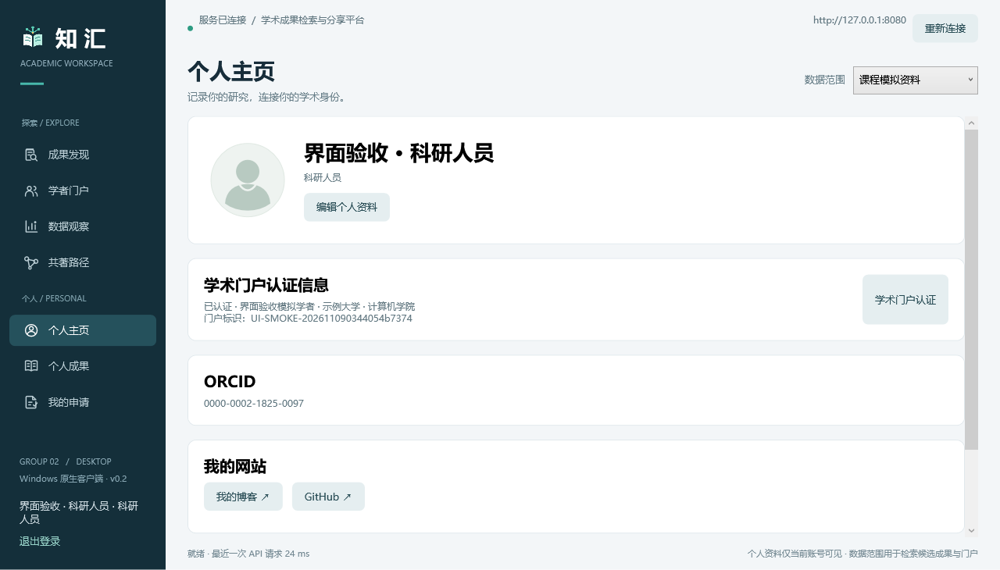
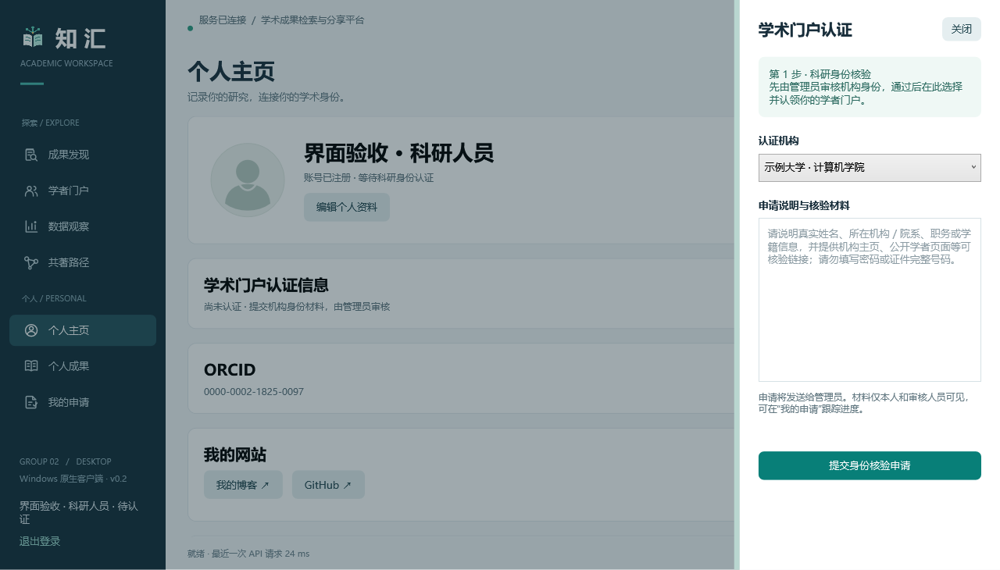
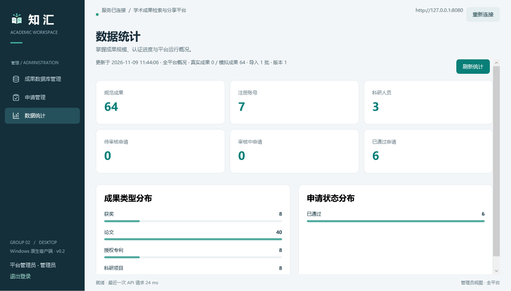

# v0.2.0 验收记录 · 2026-11-09

本轮在 Group2 完成独立登录入口、角色导航、个人资料与认证申请重构。证据为真实构建产物和本机 API 功能验收，不包含压测或 P95 声明。完整计数与成品 SHA-256 见 [results.json](results.json)。

## 已通过

| 验证 | 结果 |
| --- | --- |
| Java 21 / Gradle test + bootJar | H2：27 / 27；PostgreSQL：27 / 27 |
| Flyway | 既有 PostgreSQL V1 升级到 V2，保留原数据 |
| WPF Release / 自带运行时单文件发布 | 成功；0 警告、0 错误 |
| 公共页验收 | 真实目录、学者、统计和共著路径加载通过 |
| 独立入口 | 实际模态窗口点击访客、注册、登录；确认密码拦截；新账号仍为 USER |
| 角色与申请 | 访客 5 项、个人 7 项、管理员 3 项；未授权内部标签跳转被阻断；私有申请归属正确 |
| 资料与认证 | 个人资料持久化；10 个 SVG 实际渲染；右侧面板约 1/4 宽、可调整，Escape 关闭 |
| 申请闭环 | 临时账号的身份核验 → 门户认领 → 成果申领，管理员依次审核后进入个人成果 |
| 原生窗口 | 192 DPI 下默认最大化；实际鼠标拖动、最小化、还原/最大化和关闭均通过；图标存在 |

本次补修了三处真实问题：登录 Tab 早于提示控件初始化引起的空引用；隐藏 Tab 仍可能由内置键盘导航进入；草稿提交时新材料被旧接口忽略。后端对草稿编辑、空白回滚、旧版本冲突及 null 材料兼容新增回归测试。

验收使用本地 H2 API 8080；PostgreSQL 功能测试使用 Docker 里的 academic_test，未执行服务器部署。验收创建的唯一合成账号、模拟学者和申请保留供审计，测试会话结束后注销，不更改原有用户资料。

## 复现

先运行最新后端，再发布桌面程序。在仓库根目录运行：

```powershell
.\scripts\publish-desktop.ps1
.\scripts\verify-desktop-workspace.ps1 -CheckWindowControls
```

脚本仅允许本机 API，按顺序运行公共页、入口和工作区功能测试；最后可用真实鼠标测试标题栏。截图和 JSON 写入 artifacts/verification-v0.2。完整功能验收会新建明确标记的合成账号/学者和三条审核申请，默认不在应用启动时运行。

## 界面证据













认证机构外部登录仍为 TODO，当前明确走管理员人工审核。公开目录的纠错、软删除和来源质量治理仍沿用后续范围；本轮没有把它们标为完成。
