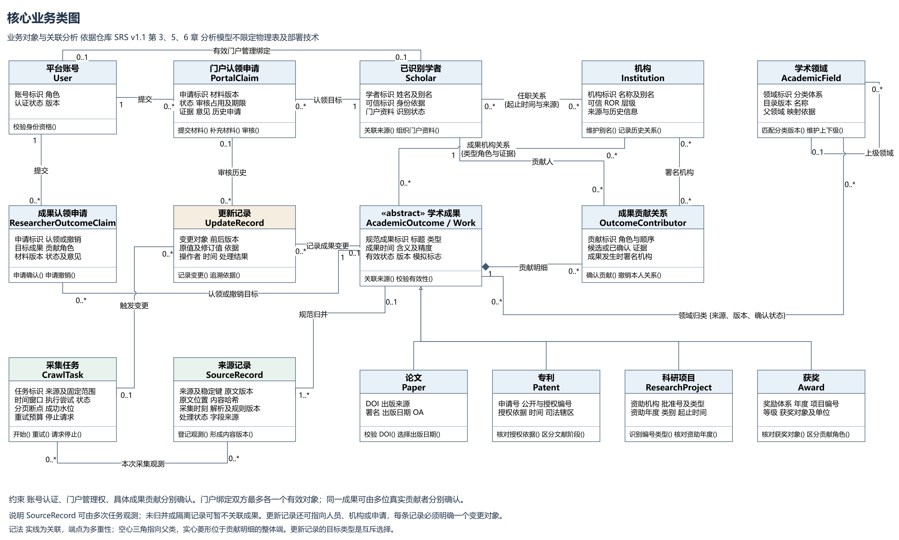
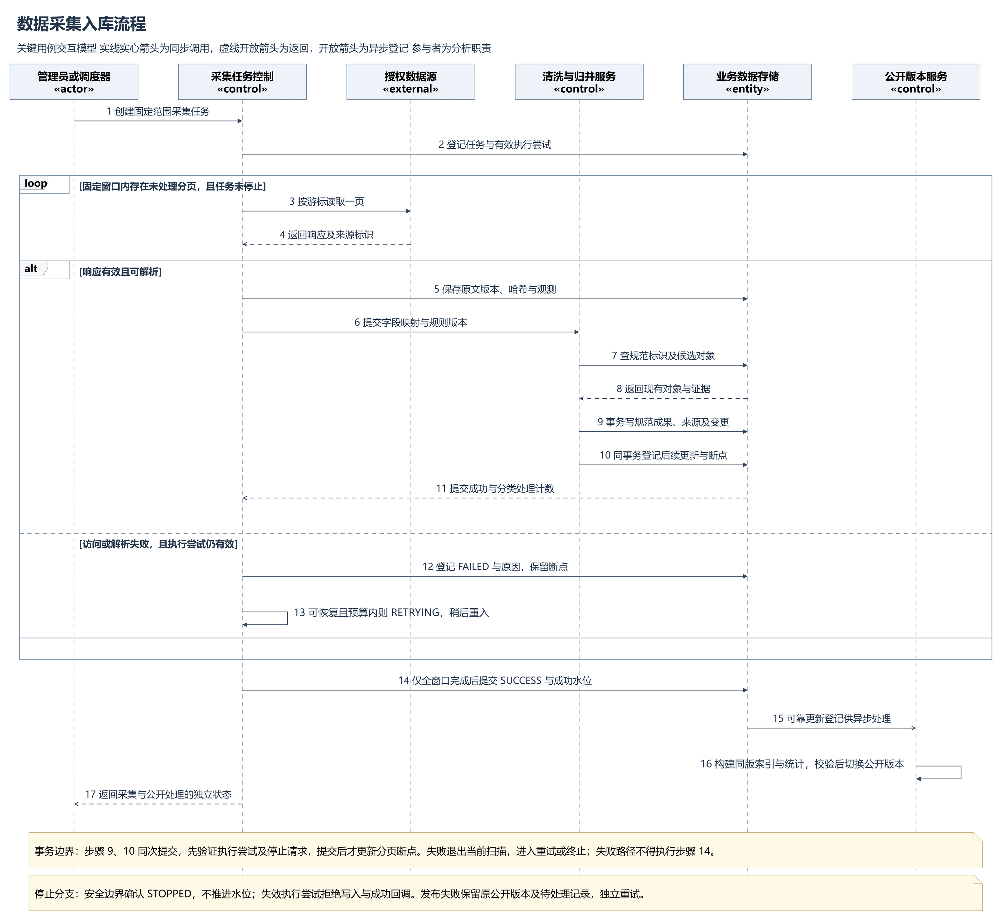
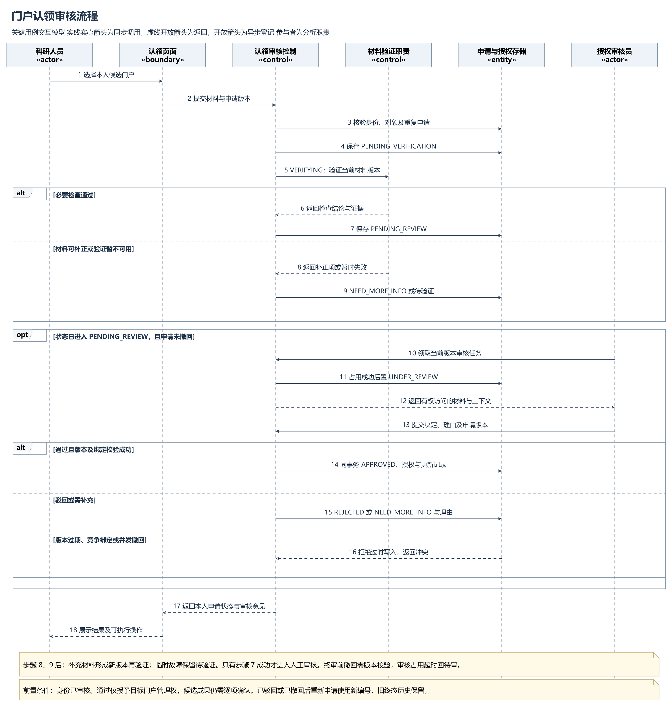
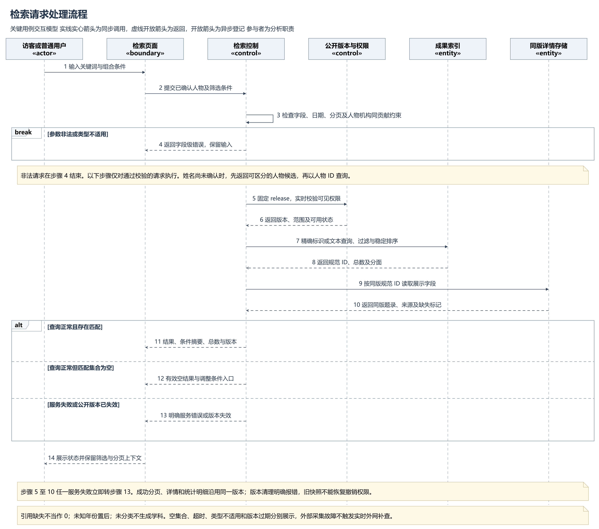

# 学术成果分享平台需求分析报告

版本 v1.0　日期 2026 年 10 月 26 日　小组 9 组　团队 1011101011

本报告承接需求调研与需求建模，说明系统需要管理哪些业务对象、对象之间如何约束，以及采集入库、门户认领审核和检索处理如何协作。分析结果供需求分析评审和后续架构、数据库、接口与测试设计使用。

本阶段形成 15 个核心业务类、一张核心业务类图和三张关键用例时序图。模型统一表达四类成果，分开处理账号身份、学者记录、门户管理权与成果贡献，保留来源和更新依据。采集完成、公开可检索与统计更新分别确认，避免把局部成功解释为整体业务完成。

本报告为需求分析交付稿。模型和场景规定预期行为，系统实现、性能达标和团队评审结论由相应阶段另行记录。

## 1 编制依据与基线选择

### 1.1 依据与阅读顺序

| 编号 | 依据 | 本报告使用内容 |
| --- | --- | --- |
| B1 | [仓库 SRS v1.1](../../需求调研和建模/docs/系统需求规格说明书_SRS.md) | 角色权限、FR 与 UC 编号、业务状态、数据规则和 AC 验收场景 |
| B2 | [仓库 SPEC v1.1](../../需求调研和建模/docs/核心模块开发规范_SPEC.md) | 采集、清洗、归并、检索、认领与统计的处理契约 |
| B3 | [仓库需求调研报告 v1.1](../../需求调研和建模/docs/需求调研报告.md) | 角色任务、业务问题、来源条件与证据限制 |
| B4 | [课程实践任务书](../../需求调研和建模/docs/参考材料/课程实践任务书.pdf) | 印刷页 4 的需求分析要求及印刷页 8 的阶段交付要求 |
| B5 | 目录外第一轮交付 SRS v2.0、SPEC v2.0 及根目录需求文档 | 补充核对角色分工、交付结构和已有边界；规则冲突时遵循 B1、B2 |

Group2 整理前基线为提交 62fb8e6，材料整理提交为 5277300，四张分析模型提交为 432b9d8。保留材料的原路径和原始校验值见需求调研和建模目录的来源清单。三份仓库正文自标日期均为 2026 年 10 月 10 日，整理时间不表示重新完成需求评审。

### 1.2 差异处理

| 差异 | 本报告采用的规则 |
| --- | --- |
| 目录外 SRS v2.0 将门户申请简化为六状态，仓库 SRS 保留验证与审核过程状态 | 按仓库 SRS 6.8 使用九状态，图、正文与场景保持一致 |
| 目录外稿成功状态为 SUCCEEDED，重试耗尽转 STOPPED | 采用仓库 SUCCESS；重试耗尽保持 FAILED，管理员明确放弃后才 STOPPED |
| 旧图将门户通过与授予科研人员角色合并 | 科研人员身份审核是前置业务，门户通过仅建立指定门户管理权 |
| 原材料没有独立 UpdateRecord 业务类 | 将 AuditLog、字段修订及任务变更证据抽象为更新记录，具体表结构后续确定 |

本报告不改变既有 FR、UC、AC 编号。新增的分析用例采用 AN-UC 编号，评审和后续验收设计场景采用 AN-AT 编号，通过追踪表与原基线关联。

## 2 业务范围与参与者

### 2.1 分析范围

平台面向普通用户、科研人员和管理员，管理学者、机构、学术领域以及论文、授权专利、科研项目和获奖信息。核心业务从公开资料接入开始，经过清洗、规范化、归并和身份识别，形成可检索的成果目录与学者门户，再通过认领审核和治理持续修正资料。[B1 第 1～4 章]

一期基础范围包括四类成果收录与基础管理、公开检索与详情、学者门户、身份及认领审核、来源追踪、数据更新、机构分类排名、领域热点和基础共著网络。最短共著路径与证据查看为仓库基线中的拟定 P0 创新，仍需团队评审确认。相关论文推荐、私人专题库、笔记和导出属于 P1；订阅通知、行为个性化与潜在合作者推荐属于后续扩展。[B1 4.16～4.17；B3 11.4]

交易、支付结算、未授权全文托管、付费墙绕过和正式综合科研评价不属于一期范围。本次三个交互模型聚焦任务书指定关键用例，其余功能沿用 SRS 的需求和用例定义。

### 2.2 角色与权限边界

| 参与者 | 核心任务 | 权限及限制 |
| --- | --- | --- |
| 访客或普通用户 | 查询成果、学者、机构与公开统计，访问来源入口 | 公开信息可匿名访问；私人材料和后台操作需额外授权 |
| 科研人员 | 申请本人门户、确认成果贡献、提交补录纠错、维护个人说明 | 身份审核与指定门户管理权分别校验；不能直接改写公共题录 |
| 已认领门户科研人员 | 管理本人有效关联、查看本人申请与管理统计 | 是角色与对象授权共同决定的业务身份，不新增账号角色 |
| 管理员或授权审核员 | 配置采集、审核申请、处理来源冲突与质量问题 | 后台按职责授权；不因管理员角色取得他人私人阅读笔记权限 |
| 外部数据源 | 提供允许接入的题录、清单和更新信息 | 是系统边界外参与方；来源条款、字段和可用性逐项登记 |
| 调度器 | 按配置启动和重试采集任务 | 代表系统内部触发机制，不具备任意人工审核权 |

人员姓名、机构邮箱和手填 ORCID 都不能单独证明门户控制权。一次门户批准也不能自动确认其全部候选成果。个人关联撤销只影响本人关系，公共成果及其他贡献者的有效关联继续保留。[B1 6.2、6.5～6.8]

## 3 核心业务对象及职责

### 3.1 身份与分类对象

| 业务类 | 主要属性 | 业务方法与职责 |
| --- | --- | --- |
| 平台账号 User | 账号标识、角色、认证状态、版本 | 校验身份资格，参与对象级授权判断 |
| 已识别学者 Scholar | 学者标识、姓名及别名、可信外部标识、来源、识别状态、门户资料 | 关联来源，组织门户资料，保持同名实体可区分 |
| 机构 Institution | 机构标识、名称及别名、可信 ROR、层级、历史信息 | 维护名称映射，记录历史关系，不把同域名当作同一机构 |
| 学术领域 AcademicField | 领域标识、分类体系及目录版本、名称、父领域、映射依据 | 匹配分类版本，维护分类层次，保留未分类 |

“已识别学者”指平台用独立实体标识组织的人物，不等同于已认证账号。证据不足时保留来源人物或候选识别状态，不仅凭同名进行合并。门户资料在本分析模型中归于 Scholar；后续逻辑设计可将门户展示与人员实体拆表，但须保留权限区别。

### 3.2 成果与贡献对象

| 业务类 | 主要属性 | 业务方法与职责 |
| --- | --- | --- |
| 抽象学术成果 AcademicOutcome 或 Work | 规范成果标识、类型、标题、成果时间及其含义与精度、有效状态、版本、模拟标志 | 关联来源，校验有效性，承接共同展示与治理 |
| 论文 Paper | DOI、出版来源、署名、出版日期、OA 和引用观察 | 校验 DOI，选择有依据的出版日期，区分引用缺失与零 |
| 专利 Patent | 申请号、公开号、授权公告号、司法辖区、授权依据及日期 | 核对授权依据，区分申请、公开和授权阶段 |
| 科研项目 ResearchProject | 资助机构、批准号及编号类型、资助年度、类别、起止时间 | 识别编号类型，核对资助年度，保留计划与实际状态差异 |
| 获奖 Award | 奖励体系、年度、等级、项目编号、获奖对象及单位 | 核对获奖对象，区分完成人、完成单位和提名者 |
| 成果贡献关系 OutcomeContributor | 贡献标识、贡献人、所属成果、角色、顺序、确认状态、署名机构及证据 | 确认贡献，处理本人关系撤销，支持多位真实贡献者 |

四个具体成果类继承统一成果父类，类型专属字段不互相覆盖。成果贡献以关系对象表达，避免将作者、发明人、项目负责人和获奖完成人混为一个无语义姓名数组。单位奖未列个人时，只保留单位贡献及成果机构关系。[B1 3.1、5.5]

### 3.3 申请与数据生命周期对象

| 业务类 | 主要属性 | 业务方法与职责 |
| --- | --- | --- |
| 门户认领申请 PortalClaim | 申请人、目标学者、材料及版本、九状态、审核占用与期限、理由、历史申请关联 | 提交材料、补充材料、撤回和审核；批准时原子建立管理权 |
| 成果认领申请 ResearcherOutcomeClaim | 申请人、目标成果、认领或撤销类型、贡献角色、证据、版本、状态及意见 | 申请贡献确认或撤销，限制重复在审申请，保留终审历史 |
| 采集任务 CrawlTask | 来源、固定范围、时间窗口、配置版本、执行尝试、状态、分页断点、成功水位、重试预算与停止请求 | 开始、重试、请求停止，形成可恢复的有界采集实例 |
| 来源记录 SourceRecord | 来源稳定键、原文位置及版本、哈希、采集时刻、解析与规则版本、处理状态、字段来源 | 登记观测，形成内容版本，关联规范成果或进入隔离与复核 |
| 更新记录 UpdateRecord | 变更对象类型及标识、前后版本、原值与修订值、依据、操作者、时间、结果及关联任务 | 记录变更，追溯依据，支持审核、纠错、归并及更新恢复 |

图中方法表示领域职责，不是已实现的代码接口。UpdateRecord 的目标类型互斥，每条记录指向一个确定对象；批量治理应产生可追踪的多条记录。原始来源快照不可直接被修订记录改写。[B1 5.6、6.12；B2 SPEC-QUALITY-01]

## 4 核心业务类模型与不变式

### 4.1 关系与多重性

完整核心业务类图见附录 A；[可编辑源文件](../image/01_核心业务类图.drawio)与[SVG 预览](../image/01_核心业务类图.svg)在 image 目录中。

| 关系 | 多重性与约束 |
| --- | --- |
| User 提交 PortalClaim | 每份申请只有一个申请人，一个账号可保留多份历史申请；同人同门户最多一条在审申请 |
| PortalClaim 指向 Scholar | 每份申请指向一个学者门户，一个门户可保留多次申请历史 |
| User 管理 Scholar 门户 | 有效绑定两端均为 0..1；历史解绑记录不作为当前授权 |
| Scholar 任职 Institution | 多对多，保存起止时间和证据；与成果发生时机构关系分别解释 |
| AcademicOutcome 组成 OutcomeContributor | 一项成果有 0..* 条贡献明细，每条明细属于一项成果，实心菱形位于成果端 |
| Scholar 关联 OutcomeContributor | 一位学者可有多条贡献关系，每条已识别人员贡献对应一位学者；单位贡献另由成果机构关系表达 |
| AcademicOutcome 关联 Institution 和 AcademicField | 均为多对多；机构带类型角色及证据，领域带目录版本、来源及确认状态 |
| SourceRecord 归并 AcademicOutcome | 一条来源版本最多归并到一项规范成果；一项公开规范成果至少有一条来源，隔离记录可暂不归并 |
| CrawlTask 观测 SourceRecord | 多对多；同一原文版本可以在多个任务中再次出现，只新增观测而不新增重复成果 |
| ResearcherOutcomeClaim 指向成果 | 每份申请只有一个目标成果；多位真实贡献者可分别提出申请 |
| UpdateRecord 关联任务及变更对象 | 可来自一项采集任务，也可来自人工操作；变更对象必须明确且目标类型互斥 |

贡献明细的组合表达其归属于一项规范成果的业务生命周期。软删除保留审核与来源历史，合并时受控转移关系并记录旧 ID 去向；组合不直接规定数据库级联物理删除。来源记录跨任务复用，因此不组合于某个采集任务。

### 4.2 关键不变式

BR-01：账号身份、门户管理权、成果贡献是三层判断，任一层通过不能代替另一层。BR-02：同人同成果最多一条有效确认关系，同一成果可以有多位真实贡献者。BR-03：规范成果 ID 稳定，DOI 和其他外部编号分别保存。BR-04：原文、规范值、人工修订与证据可相互追溯。BR-05：历史署名机构不被当前任职覆盖。BR-06：失败不推进成功水位，已提交批次不因重试重复入库。BR-07：公开检索、详情和统计固定同一数据版本，权限实时校验。

## 5 数据语义与质量处理

### 5.1 统一展示契约

统一成果展示至少表达标题、贡献对象及角色、成果时间、来源及缺失说明。时间同时保存 date、date_kind 与 date_precision；来源发布日期和采集时刻独立保存。仅有年份时展示年份，缺失保持未知，不补造 1 月 1 日。来源作者、机构主体与平台账号分别记录。[B1 5.5、6.10]

| 类型 | 贡献角色 | 默认业务时间 | 标识与质量边界 |
| --- | --- | --- | --- |
| 论文 | 作者及署名顺序 | 有依据的出版日期 | DOI 规范化；文献体裁校验，编委会等不直接视为研究论文 |
| 授权专利 | 发明人；申请人或权利人另列 | 授权日期或授权年 | 公开文献、申请实体与家族分层；缺授权年仍保留未知，不以公告发布日期替代 |
| 科研项目 | 负责人；依托单位另列 | 默认资助年度 | 资助机构与批准号联合识别；科学部编号、来源行号不能冒充批准号 |
| 获奖 | 完成人或获奖单位 | 奖励年度 | 奖励体系、年度与项目编号；单位奖不得生成未公开的个人名单 |

### 5.2 清洗 归并与消歧

清洗按解析、HTML 安全处理、Unicode 与空白规范化、字段校验、比较键和受控词表映射执行，保留原值。DOI 去明确前缀并规范大小写，编号保留文本和前导零。成果依强标识优先匹配；弱题名、同名人物和近似机构只能形成候选复核，不使用未评审的模糊阈值自动合并。[B2 SPEC-DATA-01/02/03]

采集范围与平台学科分类分开保存。按期刊或关键词获得候选记录，不直接证明逐篇属于该学科；分类缺失进入未分类。引用缺失为未知，不填成零，不将多个来源的引用数相加。人工确认并锁定的展示字段遇到来源冲突时进入复核，新抓取不得静默覆盖。

### 5.3 既有实验对分析模型的影响

调研报告记录了 Crossref 两轮各 10 条论文实验，以及专利、项目和获奖 40 条证据记录、其中 30 条展示样本的检查。它们支持模型保留分类依据、人员角色、时间含义和原始来源；不能证明当前已批量接入。当前可见材料未附对应脚本、原始响应和样本原件，后续应补齐或重新验证，不将这些记录写成本次新实验。[B3 8.4～8.5]

## 6 数据采集入库用例分析

### 6.1 用例契约

AN-UC-01 数据采集入库。主参与者为管理员或调度器，协作方为授权数据源。前置条件是来源登记及访问条件已确认，字段映射、规则版本和采集范围已配置。触发事件为手动采集、定时更新或经审核的定向补采。输入包括来源、成果类型、固定时间窗口、游标和配置版本。

成功后置条件是窗口内响应均有可查询处理结果，规范数据及来源已可靠保存，后续索引统计更新已登记，CrawlTask 才进入 SUCCESS 并推进成功水位。检索可见和统计完成另记状态。最小保证是保留已提交批次、有效断点与错误原因，失败时不推进整窗成功水位。[B1 6.9；B2 SPEC-INGEST-01]

### 6.2 主交互

完整时序图见附录 B，消息编号对应[采集时序图](../image/02_数据采集入库时序图.svg)。

| 消息 | 交互职责与处理结果 |
| --- | --- |
| 1～2 | 登记固定范围任务，取得有效执行尝试，从 PENDING 进入 RUNNING |
| 3～5 | 按游标读取并验证响应，保存原文版本、哈希和观测；相同内容再次出现只增加观测 |
| 6～8 | 清洗和映射类型字段，查找强标识与已有规范对象，返回候选及证据 |
| 9～11 | 同一事务提交规范成果、来源映射、贡献关系、更新记录、后续更新登记及分页断点；失败全部回滚 |
| 14 | 全窗口处理与校验成功后提交 SUCCESS，推进已成功同步水位 |
| 15～17 | 异步构建索引和统计，校验后切换公开版本，分别反馈采集与发布阶段状态 |

### 6.3 替代与异常路径

消息 12～13 表示访问或解析失败后的任务处理。可恢复且预算内进入 RETRYING；超出预算或不可恢复保持 FAILED，不再自动调度。失效执行尝试拒绝写入，旧执行器不能通过回调推进水位。管理员取消尚未执行任务可直接 STOPPED；运行中先记录停止请求，执行器在安全边界确认停止。

HTTP 200 的非数据网页不等于成功获得记录；受限响应不等于无数据；有效空页须完成响应和扫描校验。缺题名等记录进入明确隔离或复核，所有排除项有计数。来源中暂时缺席的记录不自动删除。发布失败保留上一公开版本和待处理任务，补采申请不能提前显示检索完成。

## 7 门户认领审核用例分析

### 7.1 用例契约

AN-UC-02 门户认领审核。主参与者为科研人员，协作方为授权审核员。申请人已登录并通过科研人员身份审核，目标学者门户存在。输入包括目标学者标识、证据、材料版本、申请版本与审核理由；材料默认私有，仅本人和授权审核人员可访问。

成功后置条件是申请 APPROVED、指定门户管理绑定和更新记录在同一事务提交，账号及门户的唯一性仍成立。最小保证是不泄露他人材料，不提前授权，保留版本和审核历史。门户通过不自动建立候选成果的已确认贡献关系。[B1 6.8；B2 SPEC-CLAIM-01]

### 7.2 主交互

完整时序图见附录 C，消息编号对应[门户审核时序图](../image/03_门户认领审核时序图.svg)。

| 消息 | 交互职责与处理结果 |
| --- | --- |
| 1～4 | 选择候选门户，提交材料；检查身份、目标及本人重复申请，保存 PENDING_VERIFICATION |
| 5～7 | 当前材料进入 VERIFYING，必要检查通过后进入 PENDING_REVIEW |
| 10～12 | 审核员领取任务，有效占用成功后进入 UNDER_REVIEW，读取有权访问的材料与上下文 |
| 13～14 | 提交决定和版本，再次校验材料、对象、占用与有效绑定；同事务批准、授权并保存记录 |
| 17～18 | 向本人显示申请状态、审核意见及后续可执行操作 |

### 7.3 替代与异常路径

材料可补正时进入 NEED_MORE_INFO，并列明补充项；补充后材料版本递增并重新验证。外部核验暂不可用时保留待验证或转人工核验，不自动判为冒领。驳回进入 REJECTED 并记录业务理由。终审前本人可撤回，WITHDRAWN 与审批并发时只能有一个合法提交。

同人同门户重复提交返回本人已有在审申请。他人竞争认领进入人工争议处理，不返回其私有申请。审核版本过期、占用失效或绑定冲突时拒绝过时写入，保留已有合法状态，不覆盖其他账号的管理权。审核占用超时回 PENDING_REVIEW；驳回或撤回后再申请创建新编号。已批准后的解绑为独立治理业务。

## 8 检索请求处理用例分析

### 8.1 用例契约

AN-UC-03 检索请求处理。主参与者为访客或普通用户，科研人员同样可使用。前置条件是平台存在可用公开数据版本；来源当前是否可达不影响本地既有数据的查询。输入包括关键词、成果类型、已确认人物、机构、领域、年份或类型专属日期、排序、分页及数据版本。

成功后置条件是返回同一版本的结果、总数、分面、生效条件与缺失说明，并可继续打开同版详情。最小保证是保留输入，明确区分非法条件、合法空集合、服务异常与版本失效，不泄露私人证据。[B1 FR-SEARCH、6.14；B2 SPEC-SEARCH-01]

### 8.2 主交互

完整时序图见附录 D，消息编号对应[检索时序图](../image/04_检索请求处理时序图.svg)。

| 消息 | 交互职责与处理结果 |
| --- | --- |
| 1～3 | 接收并校验条件、类型、时间和分页；人物未确认时先提供可区分的候选，再以 ID 查询 |
| 5～6 | 固定公开 release，检查版本有效性与实时可见权限 |
| 7～8 | 精确标识定位或文本查询，执行筛选、稳定排序、分页和分面，返回规范 ID |
| 9～10 | 按同版规范 ID 取得题录、贡献、来源与缺失标记，不拼入数据库最新但未公开的值 |
| 11、14 | 返回结果及条件摘要，页面保留查询上下文，详情与后续分页继续使用同一版本 |

### 8.3 条件与异常语义

跨维度条件为 AND，同维度多选通常为 OR，多作者 all 或 any 明示。指定人物与机构时，机构条件属于该人物的同一贡献关系，避免把不同作者的机构交叉匹配。切换成果类型后移除或暂停不适用条件，并显示实际生效条件。全类型时间按类型含义解释。

消息 4 在参数非法或类型不适用时结束本次查询。消息 12 返回有效空结果并提供调整入口。步骤 5～10 任一服务失败立即进入消息 13；版本清理返回明确失效状态，不静默换版。默认按经评审的 BM25 相关度排序，精确标识优先，并列用业务年份和规范 ID 保持稳定；引用和年份缺失置后。权重是待校准参数，不在本报告固定未经验证的评分公式。

## 9 状态与更新一致性

### 9.1 门户认领九状态

| 状态 | 进入条件与处理边界 |
| --- | --- |
| DRAFT | 编辑草稿，缺必填项仍为草稿，不作为驳回 |
| PENDING_VERIFICATION | 已提交材料版本，等待必要检查 |
| VERIFYING | 检查当前版本、对象权限及重复，外部标识只作支持证据 |
| PENDING_REVIEW | 验证通过等待管理员，或审核占用超时释放 |
| UNDER_REVIEW | 管理员取得当前版本的有效审核占用 |
| NEED_MORE_INFO | 明确列出补充项；重提后回待验证且版本递增 |
| APPROVED | 批准、有效管理绑定和记录同事务提交成功 |
| REJECTED | 业务终审驳回，理由及原材料版本保留 |
| WITHDRAWN | 本人在终审前合法撤回，不产生新管理权 |

完整迁移按 B1 6.8。最后三项为本次申请终态；审批通过后的解绑不回退原申请。页面可以把验证和审核的等待状态概括显示，但接口和更新记录保留明确业务状态。

### 9.2 采集任务六状态

| 状态 | 迁移与约束 |
| --- | --- |
| PENDING | 待调度；取消可到 STOPPED |
| RUNNING | 有效执行尝试正在处理；异常到 FAILED，全窗口可靠提交后到 SUCCESS |
| SUCCESS | 本次采集处理成功；再次采集创建关联旧任务的新任务 |
| FAILED | 保存失败原因和已提交批次；可恢复且预算内到 RETRYING；耗尽保持 FAILED |
| RETRYING | 等待到期后到 RUNNING；未执行前取消可到 STOPPED |
| STOPPED | 管理员放弃或执行器确认停止后的终态；保留历史与已提交数据 |

运行中 stop_requested 是请求标志，收到请求不等于已停止。执行尝试失效后不再接受写入和成功回调。分页断点服务于本次恢复，成功水位服务于下一时间窗口，二者不可互换。[B1 6.9]

### 9.3 三类更新结果

业务变更提交保存规范数据、来源依据、更新记录和可靠的后续更新登记。公开版本服务再构建索引和统计，校验后切换版本指针。CrawlTask 的 SUCCESS、索引就绪、统计版本就绪分别记录；定向补采申请只有在其检索可见条件满足后才完成。上一公开版本在新版本构建失败时继续可用，权限撤销即时重新校验。[B1 6.14；B2 6.3]

## 10 分析职责与协作边界

时序图采用边界、控制和实体职责分工。它规定输入、业务判断及持久化结果，不直接决定微服务数量、部署进程或数据库产品。

| 分析职责 | 接收内容 | 输出及边界 |
| --- | --- | --- |
| 任务入口与采集控制 | 来源、固定窗口、规则版本、停止请求 | 任务标识、进度、断点和失败原因；不执行任意用户地址抓取 |
| 清洗与归并控制 | 原始记录、来源与解析规则 | 规范成果、来源映射、候选复核或隔离结果；不生成缺失事实 |
| 认领边界与审核控制 | 本人材料、版本、审核决定 | 申请状态、补充项、有效授权及记录；状态和授权原子提交 |
| 检索边界与控制 | 已确认实体及有效筛选、排序、分页 | 同版结果和明确错误；不在请求内直接访问外部来源补齐缺失 |
| 公开版本控制 | 已提交的业务变化及更新登记 | 校验后的索引、统计和公开版本；失败保留上一可用版本 |
| 实体存储职责 | 规范数据、材料、来源、更新记录及版本 | 支持事务、对象授权、审计和恢复；私人材料不进入公开索引 |

SPEC 中的 REST 路径与技术产品仍为设计候选，后续接口设计可调整路径，须保持对象、版本、错误和授权契约。长期任务返回任务编号和查询入口；总数未知时返回已处理计数，不生成无依据进度百分比。[B2 第 11～12 章]

## 11 非功能需求与可验证目标

### 11.1 质量目标

| 质量维度 | 继承的目标或约束 | 后续验证方式 |
| --- | --- | --- |
| 性能 | 至少 10,000 条、20 并发；搜索 P95≤2 秒、详情≤1 秒、预聚合统计≤3 秒 | 固定环境与查询集，预热并连续运行 5 分钟，记录 P95、错误率及版本；冷启动单列 |
| 数据规模 | 课程最终入库不少于 1 万条，10 万条扩展另测 | 按有效规范成果计数，真实与模拟分开说明；采集小样本不代替规模验收 |
| 来源与完整性 | 来源可追踪率 100%，适用核心字段完整率≥95% | 明确类型字段与分母；不删除缺失记录来提高比率 |
| 清洗与精确查询 | 分类型来源抽样 500 条，人工标注正确率目标≥99%；固定查询集≥50 组 | 样本不足注明范围；合法存在标识命中正确率目标 100% |
| 可靠性 | 重复采集幂等、失败可恢复、索引可重建 | 重复页、事务中断、执行器失效、索引失败与恢复场景 |
| 安全与隐私 | 对象与字段授权，证据私有，输入和来源访问受控 | 越权读取、并发审批、上传限制、注入和任意 URL 访问检查 |
| 工程证据 | CodeArts 工程流程、SPEC 追踪、至少 3 个核心模块行覆盖率≥80% | 后续实现阶段提供覆盖率、AI 修正案例、审查记录与演示证据 |

这些数值来自 B1 第 8 章及 B4 的验收要求，均为待验证目标。本次需求分析没有完成系统实现或性能测试，不把模型检查表当作运行测试报告。

### 11.2 统计语义

总体成果按规范身份去重；基础专利按有授权依据的申请实体计数，公开文献数和家族数另列。多机构合作成果可分别计入各机构，但机构数量之和不等于全库独立成果数。多领域标签也不能相加后当作总量。引用分源汇总并显示覆盖率，未知不填零。热点按时间桶内不同成果计频次，附有效分析分母、文本覆盖率和快照时间。[B1 6.4]

## 12 需求 模型与验收追踪

### 12.1 需求到分析模型

| 分析对象或用例 | 原需求与规范 | 对应模型 | 原验收依据 |
| --- | --- | --- | --- |
| 四类成果及贡献 | FR-OUTCOME-001～008；SPEC-DATA | 核心业务类图 | AC-R06/20/22；G1-AT-15～20 |
| 学者与机构识别 | FR-SCHOLAR；SRS 6.2～6.3；SPEC-DATA-03 | Scholar、Institution、贡献及历史关系 | AC-R29；AC-U01/02 |
| AN-UC-01 采集入库 | FR-CRAWL、FR-SYNC、FR-ES；SPEC-INGEST-01 | 采集时序图、任务与来源对象 | AC-R23/26/27/28 |
| AN-UC-02 门户认领审核 | FR-AUTH；FR-PORTAL-007/008/012/013；SPEC-CLAIM-01 | 门户时序图、账号与门户申请 | AC-R02/24/25/29 |
| AN-UC-03 检索处理 | FR-SEARCH、FR-ES；SPEC-SEARCH-01 | 检索时序图、成果与公开版本职责 | AC-U01/02/11；G1-AT-01～14/23/24 |
| 更新记录及传播 | FR-ADMIN-005、FR-OUTCOME-006；SPEC-QUALITY-01 | UpdateRecord、来源、三图的提交与反馈 | AC-R25/27/28；AC-U08/09 |

### 12.2 可执行场景设计

以下为评审及后续实现测试的输入与预期，不表示已经执行。完整状态按第 9 章和 B1 校验，模拟记录必须显式标识。

| 编号 | 场景输入 | 预期结果 |
| --- | --- | --- |
| AN-AT-01 | 同一 DOI 两个来源重复导入，再重复同页 | 一项规范论文，多份来源或观测；不增加成果总量 |
| AN-AT-02 | 题名相似且作者同名，但无可靠强标识 | 形成候选复核，保留独立实体，不自动合并或授权 |
| AN-AT-03 | 专利只有授权年；项目只有科学部编号；单位奖未列个人 | 保留年精度及编号类型；单位奖不生成个人，来源时间分别保存 |
| AN-AT-04 | 第一页已提交，第二页解析失败，再幂等重跑 | 保留第一页和断点，失败不推进成功水位，重跑无重复 |
| AN-AT-05 | 请求停止后旧执行器回报成功，或重试预算耗尽 | 旧写入被拒绝；停止确认后为 STOPPED；重试耗尽保持 FAILED |
| AN-AT-06 | 数据已入库，索引构建失败 | 采集结果保留，公开阶段报错可重试；补采不显示检索已完成 |
| AN-AT-07 | 门户材料不足后补充，同一申请重新提交 | NEED_MORE_INFO 后材料版本递增并重新验证，不提前授权 |
| AN-AT-08 | 核验外部服务超时 | 保留待验证及原因或转人工，不自动 REJECTED |
| AN-AT-09 | 两审核员同时批准，申请人同时撤回 | 最多一个合法版本提交；不重复授权，不覆盖终审历史 |
| AN-AT-10 | 一账号已有本人门户，另一账号竞争认领同一门户 | 保持有效绑定唯一；争议人工复核，不泄露对方材料 |
| AN-AT-11 | 同名 A01、A02；选 A01 并限定其成果发生时机构 | 只返回 A01 的对应贡献关系，不混入 A02 或他人机构 |
| AN-AT-12 | 起年晚于终年；合法空集合；检索超时 | 分别返回非法参数、空结果、服务失败，并保留条件 |
| AN-AT-13 | 查询跨页时新公开版本发布，旧版本随后过期 | 原分页与详情保持旧版；到期明确提示失效，不静默换版 |
| AN-AT-14 | 合著论文同时属于机构 I1、I2；引用未知 | 全库计 1，两机构各计 1；引用显示未知并报告覆盖率 |
| AN-AT-15 | 其他账号请求私有证明或私人笔记 | 依对象权限拒绝，不因公开门户或后台角色扩大可见范围 |

## 13 后续设计输入与待确认事项

### 13.1 交给架构与构件设计的输入

后续架构需支持采集适配、数据处理、检索、门户与认领、认证、统计和后台职责的协作。划分部署服务时说明事务、故障隔离和版本发布边界，不将本报告的每条生命线直接对应为一个独立微服务。

数据库与索引设计应落实规范 ID、来源版本、贡献角色、历史机构、类型化日期、有效管理绑定、在审唯一性、申请和材料版本、任务执行尝试、断点与水位、更新记录及公开版本。索引需要保持“同一贡献人的同一机构”语义，不能靠两个独立数组交叉匹配。事务登记与后续更新的具体实现由 ADR 论证。

接口与 UI 设计应明确对象权限、幂等、版本冲突、有效空结果和服务失败。私人材料与公开题录使用独立可见范围；列表、详情、分面和统计明细显示一致的数据范围。测试设计按第 12 章追踪，不以接口返回成功替代业务完成。

### 13.2 待评审事项

| 事项 | 需要确认的产物 | 处理职责 |
| --- | --- | --- |
| 来源接入与样本原件 | 允许用途、字段映射、连续分页、缺失统计和 E1/E2 原件或重做记录 | 数据采集与调研角色 |
| 平台领域目录 | 分类版本、上下级关系、来源映射及未分类策略 | 需求与数据治理角色 |
| 身份与门户证据 | 可接受材料、人工审核标准、占用期限与争议流程 | 认证与审核角色 |
| 算法与查询参数 | 固定样本、强标识规则、候选阈值及排序对照 | 数据处理与检索角色 |
| 更新发布机制 | 事务登记、版本保留期限、发布与恢复方案 | 后续架构设计角色 |
| 创新与 P1 范围 | 最短路径的团队评审结论、推荐和私人资料是否纳入迭代 | 小组共同评审 |

此表按职责分配工作，不替未提供的团队成员填写姓名、完成时间或签字。CodeArts 的工程和模型交付要求需在相应平台单独完成；draw.io 源文件不等同于 CodeArts 工程。

## 14 交付物 修订与使用说明

### 14.1 本阶段交付

本报告的 Markdown 源稿和 Word 排版稿保存相同核心正文。image 目录提供四份可编辑 draw.io、对应 SVG 和 PNG、模型说明及逐消息索引。Word 附录使用大幅图页便于查阅，编辑及制作汇报优先取 SVG 和源文件，不从 Word 截图放大。

后续 PPT 制作工作流规定素材、逐页主题、讲述边界和检查要求。本阶段准备交付文档与模型，PPT 由后续制作者据工作流生成。

### 14.2 修订记录

| 版本 | 日期 | 变更 |
| --- | --- | --- |
| v1.0 | 2026-10-26 | 依据 Group2 仓库基线完成业务对象识别、类模型、三个关键交互、异常与状态约束、需求和验收追踪；补入根目录任务书作为阶段要求依据 |

### 14.3 AI 使用说明

本阶段使用 AI 辅助整理和精简前期材料、对照需求基线、识别业务对象、编写需求分析正文与追踪场景、生成可编辑 UML 源文件并调用指定 draw.io 导出，以及编写 PPT 制作工作流。小组此前其他协作者的部分 UML 图也使用了 AI 辅助绘制。图文关系和排版已进行工具与可视检查；需求取舍、关键业务判断和最终提交内容仍由项目成员核查确认。

本阶段未开展新的真实访谈、未重新运行 E1/E2 采集实验、未取得系统性能或覆盖率结果，也未替代课程评审。

## 附录 A 核心业务类图

图 A1　15 个核心业务类的属性、方法、继承、组合与关联。可编辑源文件与矢量版见 image 目录。

## 附录 B 数据采集入库时序图

图 B1　AN-UC-01 的 17 条消息。失败和停止分支不执行全窗口成功提交，公开处理结果独立反馈。

## 附录 C 门户认领审核时序图

图 C1　AN-UC-02 的 18 条消息。验证后进入人工审核，批准时原子授权，补充、撤回与竞争按版本处理。

## 附录 D 检索请求处理时序图

图 D1　AN-UC-03 的 14 条消息。区分非法、空集合、失败和版本失效，同版展示与实时权限同时成立。
