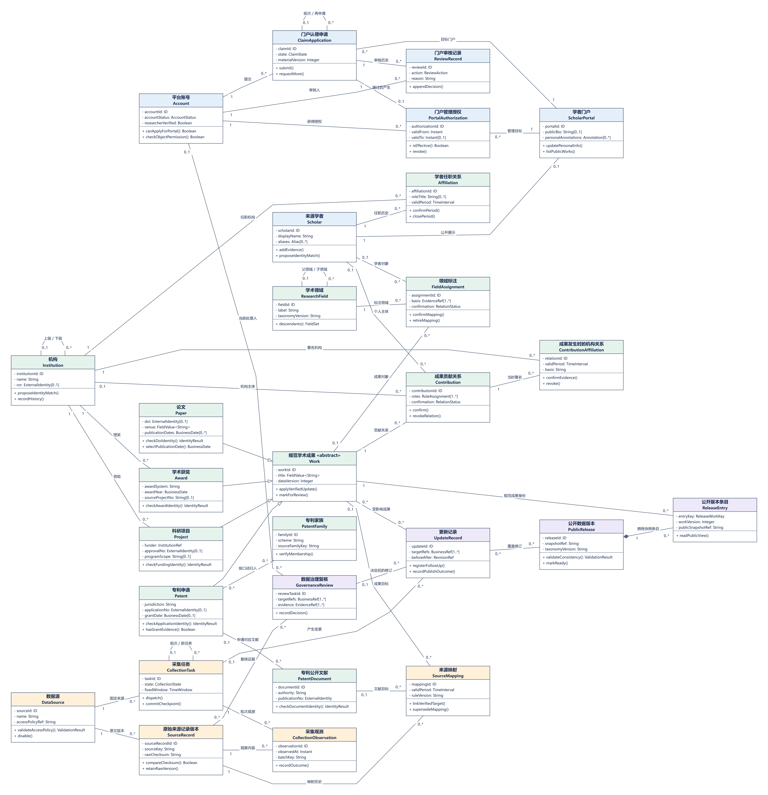
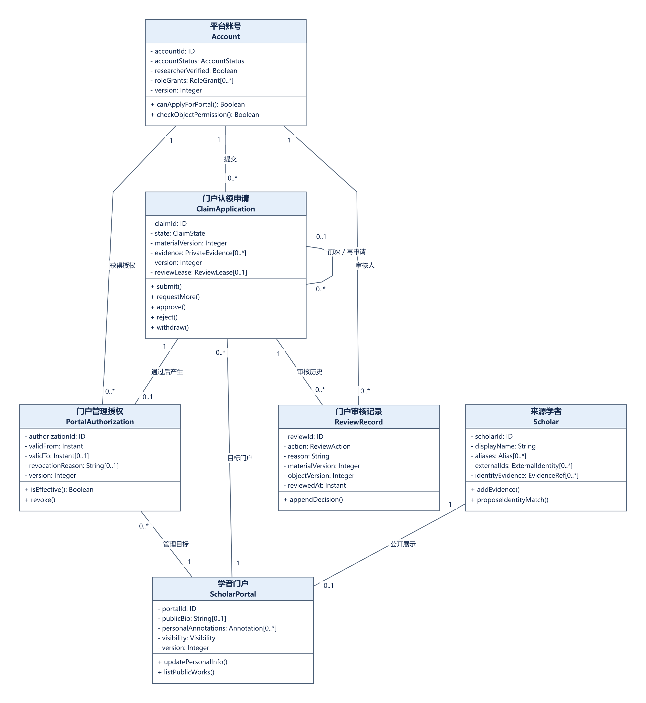
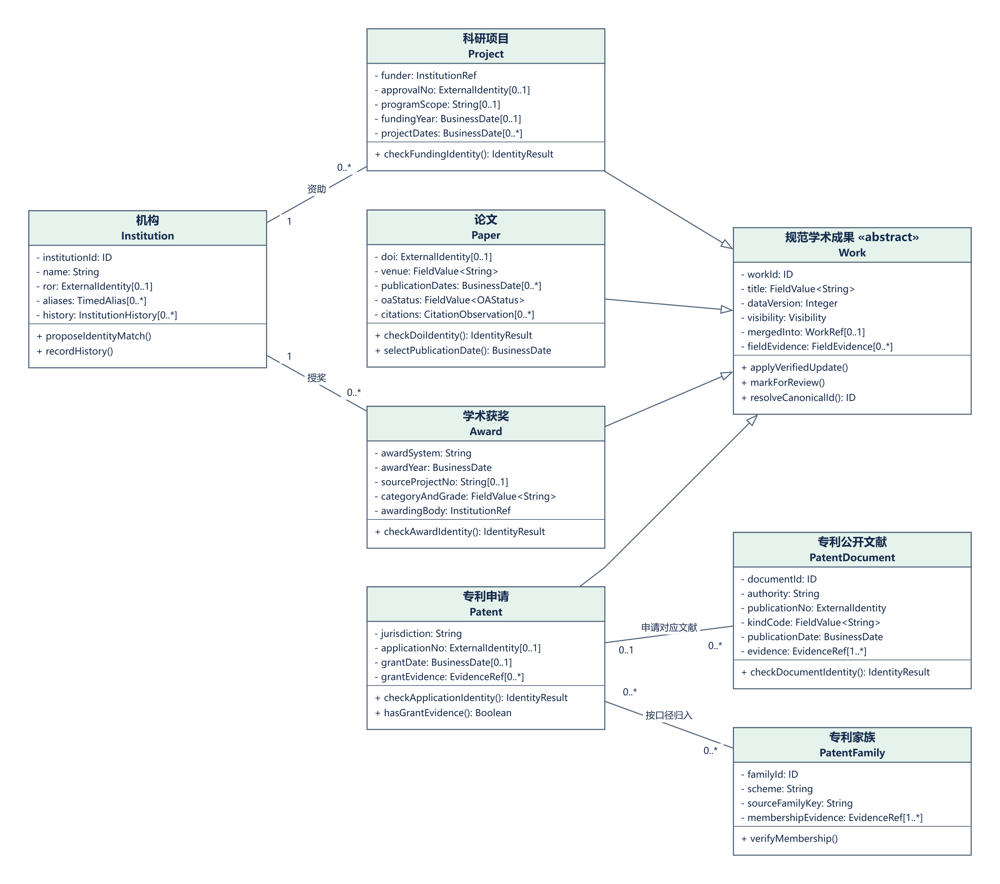
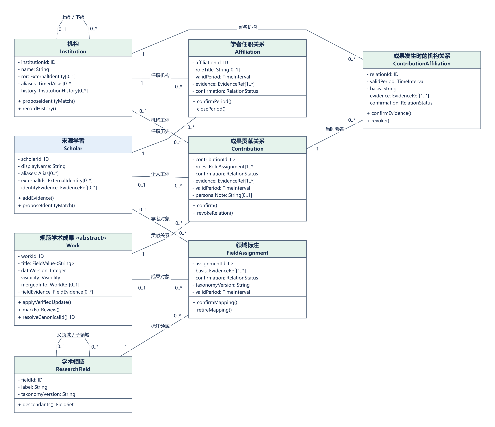
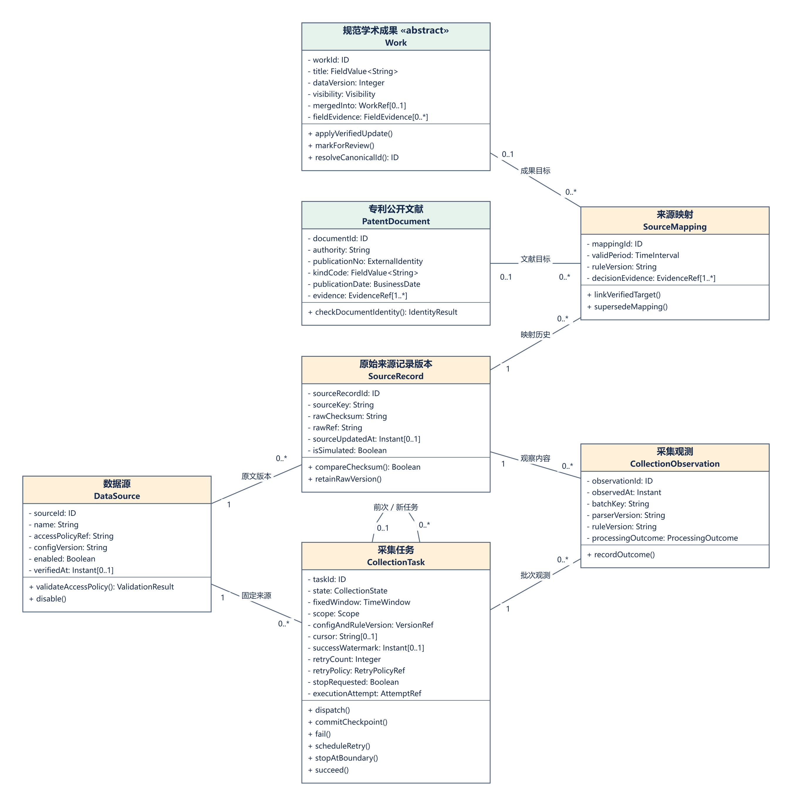
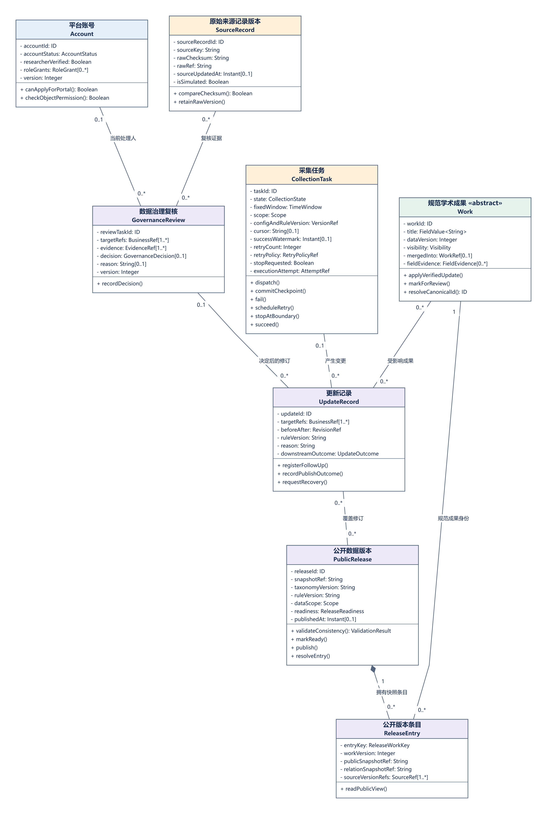

# 学术成果分享平台核心业务类图与领域关系设计

> 第9组 1011101011 / A组 / A2 / 责任人 赵琦 / AI辅助编制 / v1.0 / 2026-10-23 / 待赵琦及另一成员复审
> 对应 SRS §4.1～4.3及相关UC / SPEC §1～9 / 审核状态：AI自检后待成员复审

## 阅读导航

- [1 任务范围与需求基线](#1-任务范围与需求基线)
- [2 核心业务类图](#2-核心业务类图)
- [3 类字典与业务职责](#3-类字典与业务职责)
- [4 关联表与多重性解释](#4-关联表与多重性解释)
- [5 业务不变量与操作契约](#5-业务不变量与操作契约)
- [6 领域设计决策](#6-领域设计决策)
- [7 三类时序图交接与需求追踪](#7-三类时序图交接与需求追踪)
- [8 场景走查与验收依据](#8-场景走查与验收依据)
- [9 AI使用记录、修订与交付状态](#9-ai使用记录、修订与交付状态)

# 1 任务范围与需求基线

本报告完成第三次作业中A组A2赵琦负责的核心业务类图与领域关系设计。报告依据SRS中的数据规则和业务规则，围绕四类成果、学者与门户、来源治理及公开查询建立28个业务类、45项关系、14项业务不变量和10项设计决策。模型分别表达来源事实、平台身份、管理授权和成果贡献，并通过版本及证据连接采集、认领和检索流程。

A1可将本成果整合到组内需求分析报告，A3、A4和A5可据此核对时序图中的生命线与消息名称。报告中的操作表达分析阶段的业务职责，场景用于模型检查与后续测试设计。本版已完成AI辅助编制及文件、模型结构检查，赵琦及另一成员的交叉复审列入后续交付事项。

| 依据 | 文件与位置 | 使用范围 |
| --- | --- | --- |
| S1 | 01-SRS_v2.0-9组-1011101011.docx；§1～2；UC2.1～2.3、UC3.1～3.5、UC4.1～4.4、UC5.1～5.5；§4.1～4.3 | 该文件提供当前业务规则的主要基线。文件名标注为v2.0，正文版本表列出v1.0和v1.1。本报告按照实际可读内容记录版本依据。 |
| S2 | 02-SPEC_v2.0-9组-1011101011.docx；§1～9，尤其§2.2、§4.1、§6.3、§7.2～7.3 | 该文件规定处理边界和候选设计。阈值、重试预算及性能指标作为设计参数或目标保存，其实现效果由后续测试验证。 |
| S3 | 01-需求调研报告_v2.0-9组-1011101011.docx；§2.4、§3、§4 | 该文件提供三类用户、四类来源和P0范围。人物画像按照需求分析情景使用。 |
| S4 | 《软件系统分析与设计》实践任务书（一）学术成果分享平台-v1(1).pdf；PDF第6页 需求分析；第10页 阶段表 | 任务书要求完成对象识别、核心类图和三类交互模型。本成果包承担A2负责的类图及配套说明。 |
| S5 | 《软件系统分析与设计》课程实践作业课堂展示与提交要求（需求分析).pdf；PDF第2～6页、附录A和D | 课程文件列出报告、类图、源文件、AI使用记录及组内独立分析要求。第3页推荐CodeArts，第5～6页及附录规定CodeArts更新和源文件要求。本次按照用户指定格式生成Markdown文档。 |
| S6 | 02-A2-赵琦-核心业务类图与领域关系设计.md；建议识别范围、关系核查、个人交付与交接要求 | 该任务书明确A2的建模边界、关系核查要求、个人交付清单和成员交接要求。本次图源采用draw.io格式。 |
| S7 | 05_核心业务类图.drawio 等；04_认领申请状态图.drawio；03_门户认领活动图.drawio；数据采集任务状态机.drawio；06_检索请求时序图.drawio | 历史图件提供共享基线。本次类图按照SRS与SPEC补充对象及关系，输入范围限定为任务书、既有项目资料和指定历史图件。 |

## 1.1 本次建模边界

核心类图覆盖任务书要求的学者、四类成果、机构、领域、认领申请、采集任务和更新记录，并补充表达授权、时间、来源证据和公开版本所需的关联对象。本次建模范围限定为P0核心需求。私人收藏、笔记、推荐、订阅、支付和交易分别按照其专题需求处理，统计与共著关系由同一版本中的成果和有效关系派生。

UC1.3科研人员身份与机构登记申请、UC3.2贡献申请及UC5.4定向补采申请分别具有独立业务目的。本类图通过身份审核前置条件、有效贡献关系、治理复核和更新登记表达这些用例与核心模型的接口。ClaimApplication专门表示门户认领申请，各类申请的完整生命周期由对应专题模型进一步展开。

## 1.2 历史模型的承接与改进

| 历史表现 | 本次处理 | 依据 |
| --- | --- | --- |
| 历史模型已经包含Work及四个子类。 | 本模型保留泛化关系，将Patent明确为申请实体，并增加文献和家族类。 | DR-02、BR-06 |
| 历史模型将学者信息保存在门户内，并将账号直接绑定到门户。 | 本模型分别建立Scholar与PortalAuthorization，保存历史授权并约束当前有效授权的唯一性。 | DC-01、BR-01 |
| 历史模型使用普通多对多关联表示任职和署名。 | 本模型增加Affiliation与ContributionAffiliation，分别保存相应时间和来源证据。 | DC-01、SPEC §6.1 |
| 历史模型的来源、任务和更新职责需要进一步表达。 | 本模型增加来源版本、采集观测、规范映射、采集任务、治理复核和更新记录。 | 任务书；SPEC §2、§9 |
| 历史主图包含多个P1专题和笔记对象。 | 本次主图采用P0核心分析范围，私人资料按照对应专题需求处理。 | SRS §4、调研§4.2 |
| 历史模型在流程说明中描述公开版本。 | 本模型使用PublicRelease与ReleaseEntry表达同一版本的详情与统计。 | BR-04、SPEC §6.3 |

# 2 核心业务类图

主图包含全部28个类和45项关系，五张局部图与主图使用同一模型数据。主图展示整体关系及关键属性和操作，局部图展开本版的全部属性和操作，完整语义见第3章。图件仅保留类名、属性、操作、关联和多重性。标题、解释及约束说明保存在正文中，C与R编号用于正文追踪。draw.io文件提供可编辑图元，PNG和SVG提供图件预览。

关联端的多重性表示：对于另一端的一个对象，该端允许关联的对象数量。例如，R01在Account端的1表示每份申请对应一个账号，在ClaimApplication端的0..*表示一个账号可以具有多份历史申请。调用顺序由对应的时序图表达。

Work的泛化集合采用完整且互斥的约束，每个具体成果恰好属于Paper、Patent、Project或Award之一。实心菱形表示PublicRelease与ReleaseEntry之间的整体和部分关系。普通关联的生命周期规则由对应对象说明规定。门户管理权限应当结合多重性、有效期和唯一性约束共同判断，三组互斥关联按照INV-02执行。

# 3 类字典与业务职责

类字典中的基线对象表示需求文件直接列出的业务概念，分析细化表示为完整表达已确认业务约束而增加的模型对象。类名、属性名和方法名采用本次分析命名。UML减号表示私有属性，加号表示公开操作，具体实现语言由后续设计选择。各类ID表示业务身份，数据库结构由后续数据设计确定。

| 编号 | 类名 | 定位 |
| --- | --- | --- |
| C01 | Account 平台账号 | 核心；基线对象 |
| C02 | Scholar 来源学者 | 核心；基线对象 |
| C03 | ScholarPortal 学者门户 | 核心；基线对象；每个学者至多具有一个规范门户属于A2设计约定 |
| C04 | PortalAuthorization 门户管理授权 | 核心；基线对象 |
| C05 | ClaimApplication 门户认领申请 | 核心；基线对象 |
| C06 | ReviewRecord 门户审核记录 | 核心；基线审核历史的分析细化 |
| C07 | Work 规范学术成果 | 核心；基线对象 |
| C08 | Paper 论文 | 核心；基线对象 |
| C09 | Patent 专利申请 | 核心；基线对象 |
| C10 | PatentDocument 专利公开文献 | 支撑；专利分层身份的分析细化 |
| C11 | PatentFamily 专利家族 | 支撑；专利分层身份的分析细化 |
| C12 | Project 科研项目 | 核心；基线对象 |
| C13 | Award 学术获奖 | 核心；基线对象 |
| C14 | Contribution 成果贡献关系 | 核心；基线对象 |
| C15 | Institution 机构 | 核心；基线对象 |
| C16 | Affiliation 学者任职关系 | 支撑；时间化关联对象 |
| C17 | ContributionAffiliation 成果发生时的机构关系 | 支撑；带证据的关联对象 |
| C18 | ResearchField 学术领域 | 核心；基线对象；目录树结构为A2选择 |
| C19 | FieldAssignment 领域标注 | 支撑；分类来源与版本的分析细化 |
| C20 | DataSource 数据源 | 核心；基线对象 |
| C21 | SourceRecord 原始来源记录版本 | 核心；基线对象 |
| C22 | CollectionTask 采集任务 | 核心；基线对象 |
| C23 | CollectionObservation 采集观测 | 支撑；SPEC已明确采集观测，采用关联对象表达 |
| C24 | SourceMapping 来源映射 | 支撑；来源映射的分析细化 |
| C25 | UpdateRecord 更新记录 | 核心；基线对象 |
| C26 | GovernanceReview 数据治理复核 | 支撑；基线复核职责的分析细化 |
| C27 | PublicRelease 公开数据版本 | 核心；推荐分析抽象，具体发布机制待架构评审 |
| C28 | ReleaseEntry 公开版本条目 | 支撑；同一版本明细的分析细化 |

## C01 平台账号 Account

平台账号表示系统的登录主体，并保存账号状态、科研人员身份审核结果和角色授权范围。科研人员身份审核通过后，账号才具备申请本人门户的资格。管理员使用具有相应审核权限的平台账号。

属性：`accountId: ID`；`accountStatus: AccountStatus`；`researcherVerified: Boolean`；`roleGrants: RoleGrant[0..*]`；`version: Integer`。

操作：`canApplyForPortal(): Boolean`；`checkObjectPermission(target): Boolean`。

规则与生命周期：账号标识应当保持稳定。系统应当结合角色权限和对象授权判断访问权限。researcherVerified由UC1.3的审核结果生成，用户只提交申请材料。科研人员身份申请与门户认领申请分别维护各自的业务记录。账号停用后，系统继续保留历史申请、授权和审计记录。

需求依据：SRS §1.1、§2、UC1.1～1.3、DR-01、BR-01；SPEC §7.1～7.3。

## C02 来源学者 Scholar

来源学者表示来源资料中具有独立身份的人物。平台允许仅具有来源身份的学者记录存在，账号注册和门户认领分别按照对应流程处理。平台应当分别保存同名人物的身份资料。

属性：`scholarId: ID`；`displayName: String`；`aliases: Alias[0..*]`；`externalIds: ExternalIdentity[0..*]`；`identityEvidence: EvidenceRef[0..*]`。

操作：`addEvidence(evidence)`；`proposeIdentityMatch(candidate)`。

规则与生命周期：系统使用scholarId标识学者。系统应当分别记录ORCID格式校验结果、可信来源断言和账号控制证明。已经确认的ORCID发生冲突时，系统应当阻止自动合并并提交人工复核。候选匹配用于提供身份判断依据，人物合并和门户授权分别通过对应的审核流程生效。

需求依据：SRS DR-01、DR-03、UC2.2、DC-01；SPEC §5.1～5.2。

## C03 学者门户 ScholarPortal

学者门户组织某一学者的公开资料及各类学术成果。门户从学者、贡献关系和成果对象中读取来源事实，并单独保存个人简介、补充说明、标签和展示顺序。

属性：`portalId: ID`；`publicBio: String[0..1]`；`personalAnnotations: Annotation[0..*]`；`visibility: Visibility`；`version: Integer`。

操作：`updatePersonalInfo(patch, expectedVersion)`；`listPublicWorks(releaseId)`。

规则与生命周期：每个门户对应一个学者。本模型规定，每个学者至多具有一个当前有效的规范门户；人物合并后，系统保留旧入口并设置重定向。个人资料更新应当实时校验有效的管理授权。个人更新的范围限定为简介、说明、标签和展示顺序，公共题录、贡献顺序和机构事实通过数据治理流程更新。

需求依据：SRS UC2.2、UC3.4、BR-02、BR-04；SPEC §7.3。

## C04 门户管理授权 PortalAuthorization

门户管理授权记录一个账号对一个门户获得的管理权限及其有效时间区间。该对象同时支持当前权限判断和历史授权追溯。

属性：`authorizationId: ID`；`validFrom: Instant`；`validTo: Instant[0..1]`；`revocationReason: String[0..1]`；`version: Integer`。

操作：`isEffective(at): Boolean`；`revoke(reason, expectedVersion)`。

规则与生命周期：账号和门户均可关联多条历史授权。任一时刻，每个账号至多具有一条有效的本人门户授权，每个门户至多具有一条有效的管理授权。审核通过时，系统按照原子提交要求生成授权。后续授权撤销通过治理流程处理，原申请继续保留APPROVED终态。

需求依据：SRS BR-01、BR-03、UC3.1；SPEC §7.2～7.3。

## C05 门户认领申请 ClaimApplication

门户认领申请记录指定账号申请指定门户管理权限的一次业务请求。申请应当保存材料版本、提交时间、处理时间和前次申请引用。私有证明材料由具有访问控制的值对象保存。

属性：`claimId: ID`；`state: ClaimState`；`materialVersion: Integer`；`evidence: PrivateEvidence[0..*]`；`version: Integer`；`reviewLease: ReviewLease[0..1]`。

操作：`submit(expectedVersion)`；`requestMore(reason, expectedVersion)`；`approve(expectedVersion)`；`reject(reason, expectedVersion)`；`withdraw(expectedVersion)`。

规则与生命周期：申请状态限定为既有的六种状态。approve表示申请审核通过的领域操作，由审核协调对象在同一事务中提交申请状态、唯一绑定、管理授权和审计记录。申请人补充材料后，系统复用submit执行提交校验。已经进入终态的申请再次发起认领时，系统创建新的申请编号并关联历史申请。

需求依据：SRS UC3.1、UC3.5、BR-03、§4.1.2；SPEC §7.1～7.3。

## C06 门户审核记录 ReviewRecord

门户审核记录保存管理员已经提交的补充材料要求、通过决定和驳回决定，并记录审核所依据的材料版本及对象版本。申请人和具有相应权限的审核人员按照访问规则查询这些记录。

属性：`reviewId: ID`；`action: ReviewAction`；`reason: String`；`materialVersion: Integer`；`objectVersion: Integer`；`reviewedAt: Instant`。

操作：`appendDecision(action, reason)`。

规则与生命周期：每条审核记录对应一份申请和一个审核账号。已经提交的记录采用追加方式保存，后续纠正通过新增记录表达。审核事务提交失败时，系统记录操作失败日志；审核事务提交成功时，系统生成对应的ReviewRecord。

需求依据：SRS UC5.2、BR-03；SPEC §7.1、§7.3。

## C07 规范学术成果 Work

规范学术成果是抽象基类，统一保存稳定标识、公共题名、字段依据、数据版本和可见性。论文、专利申请、科研项目和学术获奖构成完整且互斥的具体类型集合。

属性：`workId: ID`；`title: FieldValue<String>`；`dataVersion: Integer`；`visibility: Visibility`；`mergedInto: WorkRef[0..1]`；`fieldEvidence: FieldEvidence[0..*]`。

操作：`applyVerifiedUpdate(patch, expectedVersion)`；`markForReview(reason)`；`resolveCanonicalId(): ID`。

规则与生命周期：成果公开应当满足题名有效、来源明确和类型已确认的条件。摘要、DOI或年份缺失时，系统允许保存具有缺失标记的基础记录。成果合并后，系统应当保留旧标识、来源依据和历史记录。人工锁定的字段优先采用已经确认的主值，新来源中的冲突信息进入复核流程。

需求依据：SRS DR-01、DR-02、DR-06、BR-05；SPEC §3.2、§4.3、§9。

## C08 论文 Paper

论文保存专属的出版信息。系统分别保存纸质出版日期print、在线出版日期online和发布日期issued，并按照print、online、issued的优先顺序选择默认出版日期。引用量按照来源和观察时间分别记录。

属性：`doi: ExternalIdentity[0..1]`；`venue: FieldValue<String>`；`publicationDates: BusinessDate[0..*]`；`oaStatus: FieldValue<OAStatus>`；`citations: CitationObservation[0..*]`。

操作：`checkDoiIdentity(): IdentityResult`；`selectPublicationDate(): BusinessDate`。

规则与生命周期：DOI缺失时，系统保留缺失状态。合法DOI相互冲突时，系统应当阻止模糊合并；相同DOI对应的字段发生冲突时，系统应当提交复核。引用量未知时，系统保存未知状态；引用量为零时，系统保存有效的零值观测。引用量统计采用明确的来源口径。预印本与正式出版版本通过版本关系分别保存。

需求依据：SRS DR-02、DR-04、UC2.3；SPEC §3.1、§4.1～4.2、§8.1。

## C09 专利申请 Patent

专利申请作为Work的具体子类，以申请实体作为规范成果的身份单位。基础授权专利统计仅纳入具有可靠授权依据的申请。专利公开文献和专利家族分别通过独立的类进行表达。

属性：`jurisdiction: String`；`applicationNo: ExternalIdentity[0..1]`；`grantDate: BusinessDate[0..1]`；`grantEvidence: EvidenceRef[0..*]`。

操作：`checkApplicationIdentity(): IdentityResult`；`hasGrantEvidence(): Boolean`。

规则与生命周期：专利申请的精确身份由司法辖区和申请号共同确定。申请号缺失或可靠性待核实时，系统保留待核实记录。同一申请关联的多份文献及多个家族按照同一申请身份去重统计。授权日期采用授权证据中的业务日期，网页公告日期另行保存。

需求依据：SRS DR-02、BR-06；SPEC §4.1、§8.1。

## C10 专利公开文献 PatentDocument

专利公开文献表示一份申请公开文献或授权公告文献。该对象具有独立的文献身份。所属申请尚待解析时，平台先保存文献及其来源证据。

属性：`documentId: ID`；`authority: String`；`publicationNo: ExternalIdentity`；`kindCode: FieldValue<String>`；`publicationDate: BusinessDate`；`evidence: EvidenceRef[1..*]`。

操作：`checkDocumentIdentity(): IdentityResult`。

规则与生命周期：authority、publicationNo和kindCode共同构成文献的精确标识。kindCode缺失时，文献进入候选匹配流程。申请公开文献与授权公告文献分别保存各自的身份和日期。文献参与授权申请统计的前提是所属申请关联已经确认，并且申请具有可靠的授权依据。

需求依据：SRS DR-02；SPEC §4.1。

## C11 专利家族 PatentFamily

专利家族表达来源定义的专利分组。scheme保存家族划分口径。申请按照各个来源的划分口径关联相应的家族。

属性：`familyId: ID`；`scheme: String`；`sourceFamilyKey: String`；`membershipEvidence: EvidenceRef[1..*]`。

操作：`verifyMembership(patent, evidence)`。

规则与生命周期：家族成员关系应当具有来源证据。本模型采用多对多关联保存各类家族口径，同一口径下的成员唯一性按照对应来源契约执行。系统分别使用家族标识、申请号和文献号标识相应层次的对象。

需求依据：SRS DR-02、BR-06；SPEC §4.1。

## C12 科研项目 Project

科研项目保存资助机构、批准编号及身份识别所需的计划范围。系统分别保存资助时间、批准立项时间、计划起止时间和实际结题时间。

属性：`funder: InstitutionRef`；`approvalNo: ExternalIdentity[0..1]`；`programScope: String[0..1]`；`fundingYear: BusinessDate[0..1]`；`projectDates: BusinessDate[0..*]`。

操作：`checkFundingIdentity(): IdentityResult`。

规则与生命周期：项目身份由资助机构和批准编号共同确定。批准编号相同而资助机构相异的项目分别保存。批准编号缺失的项目进入人工复核流程，科学部编号作为独立字段保存。机构身份尚待确认时，系统保存具有来源证据的机构记录，并保留其待确认状态。

需求依据：SRS DR-02、DR-04；SPEC §3.2、§4.1。

## C13 学术获奖 Award

学术获奖表示某一奖励体系在指定年度授予的获奖成果，并保存授奖机构、类别、等级和项目资料。获奖主体通过Contribution表达。

属性：`awardSystem: String`；`awardYear: BusinessDate`；`sourceProjectNo: String[0..1]`；`categoryAndGrade: FieldValue<String>`；`awardingBody: InstitutionRef`。

操作：`checkAwardIdentity(): IdentityResult`。

规则与生命周期：奖励年度、奖励体系、授奖机构或等级发生明确冲突时，系统应当阻止自动合并。正式单位奖允许仅关联机构贡献主体。系统分别记录提名者和完成人的角色，并按照来源原义保存奖项等级。科研价值评价采用独立的评价规则。

需求依据：SRS DR-02；SPEC §3.2、§4.1～4.2。

## C14 成果贡献关系 Contribution

成果贡献关系连接一个规范成果和一个贡献主体。贡献主体在学者与机构之间选择其一。roles集合保存该主体在同一成果中的各项职责，RoleAssignment分别记录角色、顺序和证据。

属性：`contributionId: ID`；`roles: RoleAssignment[1..*]`；`confirmation: RelationStatus`；`evidence: EvidenceRef[1..*]`；`validPeriod: TimeInterval`；`personalNote: String[0..1]`。

操作：`confirm(evidence, expectedVersion)`；`revokeRelation(reason, expectedVersion)`。

规则与生命周期：Scholar端与Institution端应当满足恰有一个有效主体的互斥约束。同一主体与同一规范成果至多具有一条有效贡献关系，各个角色保存在该关系的角色集合中。撤销操作结束目标关系的有效期，系统继续保留公共成果及其他贡献关系。公共角色和顺序的修改应当经过审核。

需求依据：SRS BR-01、BR-02、UC3.2～3.3；SPEC §3.2、§7.3。

## C15 机构 Institution

机构表示学校、院系、科研院所、企业、资助机构和授奖机构等具有独立身份的组织。已经核实且通过冲突校验的ROR用于精确关联，名称和域名用于生成身份匹配候选。

属性：`institutionId: ID`；`name: String`；`ror: ExternalIdentity[0..1]`；`aliases: TimedAlias[0..*]`；`history: InstitutionHistory[0..*]`。

操作：`proposeIdentityMatch(candidate)`；`recordHistory(change, evidence)`。

规则与生命周期：同名或共享域名的机构应当结合来源证据进行身份复核。当前上下级关系通过自关联表达。更名、合并和拆分记录通过包含有效期及证据的历史值对象保存，历史成果继续引用成果发生时的机构关系。

需求依据：SRS DR-01、DR-03、DC-01；SPEC §5.3。

## C16 学者任职关系 Affiliation

学者任职关系表示一个学者与某一机构之间的任职或隶属关系，并保存对应的时间范围和来源依据。一个学者可以同时具有多段任职，也可以先后具有多段任职。

属性：`affiliationId: ID`；`roleTitle: String[0..1]`；`validPeriod: TimeInterval`；`evidence: EvidenceRef[1..*]`；`confirmation: RelationStatus`。

操作：`confirmPeriod(evidence)`；`closePeriod(endDate, reason)`。

规则与生命周期：任职起止时间缺失时，系统应当保留缺失状态。当前任职由有效期查询确定，历史成果署名按照成果发生时的来源证据保存。人物身份判断应当结合身份标识和来源资料进行，任职变化作为其中的一项证据。

需求依据：SRS DR-04、DC-01；SPEC §5.1、§5.3。

## C17 成果发生时的机构关系 ContributionAffiliation

成果发生时的机构关系将某一贡献关联到成果署名或承担任务时的机构。一个学者在同一成果中可以具有多个署名机构。人物条件和机构条件通过同一Contribution进行关联查询。

属性：`relationId: ID`；`validPeriod: TimeInterval`；`basis: String`；`evidence: EvidenceRef[1..*]`；`confirmation: RelationStatus`。

操作：`confirmEvidence(evidence)`；`revoke(reason)`。

规则与生命周期：该关系应当依据成果发生时的来源证据建立。机构直接作为贡献主体时，该主体已经构成成果与机构之间的有效关系。本类主要保存个人贡献对应的署名机构或承担机构。统计时，系统合并这些有效机构关系，并按照机构标识与规范成果标识去重。

需求依据：SRS BR-07、DC-01；SPEC §5.3、§6.1、§8.1。

## C18 学术领域 ResearchField

学术领域表示平台学科目录某一版本中的领域节点。目录采用支持多个根节点的树形结构。来源中的主题文字保存在对应的来源记录中。

属性：`fieldId: ID`；`label: String`；`taxonomyVersion: String`。

操作：`descendants(): FieldSet`。

规则与生命周期：同一目录版本中的每个节点至多具有一个父节点，并满足无环约束。跨版本的领域对应关系作为独立的映射处理。有效FieldAssignment数量为零的对象归入待分类集合，并在查询和统计结果中单独展示。

需求依据：SRS DR-05；SPEC §3.1～3.2、§6.3。

## C19 领域标注 FieldAssignment

领域标注连接一个领域与一个成果或学者，并记录映射依据、目录版本和确认状态。同一对象允许具有多个领域标签。

属性：`assignmentId: ID`；`basis: EvidenceRef[1..*]`；`confirmation: RelationStatus`；`taxonomyVersion: String`；`validPeriod: TimeInterval`。

操作：`confirmMapping(evidence)`；`retireMapping(reason)`。

规则与生命周期：Work端与Scholar端应当满足恰有一个标注对象的互斥约束。同一对象、领域和目录版本的有效标注按照集合去重。确认分类应当具有分类依据及审核结果。统计总体数量时，系统按照规范成果集合去重，领域分项分别按照各自的成员集合计算。

需求依据：SRS DR-05、BR-07；SPEC §3.2、§6.3、§8.1。

## C20 数据源 DataSource

数据源登记公开来源的访问条件、许可范围、访问频率和配置版本。候选来源的接入状态在完成核验后更新为已接入。

属性：`sourceId: ID`；`name: String`；`accessPolicyRef: String`；`configVersion: String`；`enabled: Boolean`；`verifiedAt: Instant[0..1]`。

操作：`validateAccessPolicy(): ValidationResult`；`disable(reason)`。

规则与生命周期：敏感访问凭证保存在受控配置中，数据源对象仅保存配置引用。公开数据按照允许公开的字段清单输出。来源停用后，系统继续保留已经采集的内容和任务历史，并分别保存来源更新时间和平台观察时间。

需求依据：SRS UC5.1、DR-06；SPEC §2.1、§2.4。

## C21 原始来源记录版本 SourceRecord

原始来源记录版本表示某一来源稳定键对应的一次原文内容版本。稳定键保持相同而内容校验值发生变化时，系统创建新版本；稳定键和校验值均相同时，系统复用原版本并追加采集观测。

属性：`sourceRecordId: ID`；`sourceKey: String`；`rawChecksum: String`；`rawRef: String`；`sourceUpdatedAt: Instant[0..1]`；`isSimulated: Boolean`。

操作：`compareChecksum(other): Boolean`；`retainRawVersion()`。

规则与生命周期：系统应当独立保存原始内容和规范字段。数据源、稳定键及rawChecksum共同标识原文版本。一个公告包含多项成果时，系统按照来源映射契约拆分子记录并保留原页引用。某次采集结果中缺少既有记录时，系统继续保留该记录，并按照来源删除确认规则处理后续变化。

需求依据：SRS DR-01、DR-06、BR-05；SPEC §2.2、§3.1、§4.3。

## C22 采集任务 CollectionTask

采集任务按照固定的数据源、范围、时间窗口、配置版本和规则版本执行采集。任务记录开始时间、结束时间、停止请求、执行尝试和处理数量。

属性：`taskId: ID`；`state: CollectionState`；`fixedWindow: TimeWindow`；`scope: Scope`；`configAndRuleVersion: VersionRef`；`cursor: String[0..1]`；`successWatermark: Instant[0..1]`；`retryCount: Integer`；`retryPolicy: RetryPolicyRef`；`stopRequested: Boolean`；`executionAttempt: AttemptRef`。

操作：`dispatch(attempt)`；`commitCheckpoint(batch)`；`fail(error)`；`scheduleRetry(policy)`；`stopAtBoundary(attempt)`；`succeed(summary)`。

规则与生命周期：任务状态严格采用既有的六种状态。批次事务提交成功后，任务推进cursor。整个固定窗口的规范处理、校验和后续更新登记完成后，任务推进successWatermark。停止请求使用stopRequested控制字段表达。系统只接受当前有效执行尝试的写入请求。

需求依据：SRS UC5.1、§4.1.3、REL-01；SPEC §2.1～2.4。

## C23 采集观测 CollectionObservation

采集观测表示某一任务对某一原文版本的一次业务观察。该对象连接采集任务与来源记录，并保存规范处理阶段的结果。

属性：`observationId: ID`；`observedAt: Instant`；`batchKey: String`；`parserVersion: String`；`ruleVersion: String`；`processingOutcome: ProcessingOutcome`。

操作：`recordOutcome(result, counts)`。

规则与生命周期：多个任务可以分别观察相同内容。同一任务的有效批次重放应当按照观测幂等键去重。ProcessingOutcome独立描述待处理、处理中、已提交、待复核、隔离和错误等处理结果；CollectionState描述任务整体的六种状态。

需求依据：SPEC §2.1～2.3；SRS DR-06、REL-01。

## C24 来源映射 SourceMapping

来源映射将原始来源记录版本关联到规范成果或专利公开文献。映射独立于原始内容保存，并支持纠正、重定向和恢复。

属性：`mappingId: ID`；`validPeriod: TimeInterval`；`ruleVersion: String`；`decisionEvidence: EvidenceRef[1..*]`。

操作：`linkVerifiedTarget(target)`；`supersedeMapping(newTarget, reason)`。

规则与生命周期：Work端与PatentDocument端应当满足恰有一个映射目标的互斥约束。一个原文版本至多具有一个当前有效的规范目标，并允许保留多条历史映射。隔离记录或待复核记录的有效映射数量可以为零。专利文献通过所属申请参与Patent的授权申请统计，统计按照申请身份去重。

需求依据：SRS BR-05、DR-02；SPEC §4.1、§4.3。

## C25 更新记录 UpdateRecord

更新记录保存规范数据或业务关系的变更、前后版本、变更依据以及后续索引和统计的更新结果。记录由采集处理或人工治理产生，用于支持修订追溯和恢复。

属性：`updateId: ID`；`targetRefs: BusinessRef[1..*]`；`beforeAfter: RevisionRef`；`ruleVersion: String`；`reason: String`；`downstreamOutcome: UpdateOutcome`。

操作：`registerFollowUp(workSet)`；`recordPublishOutcome(result)`；`requestRecovery(evidence)`。

规则与生命周期：业务变更及其后续工作登记应当可靠提交，提交结果作为成功判断依据。系统保留失败后的重建入口，恢复操作应当核对后续修订。downstreamOutcome单独表达后续更新结果，CollectionState表达采集任务状态。具体提交机制由架构设计确定。

需求依据：任务书需求分析对象清单；SRS UC5.4、BR-05、DC-02；SPEC §4.3、§6.3、§9。

## C26 数据治理复核 GovernanceReview

数据治理复核汇集重复记录、强标识冲突、人物身份候选、机构身份候选、字段冲突及成果归属纠正等处理资料。具有相应权限的管理员据此选择合并、分别保留、建立版本关系、等待证据或修改字段。

属性：`reviewTaskId: ID`；`targetRefs: BusinessRef[1..*]`；`evidence: EvidenceRef[1..*]`；`decision: GovernanceDecision[0..1]`；`reason: String[0..1]`；`version: Integer`。

操作：`recordDecision(decision, expectedVersion)`。

规则与生命周期：复核决定、实际变更和审计记录应当可靠提交。系统应当拒绝过期版本的修改请求，并优先处理强标识冲突。GovernanceReview描述数据治理待办，ReviewRecord描述门户审核历史，两类对象分别采用对应的状态和记录规则。

需求依据：SRS UC5.3、BR-05；SPEC §4.2～4.3、§5、§9。

## C27 公开数据版本 PublicRelease

公开数据版本表示经过校验的统一发布版本，涵盖公开成果、来源、贡献关系、目录、检索和统计。该对象确定用户查询所使用的数据版本范围。

属性：`releaseId: ID`；`snapshotRef: String`；`taxonomyVersion: String`；`ruleVersion: String`；`dataScope: Scope`；`readiness: ReleaseReadiness`；`publishedAt: Instant[0..1]`。

操作：`validateConsistency(): ValidationResult`；`markReady()`；`publish()`；`resolveEntry(workId)`。

规则与生命周期：本模型采用SPEC中的候选发布设计表达已经确认的同一版本查询要求。切换版本前，系统应当校验数量、标识和样例；切换失败时，系统继续提供上一版本。令牌过期时，系统返回明确的版本失效结果。访问历史版本时，系统仍应当执行当前生效的权限规则。

需求依据：SRS BR-04、REL-02、DC-02、UC2.1、UC5.4；SPEC §6.3、§8.4。

## C28 公开版本条目 ReleaseEntry

公开版本条目保存某一发布版本中指定规范成果的固定公开数据，包括当时的贡献、署名机构、分类和来源版本引用。查询应当按照条目记录的版本读取对应字段及关系。

属性：`entryKey: ReleaseWorkKey`；`workVersion: Integer`；`publicSnapshotRef: String`；`relationSnapshotRef: String`；`sourceVersionRefs: SourceRef[1..*]`。

操作：`readPublicView(permissionContext)`。

规则与生命周期：releaseId与workId共同确定条目的唯一身份。每个条目属于一个发布版本，其生命周期遵循该版本的保留策略。条目清理后，系统继续保留规范成果、原始内容和审计记录。公开快照仅包含允许公开的字段及来源引用。

需求依据：SRS BR-04、DC-02；SPEC §6.3、§8.4。

## 3.1 共享值类型与状态约定

值对象保存具有业务含义的结构化数据，其身份依附于所属业务对象。图中的属性可以引用这些值类型，以下定义构成类字典的组成部分。通用审计时间、有效期、版本和错误原因按照所属对象的职责保存。

ID与各类Ref：ID表示内部稳定标识。带有类型的引用应当校验目标存在性和访问权限，名称用于展示和检索。

FieldValue&lt;T&gt;：该类型包含value、status、evidenceRefs和manualLock。status的取值为known、missing、pending和not_applicable，其中known携带已经确认的值。图中使用String简写的业务字段发生缺失时，仍应当按照本规则保存字段状态。

BusinessDate：该类型包含value、precision、meaning、fieldStatus和sourceRefs。precision的取值为year、month和day。例如，2023/year/funding表示精度为年份的资助年度，系统应当按该精度保存。

ExternalIdentity：该类型包含rawValue、normalizedValue、identifierType、syntaxStatus、assertionLevel和evidenceRefs。ORCID来源断言与账号控制证明分别记录。

EvidenceRef与PrivateEvidence：EvidenceRef保存带有类型的来源版本引用或已经审核的证明引用，并包含定位信息和可信层级。PrivateEvidence还保存访问范围、材料版本、上传校验结果和存储引用。公开数据仅输出允许公开的来源信息。

RoleAssignment：该类型保存角色、顺序或顺序缺失标记，以及来源证据。论文角色包括作者和通讯作者，专利角色包括发明人和申请人，项目角色包括负责人和承担单位，获奖角色包括完成人和获奖单位。本版角色词表的状态为待组内确认的设计方案。

TimeInterval与InstitutionHistory：TimeInterval保存起止时间、时间精度和字段状态。本模型采用半开区间[start,end)作为设计约定，起止时间缺失时保留缺失状态。InstitutionHistory还保存机构关系类型、变更前后机构引用、有效期和来源证据。

BusinessRef：BusinessRef采用受控联合类型，保存Work、Scholar、Institution、Contribution、ContributionAffiliation、SourceMapping、FieldAssignment或PortalAuthorization等对象的类型与标识。系统应当校验类型和值所指向的实际对象。

ClaimState：ClaimState的取值限定为DRAFT、PENDING_REVIEW、NEED_MORE_INFO、APPROVED、REJECTED和WITHDRAWN。

CollectionState：CollectionState的取值限定为PENDING、RUNNING、SUCCEEDED、FAILED、RETRYING和STOPPED。

ProcessingOutcome：SPEC规定的处理结果包括PENDING、PROCESSING、COMMITTED、REVIEW_REQUIRED、QUARANTINED和ERROR。该类型描述规范处理阶段，CollectionState单独描述任务整体状态。

TimeWindow、VersionRef与RetryPolicyRef：TimeWindow固定采集窗口的开始时间和结束时间。VersionRef保存配置版本和规则版本。RetryPolicyRef引用当前来源适用的请求级重试预算、任务级重试预算和退避策略。具体参数由配置及后续验证确定。

其他状态和结果类型：RelationStatus、AccountStatus、Visibility、UpdateOutcome和ReleaseReadiness等类型分别服务于对应对象的职责。需求基线已经明确的枚举值按原定义保留，其余枚举值列入组内或后续设计确认事项。READY用于候选发布流程。

其他结构化类型：RoleGrant保存角色和授权范围；ReviewLease保存审核占用人及到期时间；AttemptRef保存执行尝试编号及有效性；CitationObservation保存来源、计数状态和观察时间；Scope保存类型、领域、机构、时间及真实数据或模拟数据的范围；Annotation保存本人说明、标签和展示顺序；RevisionRef保存前后版本及证据；ReleaseWorkKey由releaseId和workId组成。ValidationResult、IdentityResult和FieldSet分别表达对应操作的返回结果。

# 4 关联表与多重性解释

下表中的多重性与图源一致。左端数量标注在左侧类附近，右端数量标注在右侧类附近。历史关联的数量与当前有效关系的数量分别由多重性和有效期约束规定，三组互斥约束见INV-02。关系按照领域分组，R编号在文档修订过程中保持稳定。

## 账号、学者与门户授权

| 编号与语义 | 两端及多重性 | 业务解释 |
| --- | --- | --- |
| R01 提交 关联 | Account `[1]` ClaimApplication `[0..*]` | 每份申请对应一个申请账号，一个账号可以具有多份历史申请。在审申请的重复提交按照INV-04进行控制。 |
| R02 目标门户 关联 | ClaimApplication `[0..*]` ScholarPortal `[1]` | 每份申请对应一个目标门户，一个门户可以具有来自多个账号的历史申请。管理权限按照有效的PortalAuthorization确定。 |
| R03 公开展示 关联 | Scholar `[1]` ScholarPortal `[0..1]` | 每个门户对应一个学者。每个学者的门户数量为零或一个，其中至多一个当前规范门户属于本次设计约定。 |
| R04 获得授权 关联 | Account `[1]` PortalAuthorization `[0..*]` | 每条授权对应一个账号。一个账号可以具有多条历史授权，其中当前有效的本人门户授权至多一条。 |
| R05 管理目标 关联 | PortalAuthorization `[0..*]` ScholarPortal `[1]` | 每条授权对应一个门户。一个门户可以具有多条历史授权，其中当前有效的管理授权至多一条。 |
| R06 通过后产生 关联 | ClaimApplication `[1]` PortalAuthorization `[0..1]` | 每条授权由一份已经审核通过的门户申请产生，每份申请至多产生一条授权。后续撤销授权时，系统继续保留申请及授权的历史记录。 |
| R07 审核历史 关联 | ClaimApplication `[1]` ReviewRecord `[0..*]` | 每条审核记录对应一份申请。一份申请可以经过多次材料补充和审核，审核记录数量从零开始。普通关联支持审核历史的独立保留。 |
| R08 审核人 关联 | Account `[1]` ReviewRecord `[0..*]` | 每条人工审核记录对应一个具有审核权限的账号。系统依据该权限校验记录写入请求。 |
| R09 前次 / 再申请 关联 | ClaimApplication `[0..1]` ClaimApplication `[0..*]` | 每份再次提交的申请至多关联一份前次申请，一份历史申请可以关联多份后续申请。系统继续保留前次申请的终态。 |

## 四类成果、贡献与领域

| 编号与语义 | 两端及多重性 | 业务解释 |
| --- | --- | --- |
| R10 泛化 泛化 | Paper `[泛化子类]` Work `[抽象父类]` | 四种具体成果构成Work的完整且互斥的子类型集合。系统仅实例化具体成果类型。 |
| R11 泛化 泛化 | Patent `[泛化子类]` Work `[抽象父类]` | 四种具体成果构成Work的完整且互斥的子类型集合。系统仅实例化具体成果类型。 |
| R12 泛化 泛化 | Project `[泛化子类]` Work `[抽象父类]` | 四种具体成果构成Work的完整且互斥的子类型集合。系统仅实例化具体成果类型。 |
| R13 泛化 泛化 | Award `[泛化子类]` Work `[抽象父类]` | 四种具体成果构成Work的完整且互斥的子类型集合。系统仅实例化具体成果类型。 |
| R14 贡献关系 关联 | Work `[1]` Contribution `[0..*]` | 每条贡献关系对应一个成果。贡献资料缺失时，成果的贡献数量可以为零，公开详情应当展示待补充状态。 |
| R15 个人主体 XOR 关联 | Scholar `[0..1]` Contribution `[0..*]` | 每条贡献关系至多对应一个学者。选择学者主体后，机构主体端保持为空。同一学者与同一成果至多具有一条有效贡献关系。 |
| R16 机构主体 XOR 关联 | Institution `[0..1]` Contribution `[0..*]` | 正式单位奖或机构承担任务的记录可以使用机构主体。机构端与学者端共同满足恰有一个贡献主体的约束。 |
| R17 任职历史 关联 | Scholar `[1]` Affiliation `[0..*]` | 每段任职关系对应一个学者。一个学者可以先后或同时具有多段任职关系。 |
| R18 任职机构 关联 | Institution `[1]` Affiliation `[0..*]` | 每段任职关系对应一个机构。任职结束后，系统继续保留机构对象和历史任职记录。 |
| R19 当时署名 关联 | Contribution `[1]` ContributionAffiliation `[0..*]` | 每条成果发生时的机构关系对应一条贡献关系。一条贡献关系可以关联多个当时的署名机构，并独立于当前任职关系保存。 |
| R20 署名机构 关联 | Institution `[1]` ContributionAffiliation `[0..*]` | 每条署名机构关系对应一个机构。机构统计按照规范成果标识与机构标识进行去重。 |
| R21 上级 / 下级 关联 | Institution `[0..1]` Institution `[0..*]` | 本模型规定，同一机构目录快照中的每个机构至多具有一个直接上级，并满足无环约束。机构合并和拆分历史通过history保存。 |
| R22 资助 关联 | Institution `[1]` Project `[0..*]` | 本版模型为每个项目记录一个用于身份识别的资助机构。共同资助的扩展设计列入后续评审。机构身份待确认时，系统保留来源证据及确认状态。 |
| R23 授奖 关联 | Institution `[1]` Award `[0..*]` | 每项获奖对应其奖励体系中的一个授奖机构。联合授奖的详细表达列入后续模型扩展。 |
| R24 申请对应文献 关联 | Patent `[0..1]` PatentDocument `[0..*]` | 每份文献至多对应一个已经确认的申请。申请尚待解析时，该关联数量为零。一个申请可以对应多份公开文献。 |
| R25 按口径归入 关联 | Patent `[0..*]` PatentFamily `[0..*]` | 申请按照各个来源的家族口径建立多对多关联。成员关系依据scheme和来源证据解释，申请身份继续由司法辖区与申请号确定。 |
| R26 父领域 / 子领域 关联 | ResearchField `[0..1]` ResearchField `[0..*]` | 同一分类版本采用支持多个根节点的无环树结构。分类待确认的对象通过有效标注数量为零表达。 |
| R27 标注领域 关联 | ResearchField `[1]` FieldAssignment `[0..*]` | 每条领域标注对应一个指定目录版本中的领域。同一对象可以通过多条标注关联多个领域。 |
| R28 成果对象 XOR 关联 | Work `[0..1]` FieldAssignment `[0..*]` | 每条标注在成果与学者之间选择一个目标。选择成果后，学者端保持为空。 |
| R29 学者对象 XOR 关联 | Scholar `[0..1]` FieldAssignment `[0..*]` | 每条标注在学者与成果之间选择一个目标。选择学者后，成果端保持为空。学者领域标注应当保存依据和目录版本。 |

## 来源、采集与规范映射

| 编号与语义 | 两端及多重性 | 业务解释 |
| --- | --- | --- |
| R30 原文版本 关联 | DataSource `[1]` SourceRecord `[0..*]` | 每个原始记录版本来自一个数据源。一个数据源可以保存多个稳定键及其对应的内容版本。 |
| R31 固定来源 关联 | DataSource `[1]` CollectionTask `[0..*]` | 每个采集任务固定一个数据源和时间窗口。跨来源采集通过分别建立多个任务进行调度。 |
| R32 批次观测 关联 | CollectionTask `[1]` CollectionObservation `[0..*]` | 每条采集观测对应一个任务。任务进入实际采集之前，其观测数量为零。 |
| R33 观察内容 关联 | SourceRecord `[1]` CollectionObservation `[0..*]` | 每条采集观测对应一个原文版本。同一版本可以在多个任务或规则处理过程中分别产生观测。 |
| R34 映射历史 关联 | SourceRecord `[1]` SourceMapping `[0..*]` | 每个原文版本可以具有多条历史映射。目标确认之前，有效映射数量为零；目标确认之后，当前有效映射至多一条。 |
| R35 成果目标 XOR 关联 | Work `[0..1]` SourceMapping `[0..*]` | 每条映射在成果与专利文献之间选择一个目标。多个来源版本可以关联同一规范成果。 |
| R36 文献目标 XOR 关联 | PatentDocument `[0..1]` SourceMapping `[0..*]` | 具有明确文献标识的专利来源映射到PatentDocument，并通过所属申请关联参与授权成果展示。 |
| R37 前次 / 新任务 关联 | CollectionTask `[0..1]` CollectionTask `[0..*]` | SUCCEEDED或STOPPED任务再次执行时，系统创建新任务并关联前次任务，前次任务继续保留原终态。 |

## 治理、更新与公开版本

| 编号与语义 | 两端及多重性 | 业务解释 |
| --- | --- | --- |
| R38 产生变更 关联 | CollectionTask `[0..1]` UpdateRecord `[0..*]` | 一个采集任务可以产生多条更新记录。由人工治理产生的更新记录允许保持采集任务引用为空。 |
| R39 受影响成果 关联 | Work `[0..*]` UpdateRecord `[0..*]` | 一次成果合并可以影响多个成果。关系更新或机构更新通过targetRefs指明目标；更新范围仅涉及这些对象时，成果端允许为空。 |
| R40 决定后的修订 关联 | GovernanceReview `[0..1]` UpdateRecord `[0..*]` | 一次复核可以产生多条修订。复核决定为等待证据或分别保留时，修订数量可以为零。按照已确认规则执行的采集更新允许保持复核引用为空。 |
| R41 复核证据 关联 | SourceRecord `[0..*]` GovernanceReview `[0..*]` | 一次复核可以采用多个来源版本作为证据，一个来源版本可以支持多次复核。私有证据按照其独立访问规则保存。 |
| R42 当前处理人 关联 | Account `[0..1]` GovernanceReview `[0..*]` | 复核任务分配之前，当前处理人引用为空。人工决定提交时，系统应当记录具有审核权限的处理账号。 |
| R43 拥有快照条目 组合 | PublicRelease `[1]` ReleaseEntry `[0..*]` | 每个条目仅属于一个发布版本，条目的业务身份及生命周期均依赖该版本。模型允许版本的条目数量为零。 |
| R44 规范成果身份 关联 | Work `[1]` ReleaseEntry `[0..*]` | 一个规范成果可以出现在多个发布版本中，每个版本至多具有一个对应条目。条目按照固定快照读取公开字段和关系。 |
| R45 覆盖修订 关联 | UpdateRecord `[0..*]` PublicRelease `[0..*]` | 一个发布版本可以覆盖多次修订，同一次修订可以由后续多个全量快照保留。发布成功后，系统登记对应修订的公开结果。 |

# 5 业务不变量与操作契约

## INV-01 授权唯一与历史保留

effective(a,t)表示授权a在时刻t有效。对每个账号和每个门户，有效授权数量分别满足小于或等于1的条件。系统允许保存多条历史授权。申请进入APPROVED状态时，应当产生一条授权；该授权后续被撤销时，申请继续保留原终态。

依据：SRS BR-01；SPEC §7.3。

## INV-02 三类主体互斥

Contribution应当在Scholar和Institution中选择一个主体；FieldAssignment应当在Work和Scholar中选择一个标注对象；SourceMapping应当在Work和PatentDocument中选择一个映射目标。每组关联中有效端点的数量之和应当等于1。图中的两条0..1关联应当结合本项互斥约束理解。

依据：SRS DR-02、DR-05；SPEC §3.2、§4.1；A2分析细化。

## INV-03 贡献唯一和独立撤销

同一主体类型、主体标识与规范成果标识组成的组合至多对应一条有效Contribution。多个合法角色保存在同一关系的RoleAssignment集合中。撤销个人贡献时，系统结束目标关系的有效期，并继续保留Work及其他贡献关系。

依据：SRS BR-01、BR-02；SPEC §7.3。

## INV-04 在审申请去重

同一申请人针对同一目标门户提交同类申请时，处于PENDING_REVIEW或NEED_MORE_INFO状态的申请至多一份。DRAFT表示草稿。重复提交时，系统返回申请人有权查看的既有申请，其他申请人的材料继续按照各自权限保护。

依据：SRS BR-03；SPEC §7.1～7.3。

## INV-05 审核通过的原子性与并发控制

approve操作应当同时满足审核权限有效、申请处于PENDING_REVIEW状态、材料及对象版本有效、身份审核前置条件成立、账号与门户的有效授权数量均为零等条件。系统应当在同一事务中提交状态、授权、审核记录和审计记录。并发执行withdraw与approve时，至多一个操作提交成功；冲突请求返回当前有效状态及冲突原因。

依据：SRS §4.1.2；SPEC §7.2～7.3。

## INV-06 任务断点与窗口成功水位

批次事务应当统一保存原文引用、来源信息、处理登记和下一页断点。事务提交成功后，任务推进cursor。整个固定窗口的规范处理、校验和后续更新登记完成后，任务推进successWatermark。任务停止或失败时，成功水位保持原值。

依据：SRS §4.1.3；SPEC §2.2～2.3。

## INV-07 执行尝试与停止

系统应当在批次写入和成功回调之前核验执行尝试的有效性及停止请求。运行中的任务应当在当前事务处理结束后进入STOPPED状态。系统拒绝失效执行尝试的写入和水位更新请求。终态任务需要再次执行时，系统创建新任务并关联原任务。

依据：SRS REL-01、§4.1.3；SPEC §2.3。

## INV-08 来源版本与当前映射

同一数据源中，稳定键与rawChecksum均相同的内容复用原文版本，并追加观测记录；内容发生变化时，系统创建新版本。每个原文版本至多具有一个当前有效映射。合并或纠正操作结束旧映射的有效期，并保留历史映射和原始证据。

依据：SRS DR-06、BR-05；SPEC §2.2、§4.3。

## INV-09 四种精确身份分层

论文的精确身份使用通过格式校验和冲突检查的DOI。专利申请使用司法辖区与申请号，专利文献使用authority、公开号与kindCode，专利家族按照scheme单独管理。项目使用资助机构与批准编号，获奖使用奖励体系、年度及来源项目编号等识别要素。强标识冲突应当优先进入复核流程。

依据：SRS DR-02、BR-06；SPEC §4.1～4.2。

## INV-10 日期和字段缺失

BusinessDate保存日期值、精度和业务含义。FieldValue区分known、missing、pending和not_applicable四种状态。日期精度仅到年份或月份时，系统按原精度保存。引用量未知时，系统保存未知状态。字段完整率的分母仅纳入适用的字段。

依据：SRS DR-04、DR-06；SPEC §3.1～3.2、§8.1。

## INV-11 同贡献机构与分类

人物条件与该人物的机构条件应当通过同一Contribution及其ContributionAffiliation进行判断。同一版本的分类树满足无环约束，多个领域标签按照集合去重。来源主题和采集范围保留原始含义，确认分类通过具有依据的FieldAssignment表达。

依据：SRS DR-05、BR-07；SPEC §6.1、§6.3。

## INV-12 公开快照与实时访问

同一查询上下文中的列表、分页、详情和统计应当固定使用同一个PublicRelease。ReleaseEntry保存对应版本的公开字段和关系。访问时，系统继续执行当前生效的授权与可见性规则。公开快照仅包含允许公开的数据；指定版本已经清理时，系统返回明确的版本失效结果。

依据：SRS BR-04、REL-02；SPEC §6.3。

## INV-13 修订和后续工作一致

公共字段修订、有效关系变更、来源映射调整和UpdateRecord中的后续工作登记应当可靠提交。公开发布失败时，系统继续提供上一版本。重新构建统计结果时，系统按照规范成果标识去重。采集完成由CollectionTask记录，检索可见状态由公开发布结果确定。

依据：SRS DC-02、UC5.4；SPEC §4.3、§6.3、§8.4。

## INV-14 统计与共著的派生边界

机构统计按照成果发生时的可靠关系采用全计数口径，并在每个机构内部按照规范成果标识去重。领域分项分别计算各自的成果集合。论文共著边仅由有效Paper中的可识别个人作者生成，边权按照共同论文的规范标识去重计算。共同发明、共同机构和引用关系按照各自的关系类型单独处理。

依据：SRS BR-06～08；SPEC §8.1～8.2。

## 5.1 门户申请的合法迁移

下表依据既有的六状态模型列出门户申请的合法迁移。材料验证服务发生故障时，系统保留申请当前状态，并登记重试或人工处理事项。审核占用、校验过程和通知投递分别通过控制信息及操作记录表达。

| 当前状态 | 事件与守卫 | 结果状态 | 处理边界 |
| --- | --- | --- | --- |
| DRAFT | 申请人执行submit，首次材料校验通过。 | PENDING_REVIEW | 系统创建有效提交记录，并保存材料版本。 |
| DRAFT | 申请人执行submit，材料校验失败。 | DRAFT | 系统保留已填写的材料及原有权限。 |
| PENDING_REVIEW | 审核人执行requestMore，审核权限和对象版本有效。 | NEED_MORE_INFO | 系统保存补充理由及所需材料清单。 |
| NEED_MORE_INFO | 申请人执行submit补交材料，校验通过。 | PENDING_REVIEW | 系统保存新的材料版本，并恢复待审核状态。 |
| NEED_MORE_INFO | 申请人补交材料，校验失败。 | NEED_MORE_INFO | 系统保留待补充状态，并返回校验结果。 |
| PENDING_REVIEW | 审核人执行approve，审核与唯一绑定的原子提交成功。 | APPROVED | 系统统一提交授权、申请状态和审计记录。 |
| PENDING_REVIEW | 审核处理发生绑定竞争或版本冲突。 | 保留当前有效状态 | 系统读取最新有效版本，并保留已经生效的合法授权。 |
| PENDING_REVIEW | 审核人执行reject，并填写驳回理由。 | REJECTED | 系统保存驳回决定，账号维持原有授权范围。 |
| PENDING_REVIEW或NEED_MORE_INFO | 申请人执行withdraw，对象版本有效。 | WITHDRAWN | 撤回与最终审核同时发生时，系统只允许一个请求提交成功。 |
| APPROVED、REJECTED或WITHDRAWN | 申请人再次发起门户认领。 | 保留原终态 | 系统创建新的申请编号，并关联原申请。 |

## 5.2 采集任务的合法迁移

任务级重试与请求级重试分别计数，maxRetry等参数引用相应配置。SPEC中列出的3次、15秒和5%等数值按照候选参数记录，其最终取值由后续验证确定。下表的失败和停止语义遵循SRS规定的采集状态模型。

| 当前状态 | 事件与守卫 | 结果状态 | 处理边界 |
| --- | --- | --- | --- |
| 创建之前 | 管理员使用合法参数创建任务。 | PENDING | 系统固定数据源、范围、窗口及配置与规则版本。 |
| PENDING | 调度对象执行dispatch，执行器有效且停止标记为false。 | RUNNING | 系统记录当前执行尝试及心跳信息。 |
| PENDING | 管理员取消任务。 | STOPPED | 系统保存取消原因。 |
| RUNNING | 任务执行succeed，整个窗口的处理、校验和登记完成。 | SUCCEEDED | 系统推进成功水位，并由公开发布对象单独记录发布结果。 |
| RUNNING | 任务发生异常、超时或校验失败。 | FAILED | 系统记录错误，并保留已经提交的批次和断点。 |
| RUNNING | 管理员提出停止请求，当前事务结束。 | STOPPED | 系统核验执行尝试后停止任务，成功水位保持原值。 |
| FAILED | 停止标记为false，retryCount小于maxRetry。 | RETRYING | 系统将任务级重试次数增加一次，并保存退避时间。 |
| RETRYING | 退避时间结束，停止标记为false。 | RUNNING | 系统创建新的有效执行尝试，并从已保存断点恢复。 |
| RETRYING | 管理员提出停止请求。 | STOPPED | 系统结束后续调度，并保存停止原因。 |
| FAILED | 重试预算耗尽，或者管理员终止任务。 | STOPPED | 系统保留失败历史及终止原因。 |
| SUCCEEDED或STOPPED | 管理员要求再次执行。 | 保留原终态 | 系统创建新的任务编号，并关联原任务。 |

## 5.3 关键操作前后条件

| 操作 | 前置条件 | 成功后与失败边界 |
| --- | --- | --- |
| ClaimApplication.approve | 审核人具有权限，申请处于待审核状态，材料及对象版本有效，身份前置条件和双方授权唯一性条件均成立。 | 系统原子提交APPROVED状态、授权及审计。条件发生冲突时，系统拒绝提交，并保留当前有效权限。 |
| Contribution.confirm | 治理或贡献审核已经完成，角色具有证据，主体满足互斥约束。 | 系统确保规范主体与成果组合具有唯一的有效关系。重复调用返回已有关系，角色依据证据合并保存。 |
| CollectionTask.commitCheckpoint | 执行尝试有效，停止标记为false，原始内容已经保存。 | 系统在同一批次事务中提交来源、处理登记和下一页断点，并推进cursor；事务失败时，cursor保持原值。 |
| CollectionTask.succeed | 任务处于RUNNING状态，整个窗口已经处理完毕，各项处理结果具有计数，存储校验和后续登记已经可靠完成。 | 任务进入SUCCEEDED状态并推进成功水位，公开版本切换由PublicRelease按照发布条件单独执行。 |
| Work.applyVerifiedUpdate | 更新具有审核决定或明确允许的来源规则，expectedVersion与当前版本一致。 | 系统保存字段证据、修订记录和后续工作登记。新值与人工锁定字段发生冲突时，系统创建复核事项。 |
| PublicRelease.publish | 固定快照、索引和统计结果均已构建完成并通过校验，版本达到发布条件。 | 系统原子切换当前可用版本引用。切换失败时，系统继续提供上一版本；版本保留期限应当覆盖对应令牌的有效期。 |
| ReleaseEntry.readPublicView | 指定公开版本有效，对应条目存在，实时访问校验通过。 | 系统返回该版本的固定公开字段和关系。条目缺失、版本失效和访问受限分别返回对应结果。 |

# 6 领域设计决策

## DD-01 分别建立账号、学者、门户与授权对象

业务问题：历史模型将学者信息放在门户中，并将账号直接连接到门户。来源人物的独立身份和历史授权需要进一步表达。

采用方案：Account保存登录主体，Scholar保存来源人物，ScholarPortal组织公开资料，PortalAuthorization保存具有有效期的管理关系。

备选与取舍：以Scholar.hasAccount保存布尔值会丢失授权历史，以继承关系连接Account与Scholar会使登录身份和业务人物共享生命周期。本模型采用独立对象及普通关联表达这些概念。

后果与局限：本方案增加了对象数量，并提供对象权限和授权历史的完整表达。每个学者至多具有一个当前规范门户属于本次设计约定，确认责任由组内评审承担。

依据：SRS §1.1、DC-01、BR-01；SPEC §5.1、§7.3。

## DD-02 使用抽象父类统一四类成果

业务问题：公共检索需要统一的成果标识和题名，各类成果又具有专属的身份、角色和日期含义。

采用方案：Work保存公共属性，Paper、Patent、Project和Award保存专属属性。泛化集合采用complete与disjoint约束。

备选与取舍：将全部字段集中于单一类型会增加大量条件字段。采用组合关系会表达整体与部分的生命周期。本模型采用泛化关系表达具体成果类型与抽象成果类型之间的归属。

后果与局限：各类成果继续遵循各自的日期与评价口径。跨类型排序规则由查询设计统一规定。

依据：SRS DR-02、DR-04；SPEC §4.1、§6.1～6.2。

## DD-03 分别建立专利申请、文献与家族对象

业务问题：同一申请可以具有申请公开文献和授权公告文献，来源之间还采用各自的家族划分口径。

采用方案：Patent以申请身份继承Work，PatentDocument和PatentFamily分别保存文献身份和家族成员关系。授权统计仅纳入具有可靠授权依据的Patent。

备选与取舍：使用单一patentId混合申请号、公开号和家族号会造成身份混淆及重复计数。本方案分别保存各层标识，并通过关联保留对应关系。

后果与局限：文献所属申请待确认时，其申请关联数量为零。家族采用多对多关联保存各类scheme，来源契约负责规定各口径的成员规则。

依据：SRS DR-02、BR-06；SPEC §4.1、§8.1。

## DD-04 使用关联对象表达成果贡献

业务问题：四类成果均具有人员或机构角色，同一主体与同一成果的有效贡献关系又具有唯一性要求。

采用方案：Contribution连接一个Work与一个学者或机构，并通过互斥约束确定主体。roles集合保存各项角色、顺序和证据。

备选与取舍：作者字符串只能表达展示文字，按角色分别建立贡献关系会产生重复的主体成果关系。本方案使用稳定主体标识和统一角色集合。正式单位奖采用机构主体。

后果与局限：角色词表由A1与相应流程负责人共同确认。多条来源证据可以支持同一条有效贡献关系，统计按照主体成果组合去重。

依据：SRS BR-01、BR-02；SPEC §3.2、§7.3。

## DD-05 分别保存任职关系与成果署名机构

业务问题：学者变更任职机构后，历史成果需要继续保留成果发生时的署名机构和统计归属。

采用方案：Affiliation保存任职时间范围，ContributionAffiliation保存指定贡献对应的机构证据。人物与机构的组合检索沿同一贡献关系执行。

备选与取舍：仅保存currentInstitution会丢失历史任职信息。分别保存作者数组与机构数组会丢失作者和署名机构之间的对应关系。本方案通过关联对象保存时间和证据。

后果与局限：本方案增加了关联数量，并支持逐条核对来源。机构直接作为贡献主体时，系统将其加入有效机构集合，再按照机构与成果标识去重。

依据：SRS DC-01、BR-07；SPEC §5.3、§6.1、§8.1。

## DD-06 分别保存来源版本、采集观测与规范映射

业务问题：同一来源内容可以被多个任务重复观察，规则升级后也需要重新处理既有原文。

采用方案：SourceRecord保存内容版本，CollectionObservation保存任务观测，SourceMapping保存规范映射及有效期。

备选与取舍：按采集次数创建Work会造成重复成果，将SourceRecord作为Work的组成部分会使原始证据依赖规范成果的生命周期。本方案独立保存原文，并按照规范身份确认映射。

后果与局限：来源契约应当规定公告拆分条目的稳定键。字段主值的来源依据通过值对象保存，以控制核心类图的对象数量。

依据：SPEC §2.1～2.3、§4.3；SRS DR-06、BR-05。

## DD-07 分别记录采集完成与公开发布

业务问题：采集处理完成、后续工作登记完成和用户检索可见分别对应独立的业务条件。

采用方案：CollectionTask保留既有六状态，UpdateRecord保存后续处理结果，PublicRelease和ReleaseEntry保存固定公开版本。

备选与取舍：将索引构建或公开发布加入采集状态会改变需求基线中的状态集合。本方案在各自对象中记录阶段结果，补采申请按照自身的完成条件处理。

后果与局限：公开版本属于本次采用的分析抽象。索引产品、事务发件箱机制和快照存储方案由后续架构设计确定。

依据：SRS §4.1.3、DC-02；SPEC §2.3、§6.3、§7.3。

## DD-08 使用组合关系表达公开版本与条目

业务问题：来源、申请、授权和审计记录具有独立保留要求，公开版本条目的身份则依赖所属版本。

采用方案：PublicRelease与ReleaseEntry采用组合关系，其余关系采用普通关联或泛化。具有独立业务含义的多对多关系通过关联对象表达。

备选与取舍：组合关系适用于整体和部分之间明确的生命周期依赖。具有独立保留要求的对象使用普通关联，以完整保存审计和来源历史。

后果与局限：组合关系规定领域生命周期，数据库删除策略由后续设计确定。版本清理应当满足令牌有效期和版本保留期限。

依据：SRS BR-03～05；SPEC §4.3、§6.3。

## DD-09 为领域标注保存来源与目录版本

业务问题：来源主题和平台确认学科具有各自的含义，多领域统计还存在成果集合重叠。

采用方案：ResearchField保存版本化目录树，FieldAssignment保存具有依据的成果或学者标注。有效标注数量为零的对象进入待分类集合。

备选与取舍：单一discipline字符串会丢失多标签、来源和版本信息。本方案使用结构化标注，并依据分类证据建立确认关系。

后果与局限：单父节点树支持子领域范围查询。跨体系的多父语义通过后续的目录映射模型表达。

依据：SRS DR-05、BR-07；SPEC §3.2、§6.3、§8.1。

## DD-10 分别管理私有证明与公开来源

业务问题：门户认领证明具有访问限制，成果来源和历史公开版本需要按照各自的授权范围提供查询。

采用方案：PrivateEvidence仅向本人和具有相应审核权限的人员开放。公开快照仅保存允许公开的字段和SourceRecord引用，查询时继续校验实时权限。

备选与取舍：将认领材料作为公共成果证据会扩大私有材料的访问范围。本方案按照材料类型、对象范围和审核职责确定访问权限。

后果与局限：公开机构网址可以按照许可条件作为公开来源，私人上传证明按照私有材料规则保存。系统应当在每次访问时核验对应的审核权限。

依据：SRS BR-04、SEC-01～02；SPEC §7.1、§6.3。

# 7 三类时序图交接与需求追踪

本节提供供组内负责人核对的接口及交互要求，当前交接状态详见第9章。时序图可以依据流程设置边界对象和控制对象。控制对象负责权限校验、事务、排序及业务协调，领域对象负责自身数据和业务不变量。数据库、存储访问组件、搜索索引及HTTP接口由后续架构设计表达。

## A3 王彦骁

名称与操作：CollectionTask.dispatch / commitCheckpoint / fail / scheduleRetry / stopAtBoundary / succeed。

交互组织：采集流程首先固定数据源与窗口，随后登记SourceRecord和CollectionObservation。冲突记录进入GovernanceReview，规范变更与UpdateRecord中的后续工作登记应当可靠提交。

必须核对：流程应当分别处理cursor和successWatermark，校验执行尝试的有效性，并为隔离记录保存完整数量与原因。索引失败由后续更新对象记录，采集任务继续遵循六状态模型。

## A4 张学程

名称与操作：Account.canApplyForPortal；ClaimApplication.submit / requestMore / approve / reject / withdraw；PortalAuthorization.isEffective。

交互组织：科研人员身份审核应当先于门户申请。approve消息交由审核协调对象处理，该对象统一提交申请状态、管理授权和审核记录。

必须核对：流程应当保护私有材料。绑定冲突时，申请保留待审核状态；补交失败时，申请保留待补充状态。审核占用通过控制信息表达，撤回与最终审核并发时至多允许一个请求提交成功。

## A5 张晋纲

名称与操作：PublicRelease.resolveEntry；ReleaseEntry.readPublicView；Work.resolveCanonicalId；ScholarPortal.listPublicWorks。

交互组织：匿名公开用户发起检索后，检索控制对象校验参数、确定公开版本并查询索引标识，随后按照同一版本读取成果详情、来源和关系。

必须核对：跨维度条件采用AND，同一维度条件采用OR。人物与机构条件按照同一贡献关系判断。空结果、超时、输入校验失败和版本失效分别返回对应结果。排序与分页由控制对象负责。

## A1 昌昂旺

名称与操作：C01～C28类字典；R01～R45关系表；INV-01～14；DD-01～10。

交互组织：A1可将本报告的类图章节和图件整合到小组报告。整合时应当保留正文追踪编号，或者提供明确的编号映射。对象名称存在差异时，成员应当先记录差异，再统一命名。

必须核对：本成果包覆盖A2的类图及领域关系设计职责。三张时序图、课堂演示文稿和成员交叉复审由任务书指定的负责人继续完成。

| 需求分组 | 类与关系 | 业务不变量与场景检查 |
| --- | --- | --- |
| DR-01～03 四类身份与消歧 | C01～C15；R10～R25 | INV-02、09；Q01、02、10、13～15 |
| DR-04～06 时间 分类 来源 | C16～C24；R17～R37 | INV-08、10、11；Q11、12、16～18、28 |
| BR-01～03 认领贡献与并发 | C01～C06、C14；R01～R09、R14～R16 | INV-01～05；Q03～10、30 |
| UC5.1及REL-01 采集恢复 | C20～C25；R30～R38 | INV-06～08；Q16～23 |
| BR-04及UC2.1～2.3 同一版本检索 | C07、C17、C27、C28；R43～R45 | INV-11～13；Q12、24、25 |
| BR-05及UC5.3 治理恢复 | C21、C24～C26；R34～R42 | INV-08、09、13；Q17、29 |
| BR-06～08及UC4.1～4.4 统计共著 | C07～C19、C27～C28 | INV-09、11、12、14；Q13、26～28 |

# 8 场景走查与验收依据

以下30个场景根据需求规则构建，输入采用明确的设计条件，预期结果用于模型复审、课堂说明和后续测试设计。本次验收证据覆盖文件与模型结构检查，平台运行、真实来源调用和性能测量列入后续测试工作。

| 编号与输入 | 操作 | 模型预期与定位 |
| --- | --- | --- |
| Q01 来源资料已经包含学者S及其论文，账号注册状态为空。 | 系统创建Scholar和Contribution。 | 公开用户可以按照访问规则查阅成果，账号注册和门户授权通过各自流程处理。 C01～C04、INV-01 |
| Q02 学者S1与S2姓名相同，可靠身份标识仍待核实。 | 系统比较机构与题录，并生成身份候选。 | 系统分别保留两个学者标识，合并和授权均按照对应审核条件处理。 C02、INV-09 |
| Q03 一个账号先后申请两个门户，首个授权已经生效。 | 审核人尝试通过第二份申请。 | 系统因有效授权唯一性冲突而拒绝第二次提交，并保留原有授权。 R04～R06、INV-01 |
| Q04 两个账号同时申请同一个门户。 | 两个审核请求同时执行approve。 | 系统至多允许一个事务提交成功，另一份申请保留待审核状态并记录冲突。 INV-05 |
| Q05 申请处于PENDING_REVIEW状态，申请人撤回与审核通过同时发生。 | 系统同时处理withdraw与approve。 | 版本校验使其中至多一个请求提交成功，最终状态与授权结果保持一致。 C05、INV-05 |
| Q06 申请处于DRAFT状态，提交材料缺少必要字段。 | 申请人执行submit，系统进行材料校验。 | 系统保留DRAFT状态，并返回具体校验结果。放弃草稿按照草稿处理规则执行，WITHDRAWN用于已经受理的申请。 认领状态表 |
| Q07 申请处于NEED_MORE_INFO状态，补交材料仍然缺少必要字段。 | 申请人执行submit补交材料。 | 系统保留NEED_MORE_INFO状态，并按照安全保存规则记录材料版本信息。 认领状态表 |
| Q08 已经通过的申请具有有效授权，后续治理撤销该授权。 | 系统执行PortalAuthorization.revoke，申请人随后再次申请。 | 原授权的有效期结束，原申请继续保留APPROVED状态和历史审核记录。再次申请使用新编号，并关联原申请。 R09、INV-01 |
| Q09 同一学者在同一论文中同时承担作者和通讯作者角色。 | 系统确认该主体的贡献关系。 | 系统保存一条有效Contribution，并在roles集合中保存两个角色及各自证据。 C14、INV-03 |
| Q10 正式单位奖的来源仅明确记载获奖机构。 | 系统建立获奖贡献关系。 | Contribution选择Institution主体，Scholar端保持为空。 INV-02 |
| Q11 学者当前任职机构发生变化，历史论文具有原机构署名。 | 系统更新Affiliation。 | 历史ContributionAffiliation继续引用原署名机构，历史机构统计保持对应归属。 C16～C17、INV-11 |
| Q12 学者S1在论文W1中的署名机构为I1，另一作者的机构为I2。 | 系统按同一贡献范围查询S1与I2。 | 系统因同一贡献上的机构条件存在差异而将W1排除于结果。用户显式选择any_contribution范围时，系统按照该范围单独执行查询。 INV-11；SPEC §6.1 |
| Q13 同一已授权专利申请具有申请公开文献和授权公告文献。 | 系统生成基础授权专利统计。 | 系统按照Patent申请身份计数一次，文献按照各自身份计数为两份，家族数量按照家族口径单独展示。 C09～C11、INV-09 |
| Q14 两个项目的批准编号相同，资助机构各异。 | 系统执行项目身份匹配。 | 系统分别保存项目身份，并记录资助机构与编号的组合依据。 C12、INV-09 |
| Q15 两个相似获奖项目的年度或等级发生明确冲突。 | 系统执行获奖身份匹配。 | 系统阻止自动合并，并保留冲突证据供复核。 C13、INV-09 |
| Q16 两个采集任务观察到相同来源键和内容校验值。 | 系统登记原文版本与采集观测。 | 系统复用一个SourceRecord版本，保存两条观测，并复用已经确认的规范成果。 C21～C24、INV-08 |
| Q17 来源内容发生变化，既有题名主值已由人工锁定。 | 系统保存新原文并处理字段冲突。 | 系统新增原文版本，保留原主值，并创建治理复核记录。 C21、C26、INV-08 |
| Q18 原始内容保持相同，处理规则已经升级。 | 系统按照新规则重新处理内容。 | 系统复用原文版本，并记录新规则版本、处理结果和实际变更。 C23、C25 |
| Q19 原始内容已保存，批次事务提交失败。 | 系统重新处理同一页面。 | cursor保持原值，重复处理按照幂等键去重，页面处理结果得到完整登记。 INV-06 |
| Q20 RUNNING任务收到停止请求，旧执行尝试随后提交成功回调。 | 系统在事务结束后停止任务，并处理旧回调。 | 系统保留已提交批次并设置STOPPED状态，拒绝旧回调，成功水位保持原值。 INV-07 |
| Q21 任务处于FAILED状态，任务级重试预算已经耗尽。 | 系统执行终止处理。 | 系统进入STOPPED状态并保留失败原因，maxRetry继续引用有效配置。 采集状态表 |
| Q22 部分记录进入质量隔离，每条记录均具有原因和处理计数。 | 系统完成整个窗口的其余处理及后续登记。 | 任务满足完整处理条件后进入SUCCEEDED状态，并在结果中列出隔离数量；存在遗漏页面时，系统按失败规则处理。 SPEC §2.3 |
| Q23 规范数据及后续登记提交成功，索引构建失败。 | 系统检查任务、更新记录及补采申请的结果。 | 采集任务满足条件后可以进入SUCCEEDED，UpdateRecord保存索引失败结果，公开查询继续使用旧版本，补采申请继续等待其完成条件。 INV-13 |
| Q24 用户携带旧版本令牌翻页，当前业务数据已经更新。 | 系统查询旧版本的详情和统计。 | 系统读取对应ReleaseEntry的固定字段和关系；指定版本已经清理时，系统返回版本失效结果。 INV-12 |
| Q25 历史版本含有曾经公开的对象，当前访问规则已限制该对象。 | 用户携带历史令牌发起访问。 | 系统根据实时权限拒绝受限访问，公开快照继续遵循允许公开的字段范围。 INV-12 |
| Q26 一篇论文同时属于两个领域，并具有两个有效署名机构。 | 系统按照固定公开版本生成统计。 | 全库成果数量增加一次，各机构分项和领域分项分别增加一次。分项之和按照各集合的重叠情况解释。 INV-11、INV-14 |
| Q27 两位作者共同发表一篇论文，该论文被三个来源重复采集。 | 系统构建论文共著关系。 | 共著边权为1，重复来源按照规范论文标识去重，引用关系和共同机构关系分别按各自类型保存。 INV-14 |
| Q28 一篇论文的年份和引用量未知，另一篇论文具有引用量为零的观测。 | 系统展示论文并执行统计。 | 未知字段单独列示，并按照缺失值排序规则处理；零值作为有效引用观测保存，日期继续保留原始精度。 INV-10 |
| Q29 两个规范成果合并后，经复核确认属于两个独立成果。 | 系统执行具有证据的恢复操作。 | 系统核对后续修订后恢复对应身份和映射，并保留原始来源、旧标识和有效的新修订。 C24～C26、INV-08 |
| Q30 一篇多人论文中，学者甲的贡献关联经审核确认错误。 | 系统执行revokeRelation。 | 系统结束甲的贡献关系有效期，并继续保留公共Work和其他作者的贡献关系。 INV-03 |

## 8.1 具体关系实例

示例一：论文W1由学者S1和S2共同署名。S1的贡献关系为C1，角色包括作者和通讯作者，署名机构为I1；S2的贡献关系为C2，署名机构为I2。S1后来任职I2时，C1继续保留机构I1。查询条件为S1、I2且author_scope=same_contribution时，W1因同一贡献关系上的机构条件未满足而被排除。机构统计中，I1与I2分别计入W1一次，全库统计计入W1一次。

示例二：任务T1与T2均观察到来源D1中的稳定键K1及校验值H1。系统保存一个原文版本SR1、两条CollectionObservation，以及指向W1的当前有效SourceMapping。随后出现校验值H2时，系统创建SR2并保留SR1。新来源题名与人工锁定主值发生冲突时，系统保留原主值，并创建GovernanceReview供审核人员处理。

示例三：账号A1针对门户P1提交申请Q1。首次校验通过后，Q1进入PENDING_REVIEW；审核人要求补充材料后，Q1进入NEED_MORE_INFO；补交通过后，Q1重新进入PENDING_REVIEW。审核协调对象核验版本和有效绑定后，在同一事务中将Q1设置为APPROVED并生成授权U1。后续治理撤销U1时，Q1继续保留已经通过的历史状态。

# 9 AI使用记录、修订与交付状态

本次编制使用Codex中的GPT-6代理读取本地PDF、DOCX和历史draw.io资料，使用Python与Node生成Markdown、draw.io XML、PNG及SVG，并完成模型结构与图件检查。分析输入限定为已提供的项目基线、任务书及指定历史资料。访谈、真实采集、平台运行测试和CodeArts原生工程验收列入相应后续工作。赵琦负责理解模型内容并完成最终提交前的成员复审。

AI修订与成员修订分别记录。本次AI编制将专利申请、文献和家族分别建模，将同一主体的多个成果角色保存在同一Contribution中，将当前任职与成果署名机构分别保存，并区分原文版本与采集观测。以上条目属于本次AI辅助修订，成员意见在实际复审后另行填写。

| 问题编号 | 事项 | 当前状态 | 处理说明 |
| --- | --- | --- | --- |
| TODO-A2-01 | A1对象字典与类名联合审阅 | 等待A1核对 | 本次A2命名依据SRS形成。A1提供当前对象字典后，双方应当核对名称、职责和范围，并记录统一结果。 |
| TODO-A2-02 | CodeArts正式交付要求核对 | 等待团队处理 | 本次按照用户要求提供draw.io可编辑源。团队应当依据课程要求核对正式交付工具，并在需要提交CodeArts工程时完成原生模型迁移及可编辑性检查。 |
| TODO-A2-03 | 成员交叉复审 | 等待赵琦及另一成员执行 | 复审应当重点检查互斥约束、多重性、审核通过的原子提交和时间关系。实际参与成员应当填写复审意见及复验结果。 |
| TODO-A2-04 | 三张时序图联合核对 | 等待A3、A4、A5提供图源 | 本报告已经提供操作表和交互要求。各图负责人应当核对实际生命线、消息名称及异常结果，并同步修订相关模型。 |
| TODO-A2-05 | 分析设计方案确认 | 等待组内评审 | 成员应当确认每学者至多一个规范门户、机构单父节点结构、项目单资助机构、授奖机构边界、家族scheme及角色词表，并记录方案采用结果。 |
| TODO-A2-06 | 需求附录与后续参数补充 | 等待补充资料及后续设计 | 当前分析依据已提供的UC、DR、BR和SPEC正文。SRS所引用的独立验收附录列入待补充资料；补齐后应当追加逐项追踪。重试预算、算法阈值和性能指标由后续实现与测试验证。 |

## 9.1 工具交付与成员验收

本次按照用户要求提供draw.io可编辑源文件。课程PDF第3页推荐使用CodeArts，第5～6页及附录列出CodeArts更新、源文件和评分要求。CodeArts工具符合性当前列入待处理事项，团队应当依据教师的正式交付要求完成工具核对或模型迁移。

成员复审记录应当填写复审人、日期、核查关系、需求依据、发现问题、修订责任人和复验结果。自动检查记录提供图源结构、追踪编号、覆盖范围和图件格式的核验依据。三张时序图由对应负责人完成后进行联合核对，再由A1整合；课堂演示文稿按照小组分工完成。
