# 学术成果分享平台需求分析报告

## 学术成果分享平台需求分析报告

第9组 1011101011 A组

本组整合版 v1.1    2026年10月26日

本报告根据当前SRS、SPEC、需求条目与验收场景，将业务对象、核心业务类图和三项关键交互统一为可评审的需求分析模型。它回答四个问题：平台管理什么对象，对象如何关联，关键任务如何完成，失败或并发时怎样保持业务正确。

分析结果采用28个业务类、45条关系及三套交互模型。已有A2类图和A3采集模型予以保留，本次补齐门户认领审核、检索请求处理及两个必要子交互，替换A1报告中的缺图占位。

读者为本组成员、课程指导教师及后续设计实现人员。正文给出具体字段、行为契约、状态、事务边界、异常分支和可核对场景；模型源文件与高清图可单独打开查看。

| 项目 | 本版情况 |
| --- | --- |
| 编制方式 | 基于A1初稿、A2 v1.0、A3 v1.2，由Codex辅助整合和补建；v1.1纳入Group2与B5对照 |
| 文档状态 | 模型与报告整合完成，供成员复审 |
| 实现状态 | 本次交付是分析设计文档；未实现平台、未进行性能或接入测试 |
| 人员确认 | 未代替A4、A5署名；未填写未发生的真人评审或教师通过意见 |
| 版本保留 | 各岗位原稿、既有图源和历史提交快照保持独立 |

阅读顺序：第1章看依据与边界，第2～3章看静态模型，第4～6章看交互，第7章核对实现约束，第8章查看追踪和走查，第9章查看交付与评审记录，第10章查看Group2与B5的对照和具体修订。15分钟汇报提纲另附。

<!-- page -->

## 1 依据范围与交付边界

本次范围来自用户提供的“（三）需求分析”截图：寻找业务对象，构造含属性、方法、关联及继承或组合的核心业务类图，绘制采集入库、门户认领审核和检索处理三项时序模型，并形成报告及支撑材料。

| 基线 | 采用内容与定位 |
| --- | --- |
| 用户提供的本次截图 | 本报告的任务范围；不据此编造已经完成课堂评审 |
| docs/02.需求建模/系统需求规格说明书_SRS.md | UC2.1～2.3、UC3.1/3.5、UC5.1～5.5；第4章数据规则、状态与约束 |
| 同目录 核心模块开发规范_SPEC.md v2.0 | 第2章采集、第3～5章数据与身份、第6章检索、第7章认领、第8～9章统计与质量、第11章错误契约 |
| 同目录 需求条目与验收场景.md | FR、AC-R、AC-U及G1-AT需求与场景锚点 |
| A1初稿及对象表 | 报告结构、29项对象候选、交接问题与18项走查卡 |
| A2 v1.0 | 28类、45关系、六页Draw.io与类操作说明，作为统一类名基准 |
| A3 v1.2 | 主图M01～M21、清洗N01～N11、停止重试X01～X10及原始CodeArts工程 |

历史第一次实践任务书用于说明项目来源；本次截图用于确认当前需求分析任务。内部岗位说明用于理解材料分工，具体模型约束以SRS、SPEC和需求条目为准；正式评审结论按实际记录填写。

本版交付Word、同源Markdown、13张模型图、补图源文件和支撑记录，另附15分钟讲解提纲。报告重点解释对象之间的关系和三条关键用例的处理细节；课堂PPT可按讲解提纲选取对应图件编排。

本文中“基线要求”指现有SRS/SPEC约束；“本次设计决策”指为满足它们而补充的分析方案，例如查询令牌绑定权限修订。设计决策未伪装成已经实现的系统能力。

<!-- page -->

## 1 1 从调研事实落实到分析模型

调研中的数据缺失、角色差异和异常响应，直接影响模型的类、字段及流程。平台不能把公开页面上的所有字符串都当成已经确认的结构化事实。

| 已有材料中的具体问题 | 模型处理 | 对应核对点 |
| --- | --- | --- |
| 同名人物、同域名机构；用户可手填他人ORCID | Scholar与Account分离；保留身份依据；认领另设审核与授权 | AC-R29、AC-U01 |
| Crossref第二轮10条没有学科字段 | FieldAssignment保留依据和确认状态；保持未分类 | AC-R18；采集范围不推导已确认学科 |
| 4条Editorial Board条目混入题录 | 保留原文和体裁；按规则排除或分类后再计数 | AC-R19 |
| 原组10条专利授权日未知，补充组10条有日期 | 分来源保留质量分母；Patent保留授权证据和未知日期 | AC-R20；两组不能合成“全部完整” |
| 项目及奖励公告年份与业务年份不同 | BusinessDate同时保存含义、精度、来源；按类型选择检索日期 | AC-R21、AC-U05 |
| 科学部编号、提名者、权利人与作者不同 | ExternalIdentity声明编号类型；Contribution保留角色和主体类型 | AC-R22、AC-U06 |
| HTTP 412、200脚本外壳与合法空集 | 分别记录访问条件问题、结构不满足、有效空结果 | AC-R23；不能把所有响应当空页 |

因此，模型把原始来源版本、规范成果、贡献关系、人工决定和公开快照分开保存。相同题名或姓名只能提供候选线索；自动模糊合并默认关闭。可信强标识且无冲突才能进入已验证关联，弱证据进入GovernanceReview。

一期分析覆盖公开查询、四类成果、门户认领、采集治理和公开版本；推荐、私人研究工具等扩展不加入这三条关键时序的必经路径。后台角色也不自动获得全部私有材料读取权。

<!-- page -->

## 2 业务对象识别 账号学者与授权

| 对象 | 身份与关键属性 | 核心行为 |
| --- | --- | --- |
| C01 平台账号 Account | 稳定accountId；状态、科研身份审核结果、角色范围、版本。身份审核通过才能申请门户。 | canApplyForPortal()；checkObjectPermission() |
| C02 来源学者 Scholar | 稳定scholarId；姓名、别名、外部标识与身份依据；可先于注册账号存在。 | addEvidence()；proposeIdentityMatch() |
| C03 学者门户 ScholarPortal | portalId；公开简介、个人附加说明、可见性与版本；每个学者至多一个规范门户。 | updatePersonalInfo()；listPublicWorks() |
| C04 门户管理授权 PortalAuthorization | authorizationId；生效区间、撤销原因与版本；保留历史授权。 | isEffective()；revoke() |
| C05 门户认领申请 ClaimApplication | claimId；六状态、材料版本、私有证明、对象版本与可选审核占用。 | submit()；requestMore()；approve()；reject()；withdraw() |
| C06 门户审核记录 ReviewRecord | reviewId；审核动作、理由、材料版本、对象版本及时间；只表达门户审核历史。 | appendDecision() |

完整类型、参数、可选性及45条关联的逐项说明见支撑材料《业务对象与关系完整字典.md》，与A2模型数据同源。下列类图展示属性区和操作区；本表用于业务解释，不把分析类数量等同于数据库表数。

<!-- page -->

## 2 1 业务对象识别 四类成果与专利

| 对象 | 身份与关键属性 | 核心行为 |
| --- | --- | --- |
| C07 规范学术成果 Work | 抽象规范成果；workId、可追溯题名、数据版本、可见性、合并去向与字段证据。 | applyVerifiedUpdate()；markForReview()；resolveCanonicalId() |
| C08 论文 Paper | DOI、刊物、出版日期、OA与引用观测；引用数同时保留来源和观测时间。 | checkDoiIdentity()；selectPublicationDate() |
| C09 专利申请 Patent | 按申请组织的成果；辖区、申请号、授权日及证据；授权专利基础统计须有授权证据。 | checkApplicationIdentity()；hasGrantEvidence() |
| C10 专利公开文献 PatentDocument | 公开号、文献种类码、公开日及依据；代表公布／授权文献，尚未确认时可未关联申请。 | checkDocumentIdentity() |
| C11 专利家族 PatentFamily | 族口径、来源族标识、成员依据；不同来源和族口径不直接混用。 | verifyMembership() |
| C12 科研项目 Project | 资助机构、批准号、计划范围、资助年度及其他业务日期；机构与编号共同解释身份。 | checkFundingIdentity() |
| C13 学术获奖 Award | 奖励体系、获奖年度、来源项目号、类别等级、授奖机构；单位也可以是贡献主体。 | checkAwardIdentity() |

完整类型、参数、可选性及45条关联的逐项说明见支撑材料《业务对象与关系完整字典.md》，与A2模型数据同源。下列类图展示属性区和操作区；本表用于业务解释，不把分析类数量等同于数据库表数。

<!-- page -->

## 2 2 业务对象识别 贡献机构与领域

| 对象 | 身份与关键属性 | 核心行为 |
| --- | --- | --- |
| C14 成果贡献关系 Contribution | 贡献ID、角色集合、确认状态、证据、有效期及本人说明；主体是学者或机构之一。 | confirm()；revokeRelation() |
| C15 机构 Institution | 机构ID、名称、可选ROR、带时间的别名和变更历史；不按域名直接合并。 | proposeIdentityMatch()；recordHistory() |
| C16 学者任职关系 Affiliation | 学者任职关系、职务、有效期、依据与确认状态；表达人物履历。 | confirmPeriod()；closePeriod() |
| C17 成果发生时的机构关系 ContributionAffiliation | 某次贡献发生时的机构关系；有效期、依据、证据与确认状态；不等于当前任职。 | confirmEvidence()；revoke() |
| C18 学术领域 ResearchField | 领域ID、名称、分类体系版本；树形父子关系可用于包含子领域检索。 | descendants() |
| C19 领域标注 FieldAssignment | 一个成果或一个学者的领域标注；依据、确认状态、分类版本与有效期。 | confirmMapping()；retireMapping() |

完整类型、参数、可选性及45条关联的逐项说明见支撑材料《业务对象与关系完整字典.md》，与A2模型数据同源。下列类图展示属性区和操作区；本表用于业务解释，不把分析类数量等同于数据库表数。

<!-- page -->

## 2 3 业务对象识别 来源采集治理与发布

| 对象 | 身份与关键属性 | 核心行为 |
| --- | --- | --- |
| C20 数据源 DataSource | 来源ID、访问策略引用、配置版本、启用状态与核验日期。 | validateAccessPolicy()；disable() |
| C21 原始来源记录版本 SourceRecord | 一个不可变原文内容版本；来源键、checksum、原文引用、更新时间、模拟标记。 | compareChecksum()；retainRawVersion() |
| C22 采集任务 CollectionTask | 固定来源与窗口；六状态、断点、成功水位、重试策略、停止标记与执行尝试。 | dispatch()；commitCheckpoint()；fail()；scheduleRetry()；stopAtBoundary()；succeed() |
| C23 采集观测 CollectionObservation | 任务对原文的观测；批次、解析／规则版本及ProcessingOutcome。 | recordOutcome() |
| C24 来源映射 SourceMapping | 原文版本到成果或专利文献的有效映射；保留历史区间和决定依据。 | linkVerifiedTarget()；supersedeMapping() |
| C25 更新记录 UpdateRecord | 变更目标、前后版本、理由、规则版本及后续发布结果；可靠登记后续工作。 | registerFollowUp()；recordPublishOutcome()；requestRecovery() |
| C26 数据治理复核 GovernanceReview | 重复、身份、字段等治理复核；目标、证据、决定、理由与版本。 | recordDecision() |
| C27 公开数据版本 PublicRelease | 固定数据快照、分类与规则版本、范围、就绪情况及发布时间。 | validateConsistency()；markReady()；publish()；resolveEntry() |
| C28 公开版本条目 ReleaseEntry | 属于某公开版本的成果条目；成果版本、公开字段、关系及来源快照引用。 | readPublicView() |

完整类型、参数、可选性及45条关联的逐项说明见支撑材料《业务对象与关系完整字典.md》，与A2模型数据同源。下列类图展示属性区和操作区；本表用于业务解释，不把分析类数量等同于数据库表数。

<!-- page -->

## 2 4 A1对象候选与最终类模型的映射

A1的29项候选对象与A2的28个类并非一对一。分析对象可以落实为实体、值对象、关联对象或派生视图；数量变化本身不能说明需求遗漏。

| A1候选或早期名称 | 本版表达 | 具体影响 |
| --- | --- | --- |
| ResearchProject、AcademicAward | Project、Award | 统一名称，不改变项目与奖励语义 |
| PatentPublication | PatentDocument | 区分申请级成果和公开／授权文献 |
| WorkClassification | FieldAssignment | 支持Work或Scholar二选一，必须保留分类依据 |
| QualityReview | GovernanceReview | 数据复核不再与门户ReviewRecord混用 |
| ClaimEvidence | ClaimApplication.evidence中的PrivateEvidence值 | 私有证明有材料版本；无需独立核心实体类 |
| ProcessingRecord | CollectionObservation.processingOutcome | 记录当前处理结果、错误及计数，关联任务和原文版本 |
| AuditRecord | 结构化AuditEntry审计值及追加审计职责 | 审计不可省略；类图没有独立审计实体不代表不记录 |
| StatisticsSnapshot | PublicRelease及ReleaseEntry上的同版派生聚合 | 统计与检索共用公开版本与范围，不要求新增独立类 |
| 成果发生时机构 | 显式新增ContributionAffiliation | 防止用学者当前机构替代论文署名机构 |
| 重复采集的观测 | 显式新增CollectionObservation | 原文内容版本不因每次采集而重复创建 |
| 公开版本中的成果状态 | 显式新增ReleaseEntry | 详情可按原公开版本读，不混入最新题录 |

ReviewRecord记录“某门户申请被谁按哪个材料版本作出什么决定”；GovernanceReview记录“哪些数据需要依据什么证据接受、合并或保持分离”。前者属于权限授予，后者属于数据质量治理，不能共用一个含糊的审核类。

控制类负责跨对象协调，例如ClaimControl组织申请、授权、审核记录的事务。边界类负责接收和展示；检索索引是可重建读模型。三者可以出现在时序图中，但不因此加入28个核心业务类。

<!-- page -->

## 3 核心业务类模型

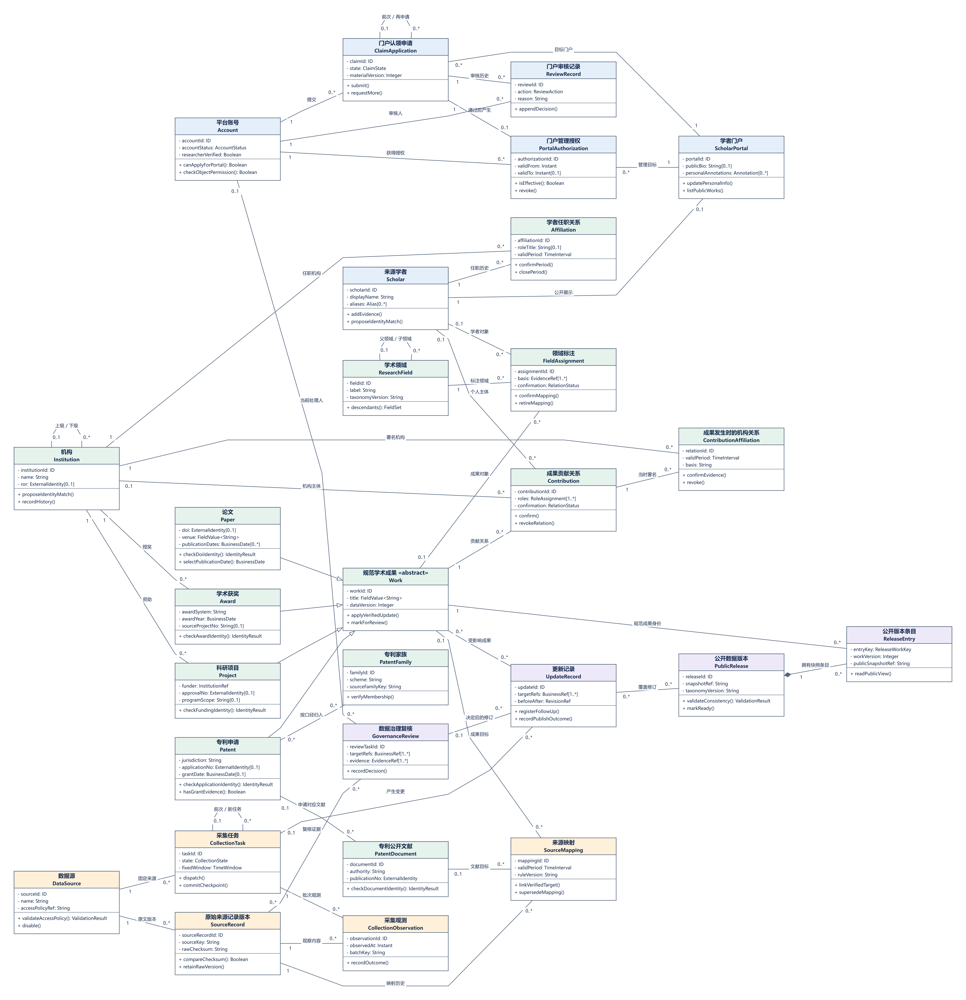

图3-1 核心业务类图 总览

保留A2 v1.0原图，含28类及45条关系。总图用于定位领域之间的连接；五张局部图用于阅读属性、操作与多重性。高清PNG、SVG和六页Draw.io均随包交付。

<!-- page -->

## 3 1 账号学者与门户授权

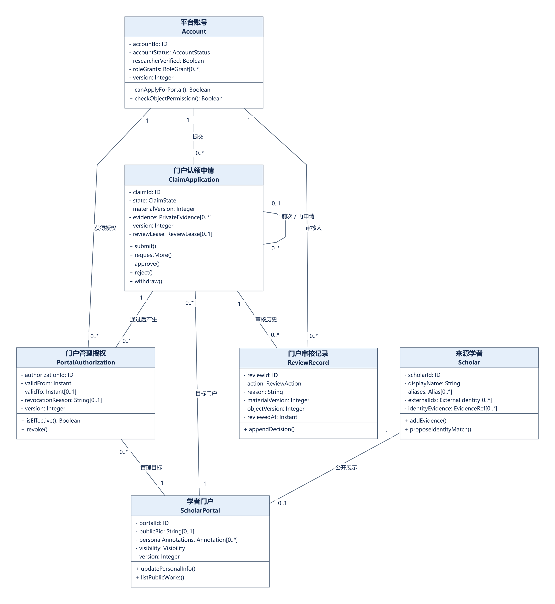

图3-2 账号学者与门户授权

Account与Scholar分离；ClaimApplication关联目标门户；批准后最多产生一个PortalAuthorization。历史授权可有多条，但账号侧和门户侧当前有效授权均至多一个。ReviewRecord保留每次审核的材料版本与理由。

<!-- page -->

## 3 2 四类成果与专利身份

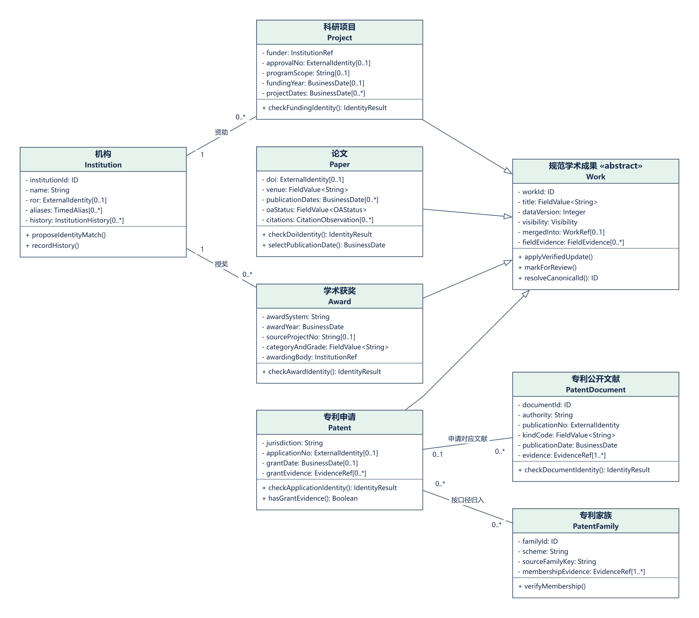

图3-3 四类成果与专利身份

Work是抽象类，Paper、Patent、Project、Award为完整且互斥的四类。本模型的Patent代表申请级成果；公开文献归PatentDocument，族关系归PatentFamily。公开和授权两份文献不能简单计为两件专利成果。

<!-- page -->

## 3 3 贡献机构与领域关系

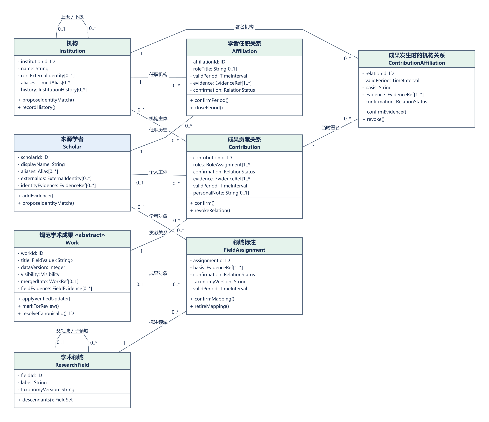

图3-4 贡献机构与领域关系

Contribution恰有一个Work，主体恰为Scholar或Institution之一。多种贡献角色收进同一关系的roles。Affiliation表达任职履历；ContributionAffiliation表达成果发生时机构，二者不可替代。

<!-- page -->

## 3 4 来源采集与规范映射

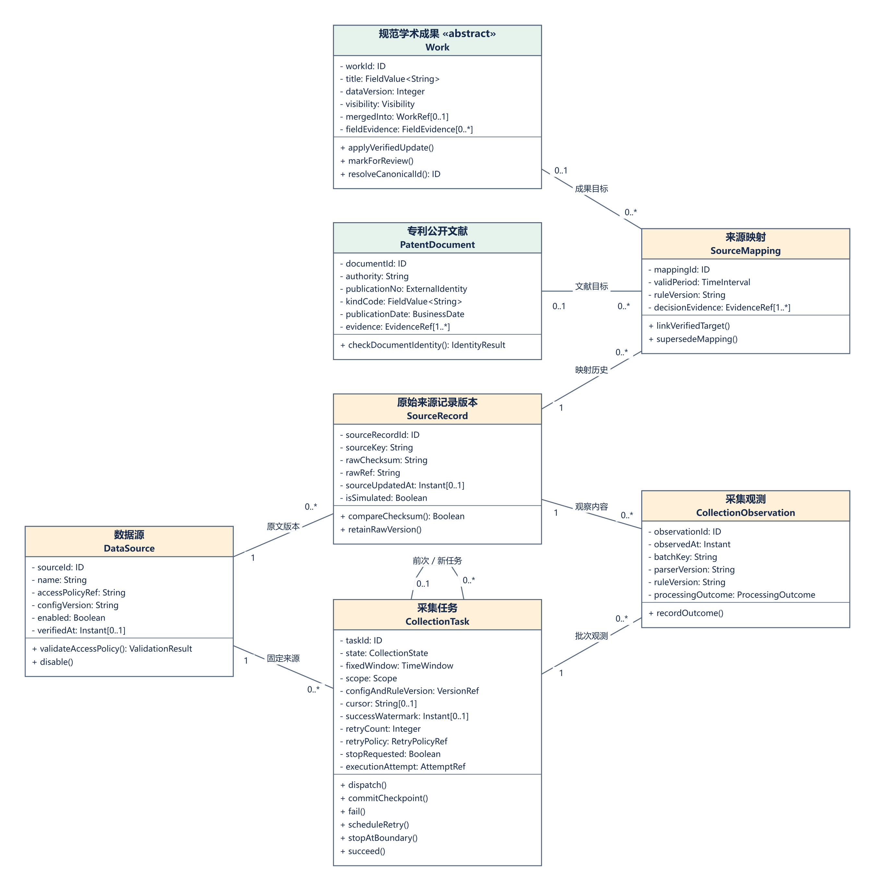

图3-5 来源采集与规范映射

SourceRecord保存不可变内容版本，CollectionObservation保存每次任务的观测和处理结果。来源＋稳定键＋checksum相同可复用原文版本；不能因此跳过未完成处理。SourceMapping只能指向Work或PatentDocument之一。

<!-- page -->

## 3 5 治理更新与公开版本

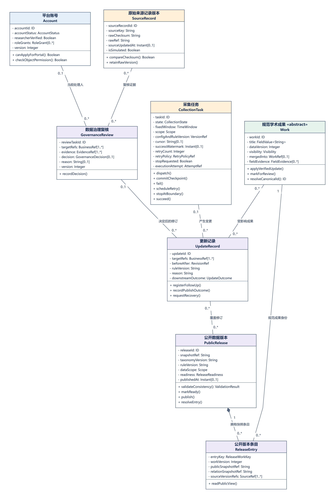

图3-6 治理更新与公开版本

PublicRelease与ReleaseEntry采用组合，条目生命周期属于公开版本。来源、贡献、审核及修订使用普通关联以保留追溯。删除或撤销管理权不级联删除公共成果、他人贡献、原文和审计。

<!-- page -->

## 3 6 多重性与必须成立的业务约束

普通关联只说明关系存在，不自动授权级联删除。组合菱形只用于PublicRelease拥有ReleaseEntry；四类成果通过泛化指向Work。本版没有为“看起来属于”而添加共享聚合，避免表达含糊的生命周期。

| 约束 | 必须成立的条件及反例 |
| --- | --- |
| I01 账号人物分离 | 学者可以无账号；注册成功不能创建门户管理授权 |
| I02 有效绑定唯一 | 一个账号至多管理一个当前有效门户，一个门户至多有一个当前有效管理账号；历史可多条 |
| I03 审核原子性 | 申请APPROVED、有效授权、审核记录和审计共同提交；不能只写成功状态 |
| I04 贡献主体互斥 | 一条贡献恰属于一个成果、一个学者或机构；两种主体不能同时有值或同时缺失 |
| I05 贡献有效唯一 | 相同主体类型＋主体ID＋规范成果ID至多一条有效贡献，多角色进入roles集合 |
| I06 机构语义 | 检索“某人在某机构的成果”须约束同一贡献的机构；另一作者所在机构不能代替 |
| I07 分类与映射互斥 | FieldAssignment仅指向Work或Scholar；SourceMapping仅指向Work或PatentDocument |
| I08 来源版本不变 | 已保存原文版本不覆盖；内容变更形成新checksum版本，规则升级保留规则版本 |
| I09 不凭弱证据合并 | 同名、相似题名、同域名只形成候选；冲突保留证据并进入GovernanceReview |
| I10 断点与水位分离 | 页事务提交后推进cursor；固定窗口全部处理可靠结束后才推进successWatermark |
| I11 停止与执行权 | RUNNING先登记stopRequested，安全退出后STOPPED；旧attempt不能继续写或成功回调 |
| I12 采集与公开分离 | SUCCEEDED表示有界处理及后续可靠登记完成；索引失败保留旧公开版本和恢复工作 |
| I13 同版与实时权限 | 同一查询列表、详情、统计读同版内容；当前权限撤销立即限制后续请求 |
| I14 私有资料隔离 | 证明、笔记、凭证不进入公开索引、结果、导出或完整错误日志 |

I编号为本报告跨模型核对索引，不替代A2原文INV编号；详细关系R01～R45保留原编号。Institution与ResearchField单父树结构及Scholar至多一个规范门户是A2分析选择，变更时须同步图源与查询规则。

<!-- page -->

## 3 7 关键操作的前后置条件

| 操作或协调职责 | 前置条件 | 成功结果与失败边界 |
| --- | --- | --- |
| ClaimApplication.submit(version) | 本人、资格有效、材料有效；DRAFT或NEED_MORE_INFO；版本一致 | 状态变为PENDING_REVIEW，材料及对象版本递增；失败保留当前状态 |
| ClaimControl批准事务 | 有权审核、PENDING_REVIEW、材料和目标版本未变化、账号与门户均无冲突有效绑定 | approve、创建授权、appendDecision及审计一起提交；冲突无部分生效 |
| PortalAuthorization.revoke(reason, version) | 具有对应治理权限，授权版本一致，理由完整 | 关闭有效区间并审计；保留旧批准申请和历史 |
| Work.applyVerifiedUpdate(patch, version) | 字段修订有可信依据；版本一致；不绕过人工锁定 | 保存前后值和证据，产生UpdateRecord及可靠后续登记 |
| Contribution.revokeRelation(reason, version) | 有权处理指定关系且版本一致 | 仅撤销该关系；不删除公共Work或其他人的Contribution |
| CollectionTask.commitCheckpoint(batch) | 当前attempt有效且页原文、观测／处理登记均可落地 | 同一提交中保存页数据与下一断点；失败不推进cursor |
| CollectionTask.succeed(summary) | RUNNING、执行权有效、未停止、整窗完整且无未处理ERROR | 原子提交SUCCEEDED和successWatermark；隔离／待复核需明确计数 |
| PublicRelease.publish() | 固定快照的索引、条目和统计一致性校验通过并已READY | 切换公开指针；失败继续提供旧版本 |
| ReleaseEntry.readPublicView(context) | 指定release可用，当前对象权限允许 | 返回该版公开字段和来源；禁止切换到最新数据掩盖版本错误 |

创建任务、请求停止、跨实体授权和查询协调是control职责；实体方法表达对象自身规则。不能为了让时序消息与类图“看起来一致”而将所有协调接口直接塞进Work或CollectionTask。

<!-- page -->

## 4 数据采集入库交互

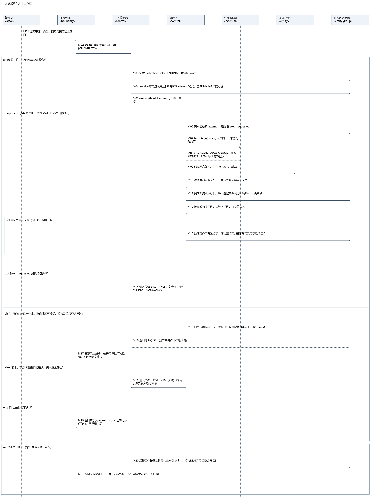

图4-1 数据采集入库主交互

采用A3 v1.2原图。M01～M21为主交互，M13引用图4-2，M14与M18引用图4-3。采集成功与公开可见分别展示；后续构建失败不回写采集任务为失败。图中文字较多，逐消息解释见本章后续表格和高清原图。

<!-- page -->

## 4 1 清洗去重子交互

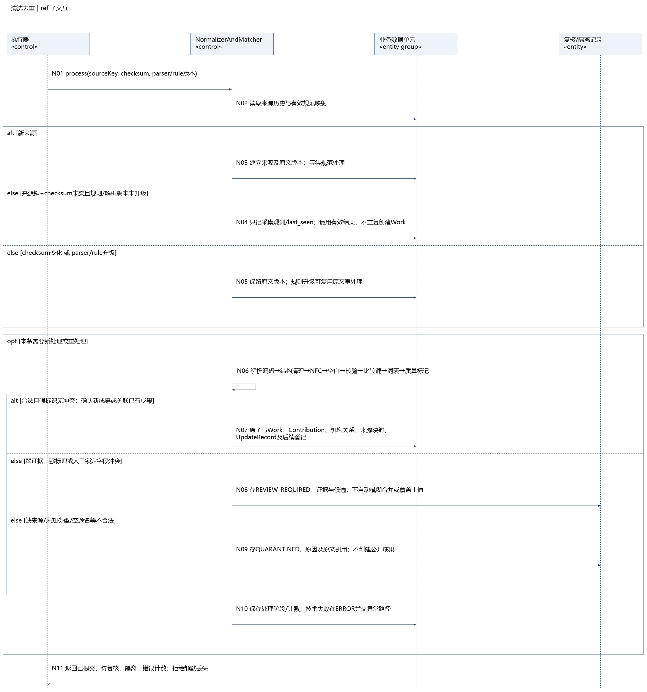

图4-2 清洗去重子交互

N01～N11展开来源幂等、原文版本、清洗和规范写入。图中“复核／隔离记录”在统一模型中分别映射为GovernanceReview及CollectionObservation.processingOutcome；不是门户ReviewRecord。

<!-- page -->

## 4 2 停止与重试子交互

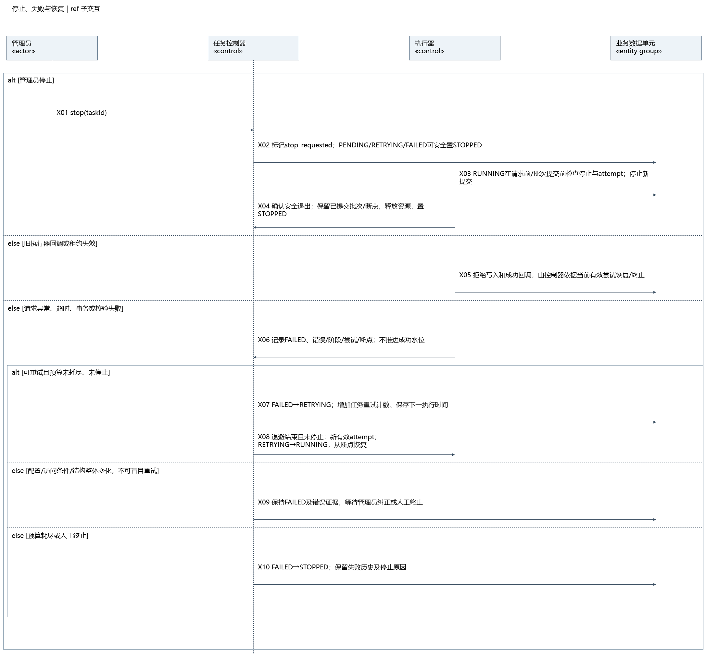

图4-3 停止与重试子交互

X01～X10展开停止请求、安全退出、失效尝试、有限退避和恢复。STOPPED需要原因；配置、访问条件及结构错误先保持FAILED等待处置，不能无休止自动重试。

<!-- page -->

## 4 3 采集消息与事务实现细节

| 消息 | 具体处理及持久化边界 |
| --- | --- |
| M01～M03 | 管理员选来源、类型、范围、窗口，控制器先核验权限和访问配置，再创建PENDING任务；固定配置、解析和规则版本 |
| M04～M06 | worker取得执行尝试与租约后dispatch进入RUNNING；每批开始前校验attempt、租约、stopRequested |
| M07～M10 | 按已提交cursor取页；验证响应结构与有效数据；原文先保存，获得可追溯引用及checksum |
| M11～M12 | 页事务：复验执行权，登记页内SourceRecord引用、观测与处理任务，并提交下一cursor；事务失败保持原断点，可幂等重入 |
| M13、N01～N06 | 读取来源键历史与checksum。相同内容且处理已完成可复用；待处理不能跳过；内容变化留新版本，规则升级允许复用原文重处理 |
| N07 | 规范写入事务：Work、Contribution、机构关系、SourceMapping、UpdateRecord和可靠后续工作共同落地 |
| N08～N09 | 弱证据／强标识冲突进入GovernanceReview；缺来源、空题名、未知类型等隔离；都保留原文、理由及明确结果 |
| N10～N11 | 记录处理阶段、成功／复核／隔离／错误计数；技术错误标ERROR并进入异常路径；不得静默漏条 |
| M14、X01～X05 | 停止标记或执行权失效时走安全停止路径；本次执行结束，不再执行M15 |
| M15～M17 | 窗口校验通过后，成功事务复验RUNNING、attempt和停止标记；共同提交SUCCEEDED与整窗水位；显示公开更新仍可能待处理 |
| M18～M19 | 执行异常进入X06～X10；创建前校验失败只返回原因和请求标识，不启动外部采集 |
| M20～M21 | 发布阶段按固定快照构建条目、索引与统计；一致性校验READY后切换。失败保留旧版本并登记恢复，补采申请不能显示“已可检索” |

同一页被重复抓取可产生新观测，但相同来源＋稳定键＋checksum复用原文内容版本。规范成果是否新增由身份规则决定；不能仅靠数据库自增ID规避重复，也不能因checksum未变而丢弃上次尚未完成的处理任务。

<!-- page -->

## 4 4 六状态与故障恢复决策

| 当前状态与事件 | 后继状态 | 动作和限制 |
| --- | --- | --- |
| PENDING，获得有效执行权 | RUNNING | 固定attempt并维护心跳 |
| RUNNING，整窗可靠处理成功 | SUCCEEDED | 成功事务中推进整窗水位；不能只凭抓取结束 |
| RUNNING，请求或处理失败 | FAILED | 保存原因与已提交cursor；整窗水位不推进 |
| FAILED，允许自动重试且预算未耗尽 | RETRYING | 按策略登记下次时间，不忙等 |
| RETRYING，到期获得新执行权 | RUNNING | 新attempt从已提交断点恢复；先处理遗留登记 |
| FAILED，配置／访问／结构错误 | FAILED | 等待人工处置，不盲目重试 |
| 预算耗尽或管理员终止 | STOPPED | 保存停止原因；RUNNING须等安全退出确认 |
| PENDING／RETRYING／FAILED，取消 | STOPPED | 无运行写入时直接停止 |
| SUCCEEDED或STOPPED，需要重采 | 原任务不变 | 新建有关联的新任务，保留旧任务审计 |

实现示例：固定窗口有三页，第一页事务已提交，第二页解析失败。重试从已提交断点恢复，第一页数据继续存在，不重复建立成果；successWatermark仍停留在旧窗口。后续所有页及已登记处理都有明确结果后才可提交新水位。

停止请求与成功事务竞争时，以事务中的当前attempt、状态和stopRequested为准。停止先提交，成功回调不得推进水位；成功先完整提交，后来的停止请求应返回当前终态。旧worker晚到的响应不得覆盖新attempt的进度。

隔离与待复核不是无记录的数据丢失。它们只有在原文、原因、处理状态、计数及后续工作可靠保存后才允许窗口结束；仍有ERROR或未登记丢页不能SUCCEEDED。重试次数、超时和质量阈值按配置管理，SPEC候选数字不作为实测结论。

<!-- page -->

## 5 门户认领审核交互

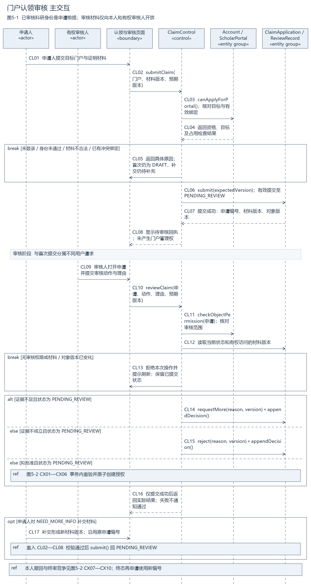

图5-1 门户认领审核主交互

本次补建。CL01～CL17覆盖提交、校验、审核、补充材料和决定反馈；批准分支展开为图5-2。申请人与有权审核人采用独立生命线，前端可共用页面边界，后台按实际身份与对象范围校验权限。

<!-- page -->

## 5 1 原子授权与撤回竞争

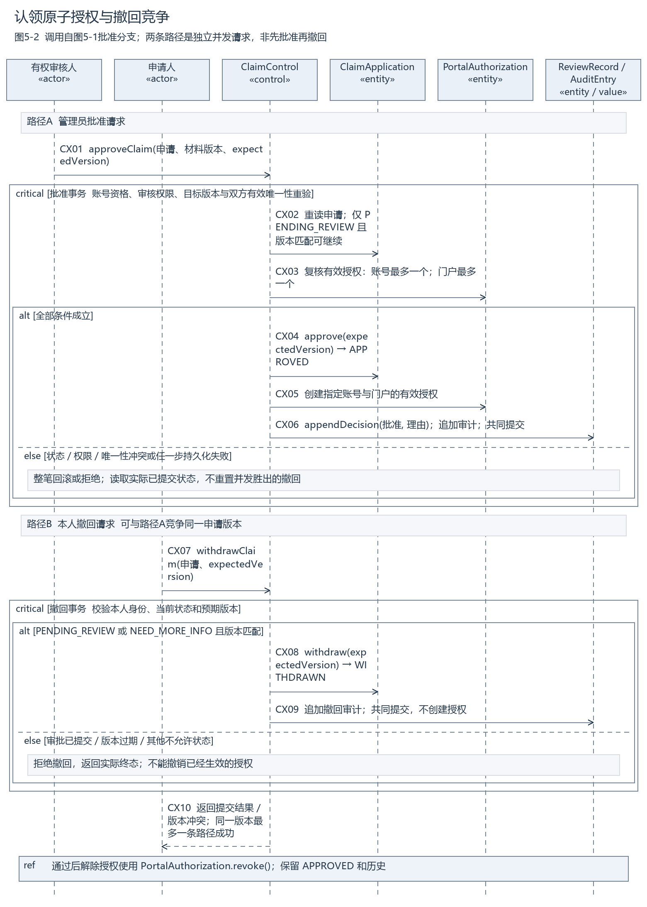

图5-2 原子授权与撤回竞争子交互

本次补建。CX01～CX06与CX07～CX10是竞争同一申请版本的两个独立请求，不是必须顺次执行的业务步骤。critical表示不可出现部分生效；不预先指定数据库锁或ORM技术。

<!-- page -->

## 5 2 认领输入校验与状态迁移

输入包括目标portalId、私有证据引用、材料版本、申请expectedVersion、操作类型及理由。账号ID和审核范围来自可信会话，不采信用户提交的管理员标记。科研身份researcherVerified必须来自UC1.3审核结果；用户填入ORCID仅是核验线索。

CL02～CL06校验顺序为：登录与账号状态 → 科研身份资格 → 目标存在和可认领 → 证明完整性及可验证性 → 本人重复申请及双向有效绑定 → 当前申请状态和版本。首次申请尚未创建时可先保存DRAFT，成功提交后才进入待审核。重复请求返回本人既有结果，不暴露他人申请证据。

| 起始状态 | 合法动作与条件 | 结果 |
| --- | --- | --- |
| DRAFT | 有效submit | PENDING_REVIEW |
| DRAFT | 材料校验不通过或技术验证不可用 | 保持DRAFT，返回可修正或可重试原因 |
| PENDING_REVIEW | 有权审核requestMore且说明理由 | NEED_MORE_INFO，追加ReviewRecord |
| NEED_MORE_INFO | 本人补交新材料版本且有效submit | PENDING_REVIEW，沿用原申请ID |
| NEED_MORE_INFO | 无效补充或验证服务失败 | 保持NEED_MORE_INFO |
| PENDING_REVIEW | approve且事务内所有资格及唯一性条件成立 | APPROVED并产生唯一有效授权 |
| PENDING_REVIEW | reject且记录理由 | REJECTED，不创建授权 |
| PENDING_REVIEW／NEED_MORE_INFO | 本人withdraw，版本一致 | WITHDRAWN，不创建授权 |
| APPROVED／REJECTED／WITHDRAWN | 再次申请 | 新建申请并关联历史，旧终态不改写 |

业务状态仅有这六个。“审核占用”是可选ReviewLease，用于减少重复劳动；它不增加REVIEWING状态，也不能替代提交时的权限、材料和版本检查。草稿放弃不画成DRAFT到WITHDRAWN。

<!-- page -->

## 5 3 认领事务与异常的具体处理

批准以ClaimControl为协调者。在一个逻辑事务内读取当前申请和目标版本，重新校验账号资格及审核权限，检查账号和门户两侧有效授权，执行approve、创建PortalAuthorization、追加ReviewRecord与审计，然后共同提交。通知只根据已提交结果发出，通知失败不撤销已提交授权，可独立补发。

| 情景 | 处理结果 | 禁止的结果 |
| --- | --- | --- |
| 两管理员读到相同version=7并同时批准 | 一个更新成功至新版本；另一个返回冲突并刷新当前结果 | 两条有效授权或重复终审历史 |
| 撤回先于批准提交 | 当前状态WITHDRAWN；批准因版本／状态不符失败 | 把撤回覆盖回PENDING_REVIEW或APPROVED |
| 批准先于撤回提交 | 当前APPROVED和有效授权保持；撤回返回当前终态 | 通过普通撤回删除已生效授权 |
| 同账号同时认领两个门户 | 账号侧有效唯一性保证最多一个批准 | 只检查门户侧而放过账号第二门户 |
| 两账号同时认领同门户 | 门户侧有效唯一性保证最多一个批准 | 先查无绑定后各自无约束插入 |
| 审核时申请人补了新材料 | 旧materialVersion／expectedVersion不能用于终审 | 审核旧材料却记录新材料版本 |
| 身份验证服务暂不可用 | 保留当前状态，记录技术原因并允许恢复 | 直接认定证据不成立并REJECTED |
| 写授权或审计失败 | 整笔回滚，保持原已提交事实 | 申请已通过但没有授权或没有审计 |

门户管理权仅作用于指定门户的个人附加信息等允许范围，不自动确认全部成果、来源人物账号控制或法律所有权。公共题录、作者顺序、贡献主体、机构和合并仍经过公共治理。解除授权使用revoke并留历史；撤销本人的成果贡献只影响对应Contribution。

成功回执包含claimId、实际状态、对象版本、材料版本、决定理由及可执行的下一动作。无权访问他人申请时不返回证据详情；日志保留请求标识和操作摘要，不输出整份证明。

<!-- page -->

## 6 检索请求处理交互

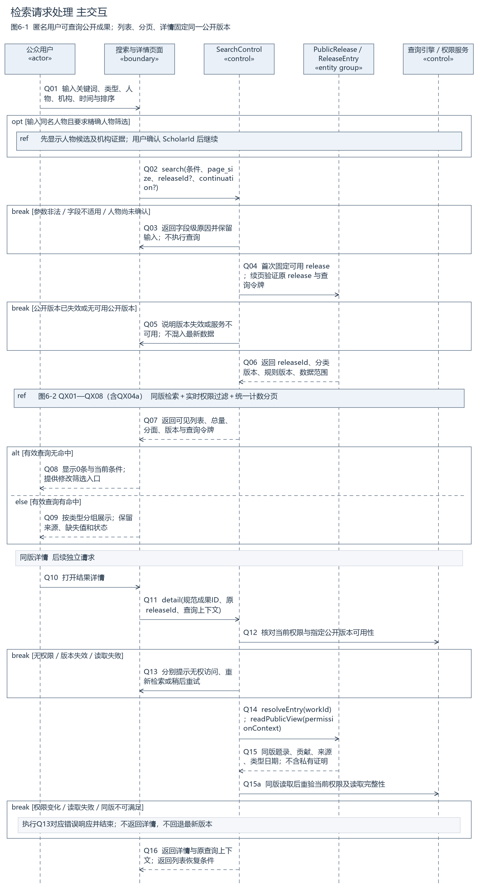

图6-1 检索请求处理主交互

本次补建。Q01～Q16覆盖公开检索、同名选择、条件校验、版本固定、列表反馈及同版详情；QX子交互说明权限和统计口径。匿名访问无需先跳转登录。

<!-- page -->

## 6 1 权限计数与分页一致性

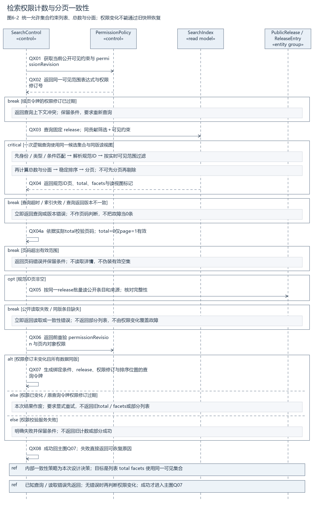

图6-2 检索权限计数与分页子交互

本次设计以同一“当前允许的候选集合”计算列表、total与facets。权限修订变化时作废并要求显式重试，不能仅从当前页删除一条却继续显示原总数。本图critical表达逻辑读视图一致，不要求给整个搜索过程加数据库全局锁。

<!-- page -->

## 6 2 查询契约与排序细节

| 输入项 | 具体规则 |
| --- | --- |
| 关键词和标识 | 显式标识字段或可识别标识按类型解析；非法标识提示。普通关键词包含斜杠不自动当作坏DOI |
| 人物条件 | 同名展示候选及机构证据；确认ScholarId后继续。多作者显式选择all或any |
| 机构条件 | 指定是否包含下级；与人物联合查询须作用于同一Contribution及其ContributionAffiliation |
| 领域条件 | 保存分类体系版本；是否包含后代字段明确；缺学科保持未分类 |
| 类型条件 | 支持四类；类型专属字段只作用于适用类型，不把专利号当论文DOI |
| 时间条件 | 论文优先print→online→issued；项目默认资助年度，立项日期需单独指定；奖励按获奖年度；专利保留授权证据及日期精度 |
| 条件逻辑 | 不同维度AND，同维多个值OR；人物all／any单独声明并回显 |
| 排序 | 有关键词默认文本相关度；同分按业务年降序、未知置后、ID升序。无词浏览按公开投影的规范成果首次收录时间降序、ID升序，不用重复观测时间顶置 |
| 分页 | page_size默认10、最大100，约束整页。all按论文、专利、项目、奖励固定分组串接后统一分页；页码范围在total返回后校验 |

无关键词但有筛选可浏览；完全空条件按SPEC §6.1的最新收录顺序。为使分页可复现，本版将“收录时间”明确为公开投影中规范成果首次收录时间，固定在release内；不以来源发布日期替代。all的组内使用生效排序，组间不比较原始相关度；跨页可延续同一分组，分组标题随结果保留。以上分组串接和收录时间字段含义是设计选择。

BM25字段权重title^4、author^2.5、venue^2、abstract^1、discipline^2属于待样本校准候选。旧复合权重公式不作为本次默认排序，更不能将其当成已部署并测优的算法。参数变更记录规则版本，固定样本比较后再决定是否采用。

返回契约包括有效条件、releaseId、数据范围、分类与规则版本、结果项、total、facets、排序、页大小、查询令牌及缺失／合并／撤稿标记。结果项至少能定位规范成果、类型、题名、贡献及来源；不公开私有证明、私人笔记或受限摘要全文。

合并成果通过resolveCanonicalId定位规范ID，列表按规范ID去重；旧ID进入合并导航并保持来源可追溯。撤稿属于明确数据状态，默认结果可保留并标识，用户可显式筛除。

<!-- page -->

## 6 3 同版读取与权限变化的处理

首次查询固定当前可用releaseId。续页令牌绑定条件摘要、排序、页位置或游标、公开版本和权限修订号，用户不能用一个查询的令牌读取另一个条件集合。采用页码时同样验证这些上下文，不要求前端必须暴露游标技术。

检索执行先在同版候选集合上解析规范ID和业务条件，再加入当前可见约束，然后从同一集合计算total、facets和分页结果。不能“先取10条、删掉其中3条受限项”而仍显示旧总数；也不能只补足列表却让分面泄漏受限记录数量。

QX05仅在ID集合非空时读取同一ReleaseEntry快照。QX04a取得真实total后校验页码：page=1且total=0允许返回空集；其余页码超过ceil(total/page_size)返回越界错误。该空集第二页约定是本次设计选择。查询、读取或同版校验已失败时，先返回对应错误；不以“权限变化”掩盖已知故障。

QX06在返回前确认权限修订与页内权限。若变化，作废本次结果并要求显式重试，不返回旧total、facets或部分列表，也不在请求内部重算。跨页令牌权限修订过期同样提示重新查询。此策略参考B5 M25～M30，替代v1.0的一次内部重算方案。新请求仍固定原公开版本；旧版已失效时才要求显式重新绑定。详情也在同版读取后通过Q15a再次校验，失败走Q13。

| 业务结果 | 页面行为 | 候选接口映射 |
| --- | --- | --- |
| 条件有效且无匹配 | 展示0条，保留全部条件，可调整筛选 | 200与空集合 |
| 条件非法或字段不适用 | 标记具体字段，不丢失输入 | 422 |
| 当前无权读取对象 | 不返回受限字段、证据或计数细节 | 403，或按防枚举策略统一不可用 |
| 权限修订或查询上下文冲突 | 说明需刷新查询，重新计算可见结果 | 409，本次方案 |
| 旧公开版本已失效 | 提示重新检索，不偷偷换用最新版本 | 410 |
| 查询超时、索引不可用或同版条目缺失 | 明确暂时失败，保留条件供重试 | 503；内部故障原因不公开敏感细节 |

详情请求同样重新验证公开版本和当前权限。公开内容版本固定不意味着旧快照可以恢复已经撤销的访问权。当前权限判断以本次请求的判定点为准；无法撤回已经交付到客户端的历史字节，不承诺不存在的实时回收能力。

<!-- page -->

## 6 4 用已有样例核对查询结果

以下是《需求条目与验收场景》已有样例口径的设计核对，不是本次执行了可运行平台后的测量结果。

| 样例 | 应得到什么 | 模型依据 |
| --- | --- | --- |
| 原始15条，其中R04B与R04为同一规范成果 | 去重后14条；排除一条公开专利扩展示例后基础口径13条 | Work.resolveCanonicalId、专利申请／文献分离 |
| 基础四类成果 | 8论文＋1授权专利申请＋2项目＋2奖励，共13条 | Work完整互斥四子类；Patent授权证据 |
| 同名A01与A02，明确选择A01 | 只使用A01的贡献，不能按名字把A02混入 | ScholarId及人物确认 |
| 查询A01且成果发生时机构I01 | R01、R04、R07，共3条 | 同一Contribution的机构关系 |
| R06中A01属于I03，A03属于I01 | 不属于上行结果；若只要求作品任一作者机构I01则可命中 | 同贡献筛选与任意贡献筛选语义不同 |
| 按机构分别计论文I01=5、I02=1、I03=3 | 机构数相加9，不等于全局唯一论文8 | 多机构共同成果允许在各机构集合出现；全局规范ID去重 |
| R08为撤稿记录 | 默认标记保留；显式排除后基础口径为12 | 状态与显式筛选，不能静默删除 |
| PJ01只有2023立项信息，资助年度未知 | 默认资助年度2023筛选不能凭立项年命中 | BusinessDate的日期含义和缺失状态 |
| D04为演示用模拟稳定标识 | 可按本地ID验证流程，不宣称合法DOI已核验 | 模拟数据与真实来源标识分开 |

这组例子可直接用于课堂讲解：“同样是作者加机构筛选，为什么会得到3条或4条？”答案由关系模型中的ContributionAffiliation决定，而不是在页面上简单叠加两个独立关键词。

公开统计还需声明数据范围、时间含义、分类口径、数据版本及未知值处理。每个分母都来自明确集合；不能把来源样本缺失当零，也不能用演示样本规模证明10,000条正式规模目标已经达到。

<!-- page -->

## 7 面向后续实现的职责与数据约束

本章给出可落实的逻辑设计，不提前指定数据库、搜索产品或框架。权威业务数据应能重建检索读模型；外部来源访问和公开服务相互隔离。

| 职责 | 接收和输出 | 必须保证 |
| --- | --- | --- |
| 采集协调 | 来源、窗口、版本 → 任务与attempt | 固定边界、有限重试、停止确认、可恢复检查点 |
| 规范处理 | SourceRecord与规则版本 → 规范对象或明确复核／隔离结果 | 强标识校验、来源保留、人工修订保护、无静默丢弃 |
| 认领协调 | 私有申请与动作 → 状态和对象授权 | 对象级权限、材料版本、双向有效唯一、事务审计 |
| 查询协调 | 条件和查询上下文 → 同版可见结果 | 同贡献过滤、统一计数分页、实时权限、失败可恢复 |
| 发布协调 | UpdateRecord集合 → READY公开版本 | 同快照构建及校验、原子切换、旧版可用和可靠重试 |

建议落实为持久化约束的业务键：SourceRecord使用(source_id, source_key, checksum)；ReleaseEntry使用(release_id, work_id)；有效Contribution使用(subject_type, subject_id, canonical_work_id)；当前PortalAuthorization分别约束account_id和portal_id的有效唯一性。具体数据库可用条件唯一约束或等价串行化机制实现，不能只依赖应用层“先查后插”。

外部接口调用不放在持有长事务锁的关键区。证据预验证先取得可追溯结果；批准提交仍复验当前资格、状态和版本。消息发送在提交后进行，可靠后续工作需与业务变更共同登记，采用事务消息表或等价机制防止“业务已提交但更新任务丢失”。

审计至少记录请求标识、操作者、对象、动作、前后版本、材料／规则版本、理由与时间。技术日志和业务审计分工明确；日志脱敏，保存证明引用而非完整证明内容。接口幂等必须绑定操作者和操作范围，不能凭他人的请求键取得私有返回结果。

<!-- page -->

## 7 1 类图与时序消息的统一映射

| 时序中的职责或旧名称 | 统一实现位置 | 说明 |
| --- | --- | --- |
| A3 createTask、start | 控制器创建；CollectionTask.dispatch(attempt) | 创建与派发分开，实体不承担页面参数解析 |
| A3 requestStop | 控制器登记stopRequested；实体stopAtBoundary(attempt) | 请求停止不等于已停止 |
| A3 finishSuccess | CollectionTask.succeed(summary) | 复验窗口完整性与执行权，并原子推进成功水位 |
| A3 SourceRecord.observe | CollectionObservation.recordOutcome(result, counts) | 原文版本与观测分离 |
| A3 addRawVersion | SourceRecord.retainRawVersion()及控制创建 | 相同checksum复用，不覆盖历史内容 |
| A3 applyVerifiedChange | Work.applyVerifiedUpdate(patch, version) | 统一A2方法名，保护人工修订及版本 |
| A3 ReviewRecord.open | 创建GovernanceReview；隔离结果进入ProcessingOutcome | 消除与门户审核历史的职责冲突 |
| A3 UpdateRecord.recordChange | 控制器保存修订并registerFollowUp(workSet) | 后续任务与业务变化共同登记 |
| CL06、CL14、CL15 | submit、requestMore、reject及ReviewRecord.appendDecision | 每次状态迁移带权限、理由和版本检查 |
| CX04～CX06 | approve＋授权创建＋appendDecision＋AuditEntry | ClaimControl负责事务；不能只调用approve就返回通过 |
| Q04、Q14 | PublicRelease解析、resolveEntry及readPublicView | release固定，当前权限仍需校验 |
| QX03～QX04 | SearchControl及可重建索引查询 | 没有将查询索引冒充权威业务实体 |

原A2/A3源文件保留历史版本，本整合版通过上述适配说明消除命名歧义，不回写个人原稿。若成员在CodeArts或Draw.io中正式统一方法名，应在新版本源文件、图片和消息表中同步修改，不只更改Word中的图片标题。

新增认领和检索源文件采用原生Draw.io图元及同源JSON生成，包含生命线、消息、返回、break、alt、opt、ref、critical片段。采集原生CodeArts工程另附；本次未登录平台导入或宣称已完成平台原生迁移。

<!-- page -->

## 8 需求到模型与场景的追踪

| 需求与规范 | 类与交互定位 | 验收依据 |
| --- | --- | --- |
| UC5.1；FR-CRAWL-001～003/007/009；SPEC-INGEST-01 | C20～C23；M01～M12 | AC-R23、AC-R27 |
| UC5.3；FR-CRAWL-004～006/010；SPEC-DATA-01/02 | C07～C19、C24～C26；N01～N11 | AC-R18/19/22、AC-U03 |
| FR-SYNC-002～004；FR-CRAWL-008 | C22～C23；M14～M18、X01～X10 | AC-R26/27、AC-U08 |
| UC5.4/5.5；FR-ES-004、FR-INDEXREQ-005 | C25、C27～C28；M20～M21 | AC-R28、AC-U09 |
| UC3.1/5.2；FR-PORTAL-007/008；SPEC-CLAIM-01 | C01～C06；CL01～CL16、CX01～CX06 | AC-R02、AC-R25/29、AC-U10 |
| UC3.5；FR-PORTAL-011～013 | C05～C06；CL14/17、CX07～CX10 | AC-R24/25 |
| UC2.1；FR-SEARCH-001～005/007～009 | C02、C07～C19；Q01～Q09、QX01～QX08 | AC-U01/02/05；既有G1-AT样例 |
| UC2.3；FR-SEARCH-006/010、FR-ES-004 | C07、C27～C28；Q10～Q16 | AC-R13/14、AC-U11 |
| FR-OUTCOME-004/007/008；SPEC-DATA-03 | C08～C17；类型与身份校验 | AC-R20/21/22/29、AC-U04/06 |
| FR-ES-003；SPEC-SEARCH-01 | QX03～QX04；第6.2节候选权重 | AC-R30；参数效果仍待固定样本测试 |

FR编号沿用《需求条目与验收场景》，UC沿用当前五包编号；旧图中的局部UC01、UC-AM等不直接等同当前编号。图3的C01～C28是类编号，CL、CX、Q、QX是新增消息编号，避免将旧A1建议编号与现图混用。

非功能目标继续保留为待实现验证的验收条件：固定不少于10,000条有效成果与20并发场景，预热5分钟后固定查询运行至少5分钟，搜索P95≤2秒、详情≤1秒、基础预聚合统计≤3秒。该执行口径同时覆盖SPEC预热与SRS持续运行要求；记录错误率、范围及冷热条件，本次文档检查不证明性能达标。

<!-- page -->

## 8 1 典型场景设计走查 采集与认领

下表为本次对模型路径的静态核对；“覆盖”表示图文已表达相应路径，不表示运行测试通过。人工复审仍应逐项确认。

| 场景与输入 | 预期和模型路径 | 本版静态核对 |
| --- | --- | --- |
| T01 来源已有Scholar但没有Account | 可公开发现；注册后仍须身份与门户审核 | C01～C06、CL03覆盖 |
| T02 同名／手填他人ORCID | 形成候选，不能合并人物或直接授权 | I09、CL03、CX02～03覆盖 |
| T03 同来源键checksum相同重复采集 | 复用原文、记录观测；未完成处理继续执行 | N02～N04、C21/C23覆盖 |
| T04 页事务提交前中断 | cursor不前进；重入原文不导致重复成果 | M09～M12、第4.3节覆盖 |
| T05 有隔离记录的固定窗口结束 | 每条均有明确处理及计数、无ERROR才可成功 | N08～N11、M15覆盖 |
| T06 RUNNING收到停止 | 安全边界停止；新写入与成功回调均检查attempt | M14、X01～X05覆盖 |
| T07 旧attempt晚到成功 | 不覆盖新尝试状态、不推进水位 | X05、第4.4节覆盖 |
| T08 两审核人同时批准 | 同版本最多一个成功，授权两侧唯一 | CX02～CX06覆盖 |
| T09 撤回和审批竞争 | 最多一个合法提交；失败方读取真实当前状态 | CX01～CX10覆盖 |
| T10 验证服务失败后重试 | 保持DRAFT或NEED_MORE_INFO，技术失败不当驳回 | 第5.2～5.3节明确；无需新增业务状态 |

人工复审重点：不要把图中的审核占用当成并发正确性的唯一保障；不要把外部响应200当成成功取到数据；不要把SUCCEEDED理解为所有数据已经公开。审核通过和窗口成功都必须检查各自事务边界，而不只看页面提示。

<!-- page -->

## 8 2 典型场景设计走查 检索与发布

| 场景与输入 | 预期和模型路径 | 本版静态核对 |
| --- | --- | --- |
| T11 A01与I01来自不同贡献 | 不匹配同贡献筛选；R06不能误入3条结果 | C14/C17、QX03、第6.4节覆盖 |
| T12 有效空结果与服务超时 | 分别为可调整条件的0条和可恢复失败 | Q08、QX异常分支覆盖 |
| T13 列表后公开版本过期 | 详情／续页提示重新查询，不混新旧内容 | Q05/Q13、第6.3节覆盖 |
| T14 同申请的公开与授权文献 | 保留两文献，一件申请级成果；授权需证据 | C09～C11及图3-3覆盖 |
| T15 项目仅有立项年 | 不冒充资助年；未知与0分开 | C12、第6.2/6.4节覆盖 |
| T16 入库成功后索引失败 | 任务仍SUCCEEDED，公开更新待恢复，旧版继续可用 | M20～M21、C25/C27覆盖 |
| T17 公共题录与个人说明修改 | 个人只改允许字段；公共数据修订走治理 | C03/C07/C26、第5.3节覆盖 |
| T18 权限在分页间撤销 | 旧令牌提示重试，新查询按当前范围统一计算；拒绝旧权限内容 | QX01～QX08、第6.3节覆盖 |
| T19 账号同时认领两个门户 | 账号侧唯一约束参与批准事务 | CX03、第5.3节覆盖 |
| T20 权限返回前变化 | 作废本次结果，明确要求重试；不返回旧计数或部分列表 | QX06～QX08及Q15a覆盖；v1.1策略 |

评审必须区分三层证据：文件存在及格式可打开；模型按规则具有完整路径；真实系统在输入下产生预期行为。本次前两层通过本地文件与静态核对形成记录，第三层留待实现和运行测试。课堂或组内正式通过由真实评审人填写。

仍需人工裁决的设计点包括：A2单父机构结构是否满足课程范围、有效绑定撤销后的再申请业务限制、查询令牌的对外错误约定、旧公开版本保留周期。它们不阻止完成当前分析图文，但应在实现设计冻结前形成记录。

<!-- page -->

## 9 交付清单与评审记录

| 交付物 | 本版内容 |
| --- | --- |
| 本组-需求分析报告.docx及同名md | 同源正文；已替换四处模型占位，按三条关键用例写入契约与异常 |
| 图件目录 | 类图总览及5局部图、采集主图及2子图、认领主图及子图、检索主图及子图，共13张PNG；已有或新增SVG一并保留 |
| 模型源文件目录 | A2六页Draw.io，A3原始CodeArts工程ZIP，4张新增Draw.io，同源JSON及生成脚本 |
| 支撑材料目录 | 完整对象关系字典、来源与修订记录、15分钟汇报讲解稿、验收和AI辅助记录 |
| 输入与交付校验清单 | 路径、文件大小及SHA-256；用于固定本版所采用的文件 |

新增图源由本次AI辅助生成，供全组复审采用；不记作A4、A5已亲自完成或签字。A2与A3沿用目录中的姓名与版本来源，不改变既有材料署名。v1.1已核对GitHub Group2提交b93110b及用户补充的B5 v0.9。v1.0文件保留，修订与来源见第10章；文件快照不等于双方成员签署的独立冻结或正式互评。

| 评审记录项目 | 待真实填写内容 |
| --- | --- |
| 本人核对 | 日期、姓名、核对对象、采用／修改理由 |
| 交叉复审 | 日期、复审人、问题编号、原文依据、结论 |
| 修改闭环 | 受影响图源、PNG、Word版本与复核结果 |
| 课堂评审 | 实际评审时间、意见及是否通过 |

本次修订已完成的具体事项：把“图未收到”更新为实际图件；补齐认领与检索及其子图；将A1候选与A2类统一映射；将采集复核与门户审核分开；明确六状态、断点和水位、原子授权及公开版本；补入FR与AC追踪。未完成事项不代填为通过。

在Word中阅读图件可放大；需要修改时打开模型源文件，不应在截图上覆盖文字。对新图可修改Draw.io图元；如使用生成脚本重建，应修改脚本中的模型定义并重新导出JSON，保持消息编号与正文一致。图件细字也可在支撑材料中的完整对象字典和新增交互消息表中逐项查阅。

<!-- page -->

## 10 Group2与B5的来源和基线差异

本章将外部模型作为对照输入。当前整合继续采用工作区SRS/SPEC v2.0；Group2有自己的v1.1基线，其模型不能直接替换本组状态和术语。文件交付时间相近不代表规则相同。

| 来源 | 实际取得内容 | 采用边界 |
| --- | --- | --- |
| GitHub caw111/SoftwareAnalyse 的Group2 | 提交b93110b8964e9061469bcfab8d0ced701f3d4526，2026-10-26 16:50:09 +08:00；报告、15场景CSV、四张原生Draw.io及PNG/SVG | 按此固定提交比较；没有切换或覆盖当前工作区 |
| 用户补充的B5压缩包 | B组B5吴星宇v0.9，SRS/SPEC v2.0；两张PlantUML图、六份说明及检查记录 | 个人交付，不等同于Group2整组报告；保留本人未确认状态 |
| 本组v1.0 | 28类45关系，原有A2/A3与本次补图 | 保留文件与SHA-256，v1.1另建目录；不补写成员签署冻结 |

| 冲突项 | Group2报告 | 当前v2.0及本组采用规则 |
| --- | --- | --- |
| 认领状态 | 九状态，含PENDING_VERIFICATION、VERIFYING、UNDER_REVIEW | 六状态；验证步骤与审核占用是过程或内部字段，不能新增业务状态 |
| 采集成功 | SUCCESS | SUCCEEDED；并非同时保留两个成功状态 |
| 预算耗尽 | 保持FAILED，管理员放弃才STOPPED | 重试耗尽按当前基线进入STOPPED；不可重试配置等故障保留FAILED供人工处理 |
| 门户建模 | 门户与管理绑定折叠在Scholar及关联中 | ScholarPortal、PortalAuthorization分离，显式记录有效期、版本和撤销历史 |
| 关系与投影 | 15个较粗类，部分版本和权限由职责契约表达 | 28类显式展开贡献机构、观测、公开版本和条目；不能按类数量直接评优 |

基线裁决以现有需求条目为依据；若全组以后决定改用Group2基线，必须同步修订SRS、SPEC、状态图、时序、场景及迁移规则，不能只改一个枚举名。外部材料中的PPT或分工要求保留为来源内容，本次按用户要求完成详细文档和图片。

<!-- page -->

## 10 1 对象与交互逐项对照

| 对照点 | Group2或B5的表达 | 本组处理及理由 |
| --- | --- | --- |
| 四类成果 | AcademicOutcome继承Paper、Patent、ResearchProject、Award | 映射Work四子类；专利另有PatentDocument与PatentFamily，避免文献数当成果数 |
| 贡献与机构 | OutcomeContributor加成果机构关联，单位贡献可由成果机构承载 | Contribution主体Scholar XOR Institution；ContributionAffiliation显式保存同次贡献机构与证据 |
| 来源版本与重复出现 | SourceRecord保存内容版本，CrawlTask多对多观察 | SourceRecord不可变，CollectionObservation独立保存每次观测及处理结果；SourceMapping记录归并依据 |
| 更新记录 | UpdateRecord目标联合，承接变更和追踪 | 保留C25；查询索引不作为权威实体，更新登记必须可靠提交 |
| 认领与成果确认 | Group2另列ResearcherOutcomeClaim | 本报告关键用例只处理门户；成果确认需求仍由贡献及需求追踪承接，不把门户批准当成果确认 |
| 采集主交互 | Group2 17条消息，强调全窗完成和发布分开 | 沿用A3 M21/N11/X10；保留页事务、规范入库事务、执行尝试与整窗水位细节 |
| 认领主交互 | Group2 18条消息，九状态验证流程 | 采纳版本、私有材料及原子绑定的核对点；六状态流程沿用CL/CX，不导入多出的状态 |
| 检索主交互 | Group2 14条消息；同版规范ID读取，实时权限 | 保留本组Q/QX并细化返回前再校验；B5将公开读取职责独立展开供对照 |
| 权限变化 | B5 M25～M30作废结果并重试 | v1.1采用此保守策略；替代v1.0的内部一次重算，减少返回时点的不确定性 |
| 页码与空集 | B5 M20～M24：先得total，再判越界，非空才读取 | v1.1新增QX04a及break、opt片段，主图Q15a补详情读取后的权限检查 |

对应不等于完全等价：Account↔User、ResearchField↔AcademicField等是术语映射；PublicRelease在B5中只是职责契约，不应声称其已在Group2十五类图内显式落模。双方采用相同的“来源追踪、同贡献条件、同版读取”等原则，也不足以证明模型已由真人互评通过。

引用定位：Group2报告§3～4、§6～9及其消息索引；B5《检索模型说明》与两份puml，主图M20～M30、详情图D01～D20。源文件副本位于支撑材料/外部对照，逐文件校验见对照来源索引.json。

<!-- page -->

## 10 2 检索边界和具体实现契约

新增QX04a和Q15a不会重新编号已有消息。主图与子图的成功返回都以同版读取完整、权限校验成功为前提；已知错误直接结束本次请求。

| 设计决策 | 具体约定 | 性质与依据 |
| --- | --- | --- |
| DEC-01 全类型分页 | 类型顺序Paper→Patent→Project→Award；组内按生效排序，串接后统一offset/page_size；每页合计≤page_size，保留分组标题 | 对SPEC默认分组的细化；不跨索引直接比较BM25原始分 |
| DEC-02 无词浏览 | 有筛选允许浏览；全空按最新收录。公开投影保存规范成果首次收录时间，release内固定；并列ID升序 | 空条件来源于SPEC §6.1；时间字段的精确定义是本次选择 |
| DEC-03 范围歧义 | 人物+机构要求same_contribution；若请求any_contribution则返回范围待确认错误，不能默改或扩大。无指定人物时可筛任一已确认贡献的机构 | 暂定接口保护规则，待基线澄清；B5 TODO-B5-01仍不冒称全局关闭 |
| DEC-04 取得总数后判页 | page正整数、1≤page_size≤100先验；实际total返回后校验上界。total=0时仅page=1合法 | 参数约束是基线；空集第二页处理为本次选择 |
| DEC-05 可见范围变化 | 返回前发现变化，作废结果，候选409并保留查询条件；客户端显式重试。续页旧权限令牌亦失效 | 参考B5 DEC-03；不返回旧计数或部分成功 |
| DEC-06 空集与故障 | total=0跳过公开条目读取，但仍重验权限；total>0而应读条目缺失视为同版错误 | B5 M20～M30；空集不触发无意义读取或掩盖故障 |
| DEC-07 标识与缺失 | 显式或可识别标识才校验标识格式；斜杠可作为普通文本。引用0与unknown、OA失败与非OA分开 | 保持原字段语义；不造事实 |

同贡献谓词：match(p,w,O)=存在贡献c，使c.work=w、c.scholar=p，且c的机构集合与O相交。person_mode=all要求每个指定人物各有匹配贡献；any要求至少一人匹配。O为空时只核对人物贡献；机构条件不从其他贡献“借用”。

对一个固定release、可见范围和筛选集合，total=去重后的规范成果数；facets也从该集合派生。分页只截取上述固定总序列，不能影响计数分母。真正实现时须选定索引读视图或等效一致性机制，不能仅靠两个独立HTTP调用“碰巧一样”。

<!-- page -->

## 10 3 补充场景和预期输出

下面使用B5明确标为模拟的R1集合，与第6.4节A组R01样例分开。W01为2024论文，贡献(S1,O1)、(S2,O2)；W02为2023论文，贡献(S1,O2)；W03、W04为不同资助机构O9/O8下编号均0007的项目；W05为年份未知论文。S1与S3同名。

| 新场景 | 输入或并发事件 | 静态预期与对应图 |
| --- | --- | --- |
| V21 人物机构 | S1 + O2，same_contribution | 只有W02；W01的O2属于S2。QX03/C14/C17 |
| V22 多人all | 人物[S1,S2]，无机构条件 | W01；不能把两个人分别存在于不同作品当共同作品 |
| V23 多人any | 人物[S1,S2]，无机构条件 | W01、W02；规范ID去重 |
| V24 同号项目 | 项目编号0007，未选资助机构 | 提示机构/计划消歧；选择O9后W03，不能混W04 |
| V25 页码上界 | 当前可见总数3，page_size=2 | 第1页2条、第2页1条、第3页错误。QX04a |
| V26 空集第一页 | 过滤结果0条，page=1 | items=[]、total=0；跳过QX05但执行QX06 |
| V27 空集第二页 | 过滤结果0条，page=2 | 页码错误；不宣称有效空集。设计约定DEC-04 |
| V28 版本切换 | 列表绑定R1后R2发布，点击详情 | 仍读R1；R1失效则说明刷新，不换成R2。Q11～Q16 |
| V29 权限变化 | 查询和读取成功，返回前可见范围改变 | 作废全部结果及计数，提示重试。QX06～QX08 |
| V30 同版缺项 | 索引ID在指定release中无公开条目 | 明确一致性错误；不能从最新业务库补齐 |
| V31 普通斜杠 | 文本query为graph/search，未指定DOI | 普通文本查询；不能仅凭斜杠返回DOI格式错误 |
| V32 分组跨页 | 模拟四类结果按DEC-01组序，page_size=2 | 总序列连续分页，整页最多2条；组边界不丢项或重计 |

上述32项由原T01～T20和本次V21～V32组成，属于设计走查；不是32次运行通过。B5原35项和Group2原15项单独保留，不能直接相加称为满足SPEC“至少50组查询”的运行证据。检索50组固定查询、10,000条与20并发性能目标仍须在真实实现后验证。

<!-- page -->

## 10 4 对照问题处理和提交边界

| 问题与来源 | 本次处理 | 当前状态 |
| --- | --- | --- |
| Group2九状态与本组六状态冲突 | 保留各自原件；整合图文统一当前v2.0，不混入验证和审核中状态 | 本版裁决已写明；非对方原稿已修正 |
| Group2 SUCCESS、耗尽FAILED与v2.0冲突 | 整合采用SUCCEEDED、耗尽STOPPED；旧执行尝试及索引边界继续保持 | 本版模型按当前基线统一 |
| B5 QA-01～04 其余岗位材料缺失 | GitHub已取得整组报告、类图和两条其他时序；并非B1～B4各岗位签署包，且基线有差异 | 更新“材料可获得”证据，不能关闭B组正式验收 |
| B5 QA-06 any_contribution歧义 | DEC-03给出暂定拒绝规则，防止静默扩大 | 本版处理路径明确；基线语义待团队确认 |
| B5 QA-07 分组分页与空集页码 | DEC-01/04明确，并增加QX04a与V25～V27/V32 | 本版设计已补，未运行验证 |
| B5 QA-08 权限变化策略 | 采用显式重试，替换v1.0内部重算，并补Q15a | 本版设计已统一，成员复审待实填 |
| B5 QA-09 任务书和附录缺失 | 当前工作区有任务书、用户截图和验收附录，列入输入依据 | 当前整合可核对；不改写B5编写时缺件事实 |
| B5 QA-05/10/11 工具、人审、独立冻结 | 保留真实状态；新增Draw.io不冒充CodeArts原生工程，文件哈希不冒充真人签署 | 正式工程要求和人审待实际记录 |

交付中“完成”指本版详细报告、缺失图件、可编辑源、对照记录和设计场景已生成并检查。模型业务行为、数据库并发约束、50组查询和性能数值尚无运行证据，不在本包虚填通过。

外部对照目录保存Group2四套图源、原报告Markdown/CSV和必要基线文本，以及B5两套图源和原说明；保留原署名与消息编号。原压缩包校验、固定提交、文件哈希和采用位置写入来源索引。引用副本不等于对原作者贡献重新署名。

15分钟汇报建议：1分钟交代任务，3分钟解释账号/门户/贡献/专利层次，3分半讲断点和整窗水位，3分钟讲原子授权及撤回竞争，3分钟讲同版和同贡献检索，最后1分半说明本章两项状态冲突与新增页码、权限场景。详细字段和完整关系留作答辩查阅。
