# 页面与素材索引

本组13张PNG原图全部随稿提供。SVG适合放大，PNG方便直接插入。主讲使用原图相关区域，完整图及可编辑源保持不变。

## 15分钟主讲安排

| 页码 | 标题 | 建议时长 | 累计时间 |

| --- | --- | --- | --- |

| 第01页 | 学术成果分享平台两组方案比较与需求分析 | 20秒 | 00:20 |

| 第02页 | 两组目标一致 需求基线和模型粒度存在差异 | 45秒 | 01:05 |

| 第03页 | 15类与28类反映了对象拆分方式的不同 | 50秒 | 01:55 |

| 第04页 | 门户认领的主要分歧是验证与审核过程是否成为业务状态 | 55秒 | 02:50 |

| 第05页 | 采集流程共同强调可恢复 预算耗尽的终态需要统一 | 40秒 | 03:30 |

| 第06页 | 28个业务类按五个领域组织 | 40秒 | 04:10 |

| 第07页 | 账号 学者 门户与管理授权分别维护 | 45秒 | 04:55 |

| 第08页 | 四类成果共享公共身份 专利保留三个层次 | 45秒 | 05:40 |

| 第09页 | 人物与机构联合检索必须沿同一条贡献关系 | 55秒 | 06:35 |

| 第10页 | 原文版本 采集观测与来源映射各有职责 | 40秒 | 07:15 |

| 第11页 | 采集入库分三次提交 完整窗口结束后才推进成功水位 | 55秒 | 08:10 |

| 第12页 | 清洗归并必须保留证据 所有输入都有明确处理结果 | 50秒 | 09:00 |

| 第13页 | 停止在安全边界生效 旧执行尝试不能推进任务 | 45秒 | 09:45 |

| 第14页 | 门户认领先校验身份与材料 审核只处理有权访问的申请 | 45秒 | 10:30 |

| 第15页 | 批准和授权共同提交 并发撤回最多一个操作成功 | 55秒 | 11:25 |

| 第16页 | 公开版本固定查询内容 业务变更可靠登记后再发布 | 40秒 | 12:05 |

| 第17页 | 检索固定公开版本 条件解析和错误反馈分别处理 | 50秒 | 12:55 |

| 第18页 | 权限过滤先于计数分页 返回前变化则作废旧结果 | 55秒 | 13:50 |

| 第19页 | 每条关键规则都能追踪到需求 图中消息和检查场景 | 45秒 | 14:35 |

| 第20页 | 当前方案的采用结论与后续裁决 | 25秒 | 15:00 |

## 本组模型图

| 图号 | 图片 | 尺寸 | SVG | 使用页 |

| --- | --- | --- | --- | --- |

| G01 | [02-核心业务类图](素材/本组/02-核心业务类图.png) | 5353×5536 | [SVG](素材/本组/02-核心业务类图.svg) | 03、06；附录A01 |

| G02 | [02-局部01-账号学者与门户授权](素材/本组/02-局部01-账号学者与门户授权.png) | 2576×2804 | [SVG](素材/本组/02-局部01-账号学者与门户授权.svg) | 07 |

| G03 | [02-局部02-四类成果与专利身份](素材/本组/02-局部02-四类成果与专利身份.png) | 2699×2386 | [SVG](素材/本组/02-局部02-四类成果与专利身份.svg) | 08 |

| G04 | [02-局部03-贡献机构与领域关系](素材/本组/02-局部03-贡献机构与领域关系.png) | 2699×2330 | [SVG](素材/本组/02-局部03-贡献机构与领域关系.svg) | 09 |

| G05 | [02-局部04-来源采集与规范映射](素材/本组/02-局部04-来源采集与规范映射.png) | 2699×2747 | [SVG](素材/本组/02-局部04-来源采集与规范映射.svg) | 10 |

| G06 | [02-局部05-治理更新与公开版本](素材/本组/02-局部05-治理更新与公开版本.png) | 2664×3964 | [SVG](素材/本组/02-局部05-治理更新与公开版本.svg) | 16 |

| G07 | [03-采集入库时序图](素材/本组/03-采集入库时序图.png) | 2777×3727 | 原交付无SVG | 11；附录A02 |

| G08 | [03a-清洗去重子交互](素材/本组/03a-清洗去重子交互.png) | 2177×2327 | 原交付无SVG | 12 |

| G09 | [03b-停止重试子交互](素材/本组/03b-停止重试子交互.png) | 2177×2027 | 原交付无SVG | 13 |

| G10 | [05-门户认领审核时序图](素材/本组/05-门户认领审核时序图.png) | 1560×2941 | [SVG](素材/本组/05-门户认领审核时序图.svg) | 14；附录A03 |

| G11 | [05a-认领原子授权与撤回子交互](素材/本组/05a-认领原子授权与撤回子交互.png) | 1560×2185 | [SVG](素材/本组/05a-认领原子授权与撤回子交互.svg) | 15 |

| G12 | [06-检索请求处理时序图](素材/本组/06-检索请求处理时序图.png) | 1560×2897 | [SVG](素材/本组/06-检索请求处理时序图.svg) | 17；附录A04 |

| G13 | [06a-检索权限计数与分页子交互](素材/本组/06a-检索权限计数与分页子交互.png) | 1560×2504 | [SVG](素材/本组/06a-检索权限计数与分页子交互.svg) | 18 |

## Group2对照图

[G2-01 核心业务类图PNG](素材/Group2/01_核心业务类图.png)、[SVG](素材/Group2/01_核心业务类图.svg)、[Draw.io](素材/Group2/01_核心业务类图.drawio)。来源为固定提交b93110b，不作为本组原图重新署名。

## 来源入口

- [S1 本组详细报告](F:/homework/软分/SoftwareAnalyse/需求分析/A组-需求分析整合版-v1.1/本组-需求分析报告.md)

- [S2 Group2原始报告](F:/homework/软分/SoftwareAnalyse/需求分析/A组-需求分析整合版-v1.1/支撑材料/外部对照/Group2-b93110b/需求分析/docs/学术成果分享平台_需求分析报告_v1.0.md)

- [S3 B5原始说明](F:/homework/软分/SoftwareAnalyse/需求分析/A组-需求分析整合版-v1.1/支撑材料/外部对照/B5-v0.9/05-检索模型说明.md)

- [S4 当前SPEC](F:/homework/软分/SoftwareAnalyse/docs/02.需求建模/核心模块开发规范_SPEC.md)

- [S4 FR与AC附录](F:/homework/软分/SoftwareAnalyse/docs/02.需求建模/需求条目与验收场景.md)

- [S5 完整对象关系字典](F:/homework/软分/SoftwareAnalyse/需求分析/A组-需求分析整合版-v1.1/支撑材料/业务对象与关系完整字典.md)

上面的来源入口指向当前工作区。随稿图件采用相对路径，可整体移动；全部比较结论和来源版本已在设计正文中说明。

## 本组13张原图预览

### G01 02-核心业务类图

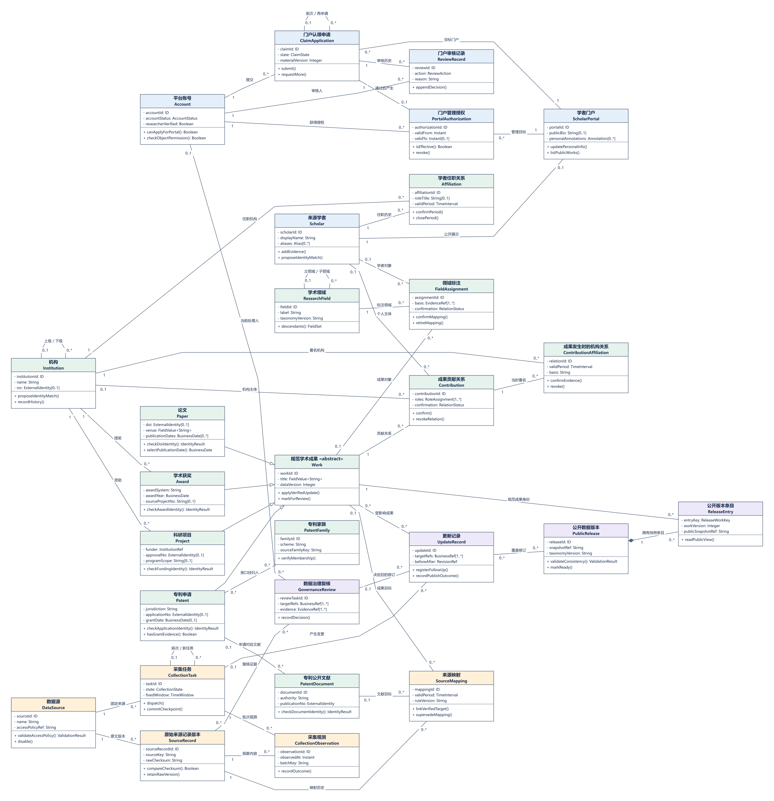

### G02 02-局部01-账号学者与门户授权

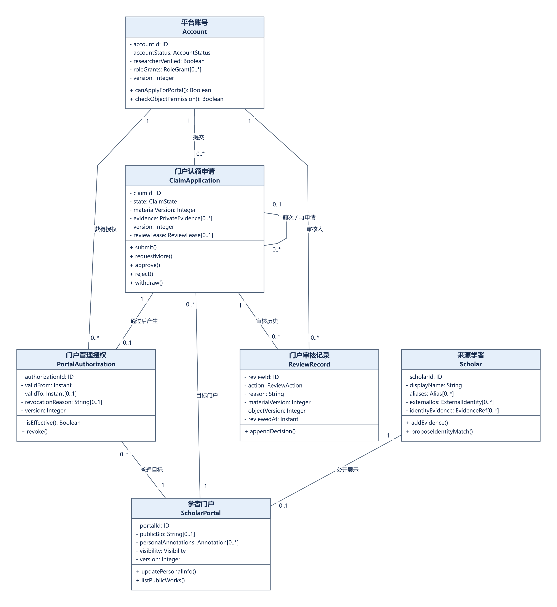

### G03 02-局部02-四类成果与专利身份

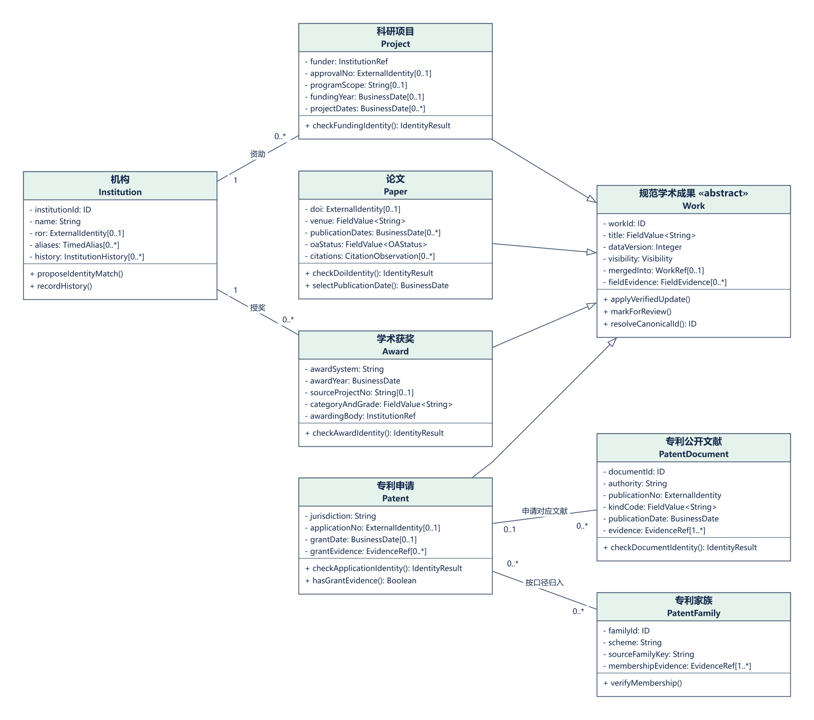

### G04 02-局部03-贡献机构与领域关系

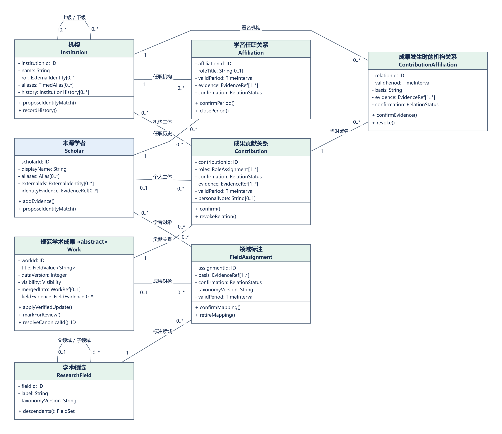

### G05 02-局部04-来源采集与规范映射

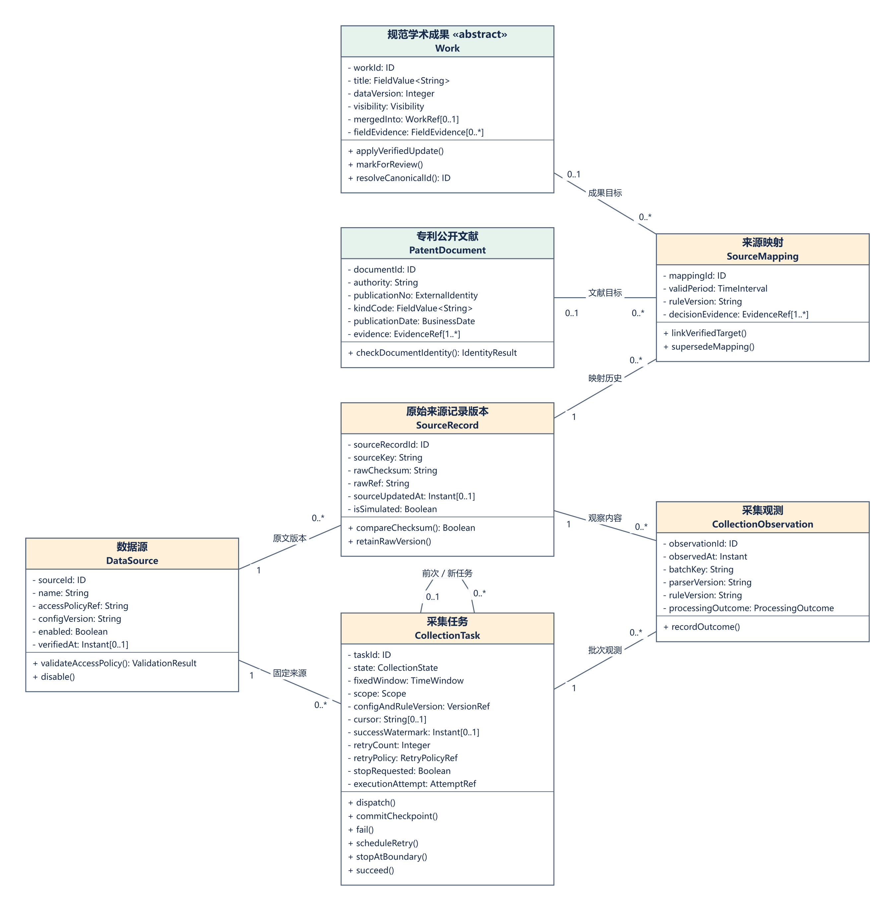

### G06 02-局部05-治理更新与公开版本

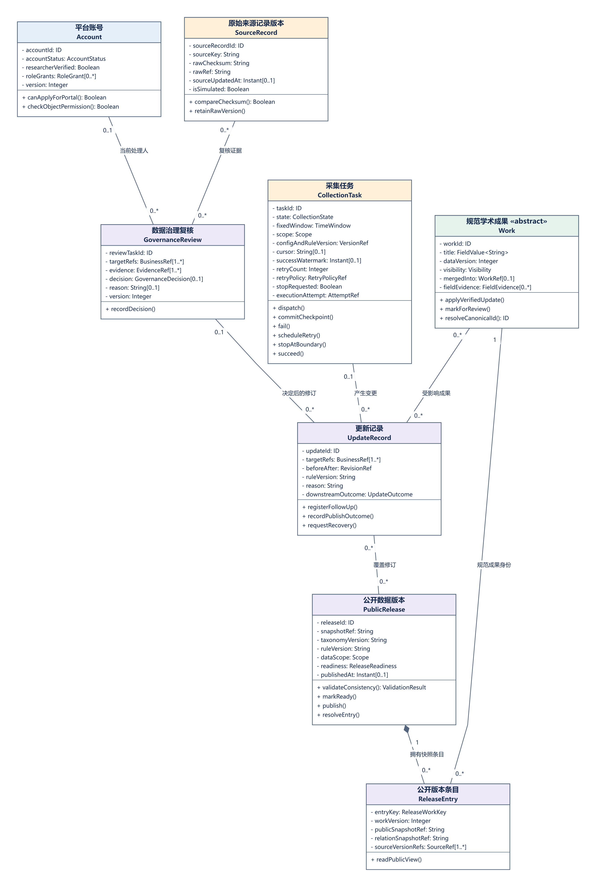

### G07 03-采集入库时序图

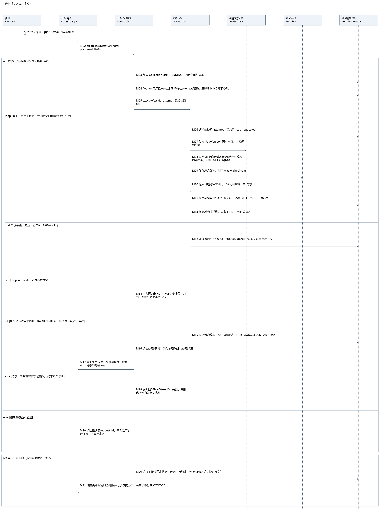

### G08 03a-清洗去重子交互

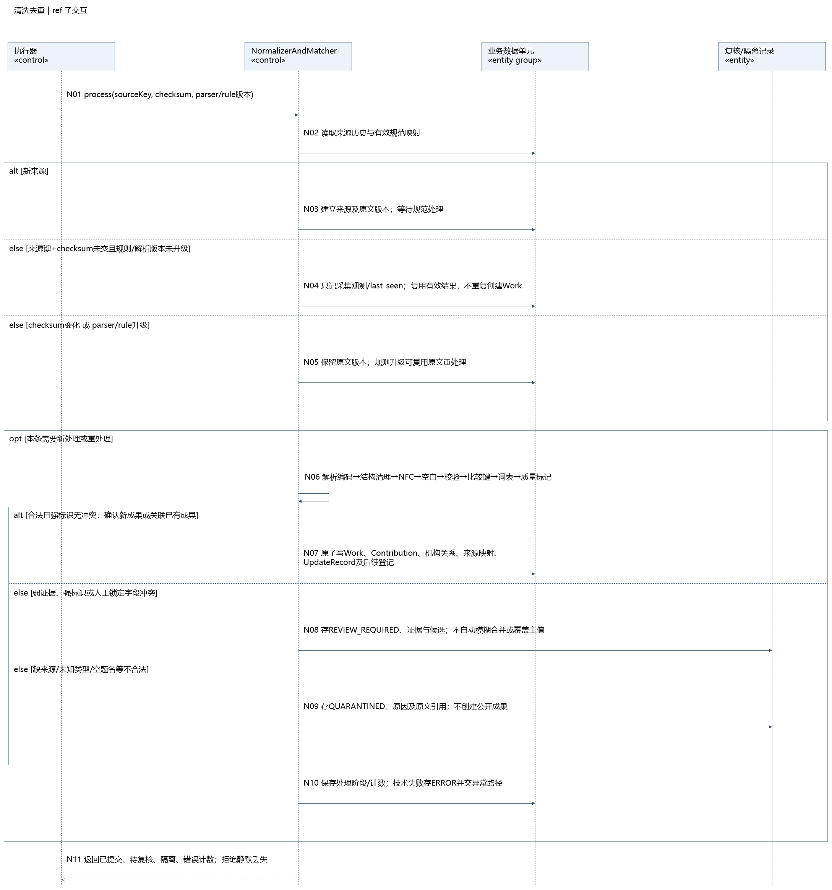

### G09 03b-停止重试子交互

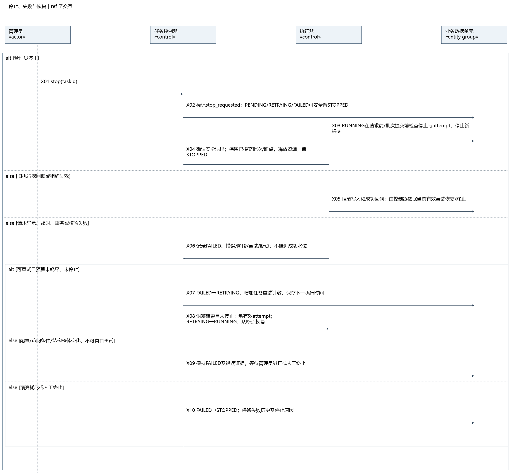

### G10 05-门户认领审核时序图

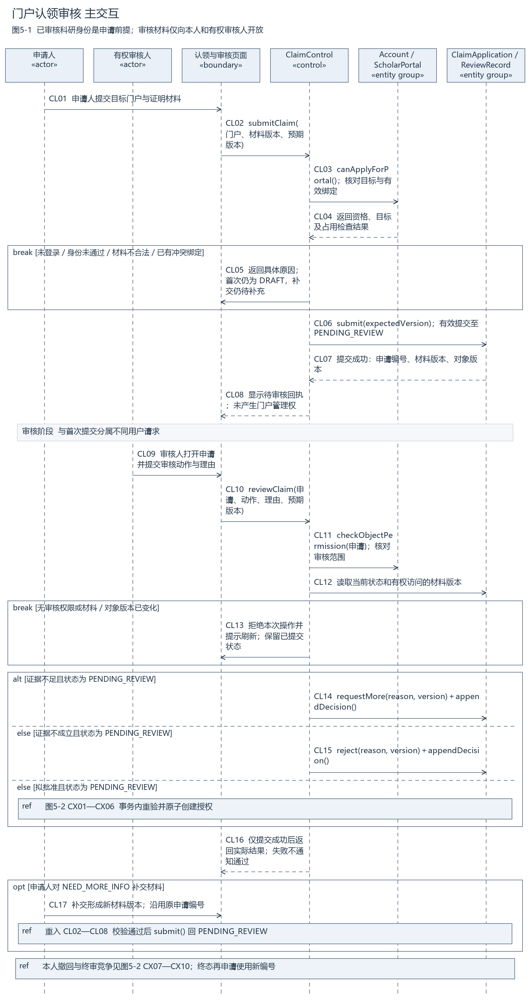

### G11 05a-认领原子授权与撤回子交互

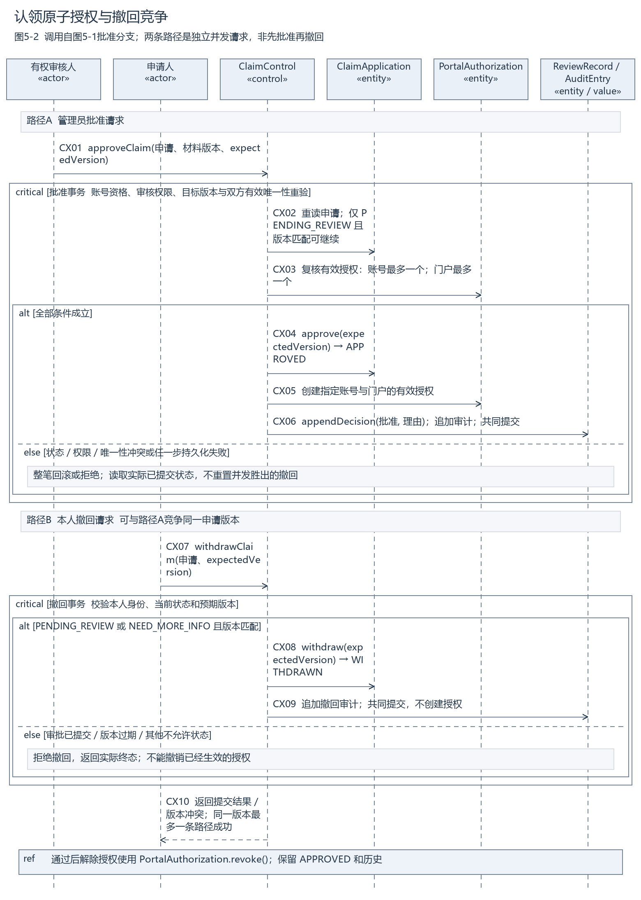

### G12 06-检索请求处理时序图

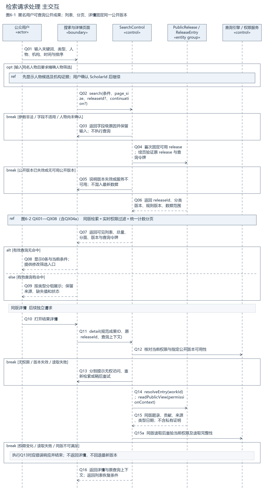

### G13 06a-检索权限计数与分页子交互

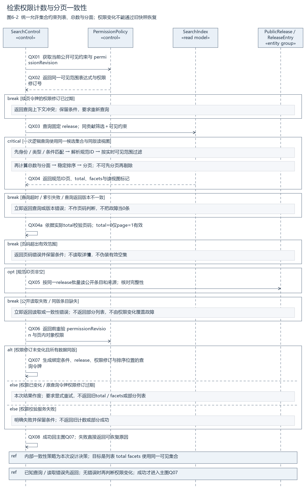
